# Are We Ready For An Agent-Native Memory System? 文献精读

**论文**：Wei Zhou 等，*Are We Ready For An Agent-Native Memory System?*，arXiv:2606.24775v1，上海交通大学和清华大学联合发表，2026 年 6 月 23 日。<br>
**原文**：[arXiv](https://arxiv.org/abs/2606.24775) · [代码仓库](https://github.com/OpenDataBox/MemoryData)。<br>
**阅读重点**：这是一篇从数据管理视角比较 Agent 记忆系统的实验研究，核心贡献是设计了一套从数据管理角度进行系统评估**Agent记忆系统**的分类框架和横向评测。研究者把记忆系统当成一个数据管理系统来拆解、测试、定量比较，并做了大量细粒度消融实验。

> **结论**：记忆系统的表现取决于任务需要什么证据。远距离、多会话的事实连接受益于关系或层级组织；精确细节需要保留原始内容；动态更新需要显式时间和版本信息；结构越复杂，构建与维护成本也可能越高。

## 一、作者为什么要重新评测 Agent 记忆

**现有研究证明了外部记忆有用，但还没有把它当作一个完整的数据管理系统来评测。**作者指出四个不足：

1. **比较范围窄**：没有让足够多、不同架构的记忆系统在统一任务下比较。
2. **只看最终答案**：常用 F1、BLEU 等分数，却难以判断证据有没有找对、旧事实能否更新、记忆变长后是否稳定。
3. **忽略运行成本**：很少测索引构建时间和查询延迟。
4. **把系统当黑箱**：没有拆开存储、提取、检索和维护等模块，分析问题出在哪一步。

​        常见记忆基准最终只看“回答对不对”，很难看出失败发生在哪一环：写入时丢了事实、检索时没找到、旧事实没失效，还是找到证据后模型没用好。所以这篇论文想回答的不只是“**有记忆后答得好不好**”，还包括“**记忆系统为什么有效、哪里会失效，以及要花多少成本**”。

作者因此把 Agent 记忆视为一个持续更新的数据系统，要求同时评估**效果、证据检索、更新、长时稳定性和成本**。

于是，将一个记忆系统形式化为
$$
M_{sys} = ⟨R, S, Q, U⟩
$$

| 模块 | 通俗解释 | 典型设计选择 |
| --- | --- | --- |
| R：表示与存储 | 记忆长什么样、放在哪里 | 原文/事实条目、向量、图、树；上下文、向量库、图库或多引擎 |
| S：提取 | 从对话或工具轨迹里写入什么 | 直接保存、自由摘要、按 schema 抽取结构化事实 |
| Q：检索与路由 | 用户提出新问题后找什么 | 向量相似度、图遍历、LLM 规划、稀疏与稠密混合检索 |
| U：维护 | 新旧信息冲突或记忆增长时怎么办 | 时间版本、淘汰、合并、遗忘、CRUD 更新 |


## 二、实验到底比较了什么

​        研究者在统一测试平台上运行了12个具代表性的记忆系统 + 2个基线（纯长上下文、Embedding RAG），覆盖三类典型场景：

| 数据集/任务 | 主要考验                                                     | 文中主要指标                                            |
| ----------- | ------------------------------------------------------------ | ------------------------------------------------------- |
| LoCoMo      | 长对话QA，考察事实召回、时序推理、开放域记忆；               | Exact Match（EM）、Answer F1；另有带来源标注的 Recall@K |
| LongMemEval | 跨会话记忆，要求系统能把散落在多个会话中的事实关联起来；     | Substring EM、ROUGE-L F1/Recall、LLM Judge Accuracy     |
| DB-Bench    | 模拟数据库操作场景，考察记忆系统是否支持有状态的过程执行（INSERT/UPDATE依赖链）。 | EM、Task Success Rate                                   |

论文的**端到端评测围绕 5 个 RQ** 展开：

| RQ                 | 研究问题                                                     | 通俗理解                       |
| ------------------ | ------------------------------------------------------------ | ------------------------------ |
| **RQ1 整体效果**   | 不同记忆系统能否提升各类任务的最终表现？                     | 装上记忆系统后，题答得更好吗？ |
| **RQ2 检索质量**   | 系统能否找回回答所需的原始证据？                             | 需要的往事有没有被找出来？     |
| **RQ3 更新鲁棒性** | 事实改变后，系统能否使用正确的当前状态？更换回答模型后是否仍有效？ | 用户搬家了，会不会还答旧地址？ |
| **RQ4 长时稳定性** | 历史变长、证据变久远时，效果能否保持？                       | 很久以前的事还能找对吗？       |
| **RQ5 运行成本**   | 效果提升需要多少构建和查询时间？                             | 答得更好，要付出多少延迟？     |


以下是参与文献测试的12个记忆框架：


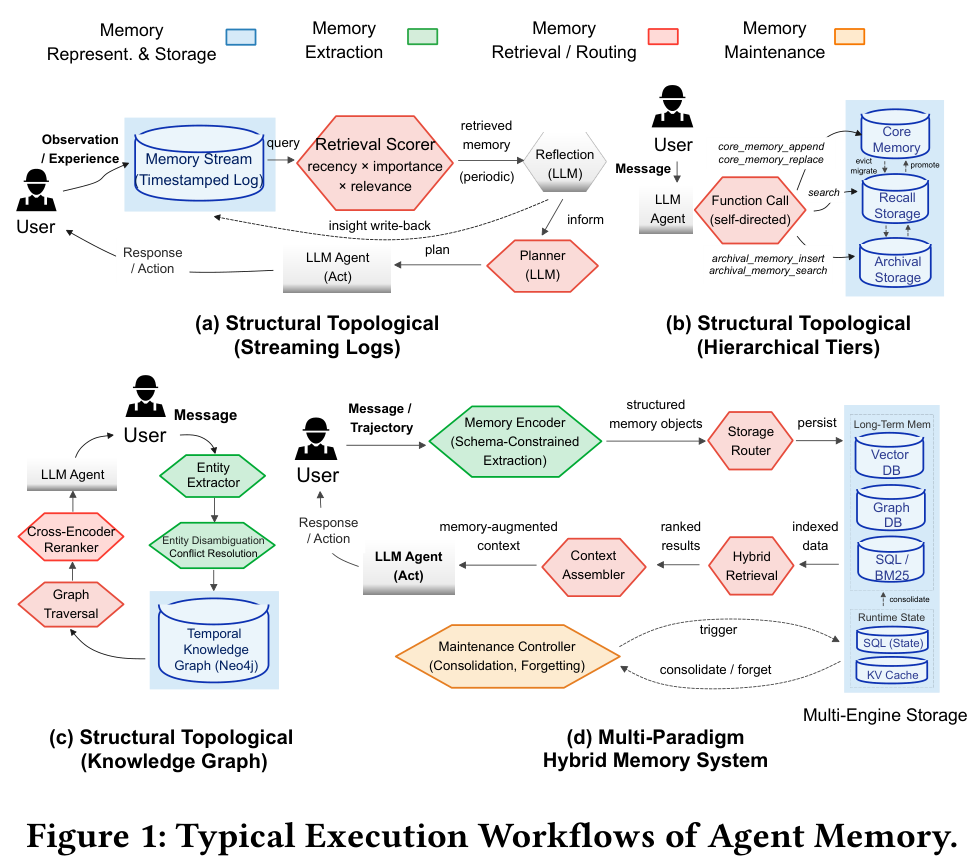

<center>原论文 Figure 1，PDF 第 1 页。图的四种架构是示例；蓝、绿、红、橙分别表示表示与存储、提取、检索与路由、维护。</center>

| 子图             |                         记忆怎样保存                         | 需要时怎样找                                                 |
| ---------------- | :----------------------------------------------------------: | ------------------------------------------------------------ |
| **(a) 时间日志** | 把经历按时间写入 Memory Stream。模型还会定期将过往记忆总结 成更高级别的映射，并把总结写回日志。 | 综合**时间新近度、重要性、相关性**给记录排序，再交给 Agent 使用。 |
| **(b) 分层记忆** | 将内存组织成具有不同容量和访问属性的多个级别。分为常驻的 Core Memory（空间小，但随时看得到，放经常要用的信息，比如用户的长期偏好。）、可回查的 Recall Storage （放过去的对话，需要时找出来）和长期的 Archival Storage（容量更大，放不常用的旧资料，查找要多一步）。将核心内存与档案存储分开，并通过跨层的显式移动（例如**移出当前层**和把它移到**更容易取用的层**）； | Agent 自己决定何时调用追加、替换或搜索等函数。               |
| **(c) 知识图谱** | **不把往事只存成一段文字，而是把“谁、与谁有什么关系、什么时候成立”拆开记录**。从消息提取人物、事件和关系，消解同名实体及冲突后，存入带时间信息的图。（方便处理**实体消歧**、**冲突解决**） | 沿关系边查找，再对找到的证据重排。                           |
| **(d) 混合系统** | 将消息或行动轨迹抽取为结构化记忆，分别存入向量库、图库、SQL 等。 | 混合检索多个存储源，组装成上下文；维护模块负责合并和遗忘。   |

**核心区别**是：前三幅分别突出“按时间排列”“按使用频率分层”“按实体关系连接”；(d) 把多种存储和检索方式组合起来。图只说明各架构的工作流程，

> （4）**“混合式记忆系统”**：同一条经历可以按不同用途建立索引，需要时再从合适的地方查找。
>
> 例如用户说：“上周被同事否定后，小王安慰了我。”系统可以先整理成一张记录卡：
>
> ```
> 人物：小王｜事件：安慰我｜时间：上周｜背景：被同事否定
> ```
>
> 然后用不同方式查这张卡：
>
> - **向量索引**：找意思相近的经历，例如“以前谁支持过我？”
> - **关系图**：找“我和小王是什么关系？”
> - **关键词索引**：精确查“小王”。
>
>  **KV cache（运行时状态）** 可以理解为 Agent *这次对话正在使用的临时工作区*；向量库、关系图等是供以后再查的*长期存储*。维护模块则负责在新信息出现后更新、合并或清理记录。


研究者在统一测试平台上运行了12个具代表性的记忆系统 + 2个基线（纯长上下文、Embedding RAG），覆盖三类典型场景：

| 数据集/任务 | 主要考验                                                     | 文中主要指标                                            |
| ----------- | ------------------------------------------------------------ | ------------------------------------------------------- |
| LoCoMo      | 长对话QA，考察事实召回、时序推理、开放域记忆；               | Exact Match（EM）、Answer F1；另有带来源标注的 Recall@K |
| LongMemEval | 跨会话记忆，要求系统能把散落在多个会话中的事实关联起来；     | Substring EM、ROUGE-L F1/Recall、LLM Judge Accuracy     |
| DB-Bench    | 模拟数据库操作场景，考察记忆系统是否支持有状态的过程执行（INSERT/UPDATE依赖链）。 | EM、Task Success Rate                                   |

**提示**：EM 偏向与标准答案精确匹配；F1、ROUGE-L 衡量文本重合；Recall@K 衡量前 K 组检索结果是否覆盖带标注的来源证据；Task Success Rate 看操作任务是否成功。指标并不互换，也不能把不同数据集的数值混排为单一“总冠军”。

评测围绕五个RQ（研究问题）展开。以下是参与测试的12个记忆框架：

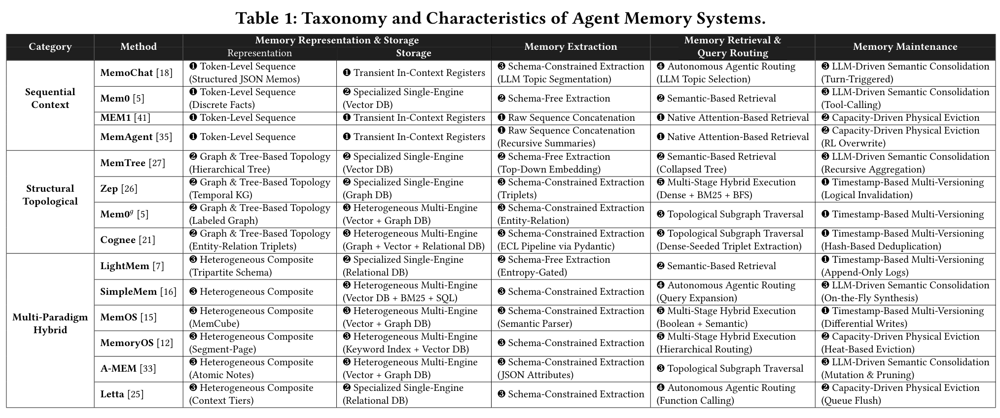

*原论文 Table 1，PDF 第 4 页。分类表列出 14 种系统；端到端实验选取其中 12 种，再加 Long Context 与 Embedding RAG 两个参考基线。不要把分类表的全部方法理解为每个实验都跑了。*

下图展示 **四种 Agent 记忆系统如何“写入、找回、更新”记忆**。顶部图例：**蓝色是存储，绿色是提取，红色是检索或路由，橙色是维护**。


## 三、五组研究问题与实验结果

### RQ1：哪种系统总体最好？

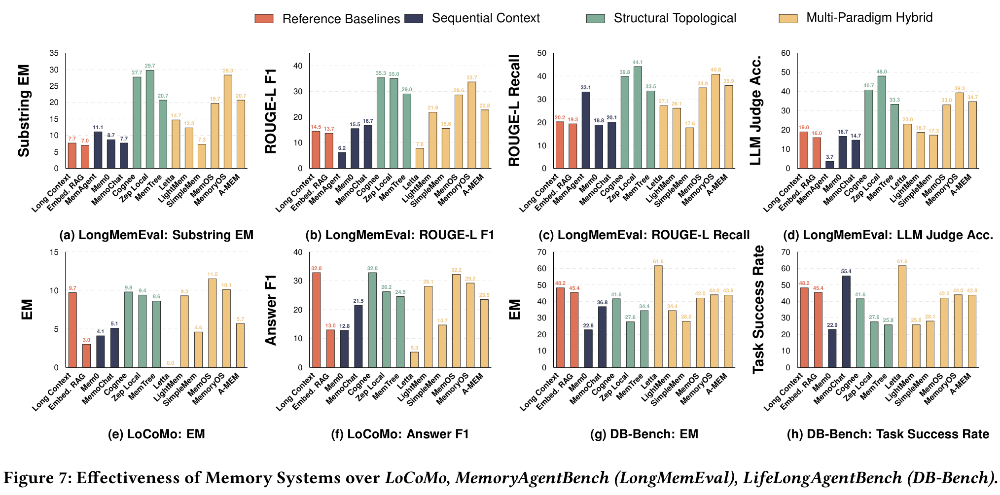

*原论文 Figure 7，PDF 第 8 页。上排四图是 LongMemEval，下排依次是 LoCoMo 与 DB-Bench。颜色表示系统类别，不代表统计显著性。*

**结论是没有单一胜者。** LongMemEval 的 LLM Judge Accuracy 中，Zep Local 为 **48.0**，高于 Cognee 的 **40.7**；但 ROUGE-L F1 由 Cognee **35.3** 略高于 Zep Local **35.0**。LoCoMo 的 EM 由 MemOS 取得 **11.5**，Answer F1 则 Long Context 与 Cognee 均为 **32.8**。这说明“选什么记忆结构”需要先看任务是找跨会话事实、还原具体细节，还是保留操作过程。

**图文不一致，必须单独看。** Figure 7 的 DB-Bench 两张图显示 **Letta 的 EM 和 Task Success Rate 均为 61.6**，是图中的最高值；正文 §4.1 却说 Long Context 的 EM **48.2** 最高、MemoChat 的 Task Success Rate **55.4** 最高。这两句与图中 Letta 的柱子直接冲突。除非作者另有未说明的排除条件，不能照正文复述“Long Context/MemoChat 第一”。

### RQ2：系统有没有真正找回支持答案的证据？

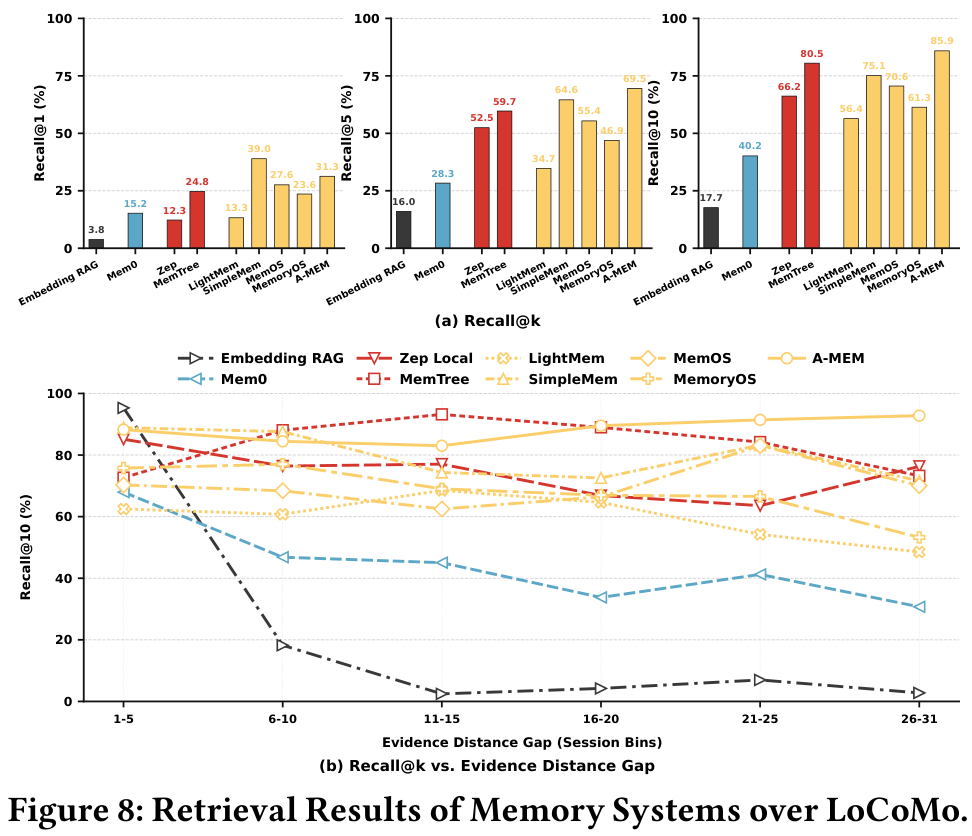

*原论文 Figure 8，PDF 第 8 页。上排看前 1、5、10 组命中情况；下排按证据距最终会话的 session 间隔分组。*

SimpleMem 的 **Recall@1 = 39.0%** 最高，说明它常能很快给出一组相关证据；但扩大到前十组时，**A-MEM = 85.9%**、**MemTree = 80.5%**，而 SimpleMem 为 **75.1%**。这体现了“第一条相关”与“找全所需证据”是两种能力。下方曲线中，Embedding RAG 从最近距离组的约 **95%** 降到远距离组的低个位数；A-MEM 相对稳定。这里的 Recall 命中的是论文标注的来源证据组，不能直接读成最终回答准确率。

### RQ3：旧事实被更新后，系统能否使用新状态？

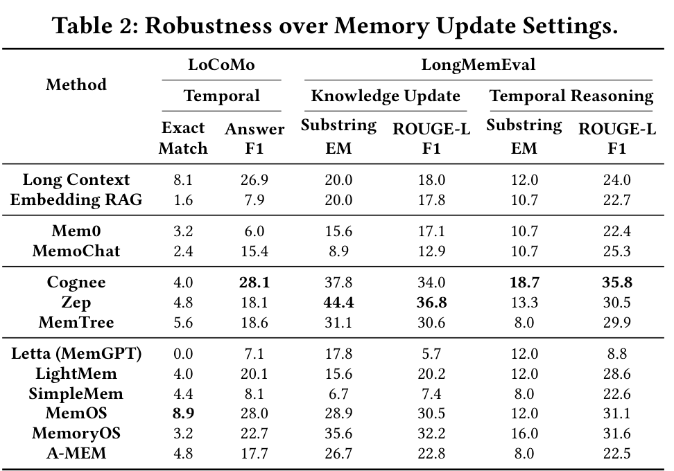

*原论文 Table 2，PDF 第 9 页。三组任务使用的指标不同，应在同一列内比较。*

在 LongMemEval 的 **Knowledge Update** 切片，Zep 的 Substring EM **44.4**、ROUGE-L F1 **36.8** 为表中最高；在 **Temporal Reasoning** 切片，Cognee 的 **18.7 / 35.8** 最高；LoCoMo 的时间类问题，MemOS 的 EM **8.9** 最高，而 Cognee 的 Answer F1 **28.1** 略高于 MemOS **28.0**。作者据此强调：需要把实体、事件和时间/有效版本连起来，不能只把新旧两句事实一起塞进相似度索引。这里仍是所选基准切片上的结果，不等同于真实生产系统在任意连续更新流中的保证。

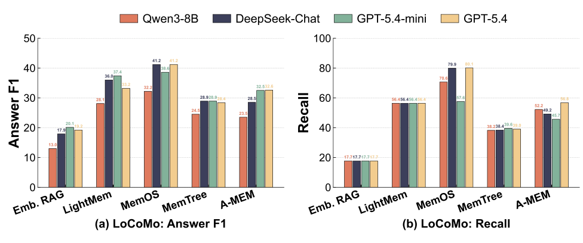

*原论文 Figure 9，PDF 第 9 页。颜色对应四个回答模型。Embedding RAG 的 Recall 在四种模型下都为 **17.7**，说明只升级最终回答模型不会自动改善已经固定的证据检索；MemOS 的 Answer F1 在四种模型下为 **32.2、41.2、38.6、41.2**。这是几种选定记忆方案的对照，不是对全部 12 个系统的稳健性证明。*

### RQ4：时间跨度和会话数增加，系统是否稳定？

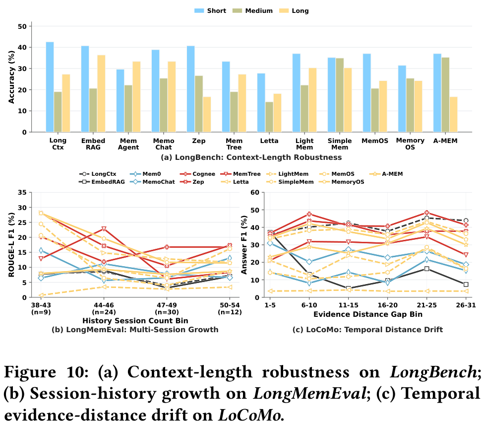

*原论文 Figure 10，PDF 第 10 页。三幅子图分别用不同数据集和指标；曲线不是同一实验的连续时间轴。*

LongBench 中，Long Context 从 Short 的约 **42.6** 降至 Medium 的 **19.0**，SimpleMem 在这两档约为 **35.2 → 34.9**。LoCoMo 的距离分组里，Embedding RAG 的 Answer F1 从约 **37.1** 降至 **7.4**。论文将此解释为：历史越长，仅靠平铺文本或相似度越难保持证据可达，关系、时间索引和分层定位更有帮助。但 Figure 10 的曲线并非严格单调，LongMemEval 某些分组样本也较少；它支持“有稳定性差异”，不支持精确预测每增加一个会话会下降多少。

### RQ5：这些效果要花多少时间？

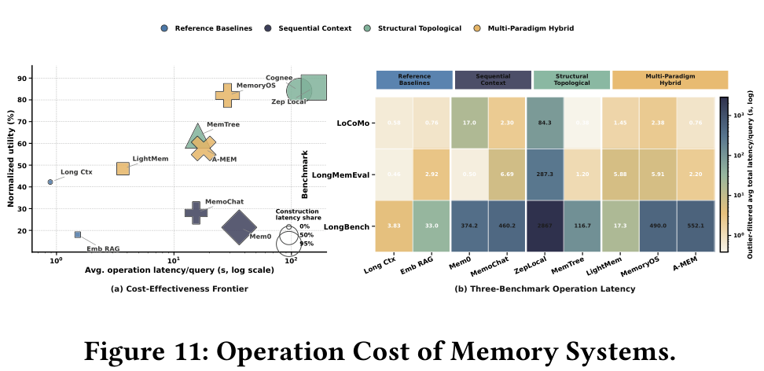

*原论文 Figure 11，PDF 第 11 页。横轴为对数刻度；左图的 Normalized Utility 是论文对六项答题指标做 min-max 归一化后的平均，不是用户满意度。*

LightMem 的归一化效用约 **48.3**，平均操作时间 **3.67 秒/问**；MemTree 为 **63.5、15.9 秒/问**。MemoryOS 达约 **82.0**，对应 **28.6 秒/问**；Cognee 与 Zep 的效用更高，但文中给出的时间约 **116.5** 与 **155.1 秒/问**。作者的解释是：昂贵的不是“使用图/树”本身，而是一次写入会触发多大范围的重组和同步。**注意**：论文的操作时间包含记忆构建成本的摊销口径，不是单次在线向量查询的纯检索延迟。

## 四、四个模块的消融实验说明什么

### 1. 表示：过早摘要会丢失可恢复的细节

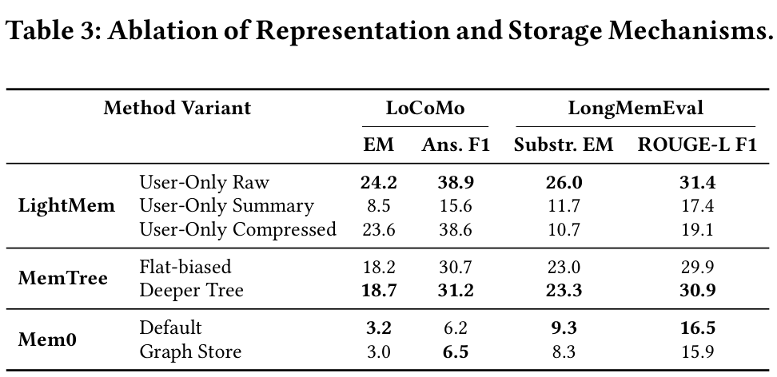

*原论文 Table 3，PDF 第 11 页。*

在 LightMem 的三种写法中，保留用户原文的 LoCoMo Answer F1 为 **38.9**；改成摘要降至 **15.6**，轻度压缩仍有 **38.6**。但在 LongMemEval，轻度压缩的 Substring EM 从 **26.0** 降至 **10.7**。可见“压缩后还能回答大意”与“能否找回日期、名称等原始细节”不能混为一谈。MemTree 加深层级只带来小幅收益；层级组织不能恢复写入时已经删掉的信息。

### 2. 提取：写入时筛得太细，可能损害组合推理

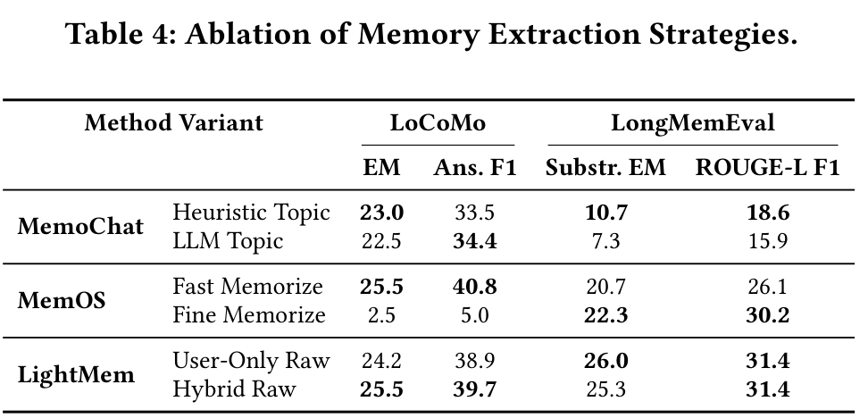

*原论文 Table 4，PDF 第 12 页。*

MemOS 的 Fast Memorize 在 LoCoMo 的 Answer F1 为 **40.8**，Fine Memorize 仅 **5.0**；但在 LongMemEval，Fine 的 ROUGE-L F1 **30.2** 高于 Fast 的 **26.1**。因此“更细的提取”并非全面更差，而是在这个实验里对长对话组合回答代价很大。作者建议先较完整地保留证据，把精细筛选放到检索时。

### 3. 检索：适量规划有用，更多推理步骤未必有用

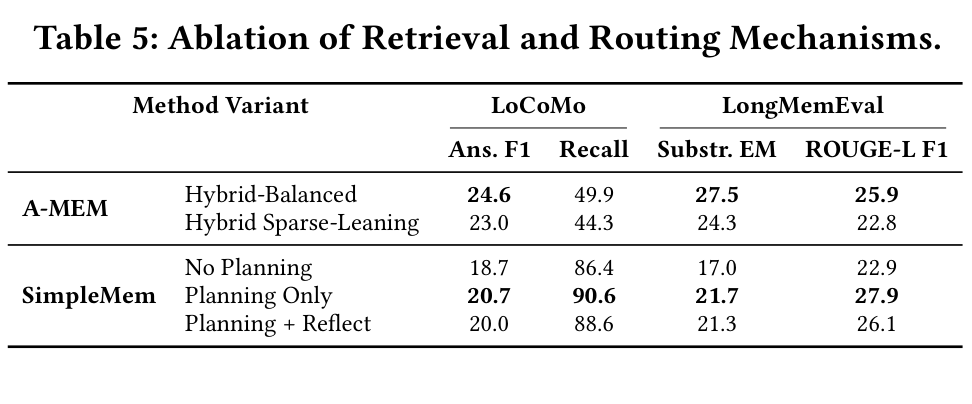

*原论文 Table 5，PDF 第 12 页。*

SimpleMem 的 Planning Only 相比 No Planning，LoCoMo Recall 从 **86.4** 到 **90.6**，LongMemEval ROUGE-L F1 从 **22.9** 到 **27.9**；再加 Reflect 则回落至 **88.6 / 26.1**。A-MEM 的均衡稠密/稀疏混合检索也优于更偏稀疏的一档。结论应读作“该参数与提示配置中，轻量规划更好”，不是所有反思或稀疏检索都无用。

### 4. 维护：谨慎合并优于延迟写入和粗粒度摘要

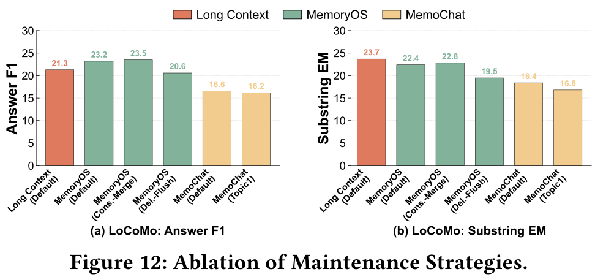

*原论文 Figure 12，PDF 第 12 页。*

MemoryOS 的 Conservative-Merge 把 LoCoMo Answer F1 从 **23.2** 提到 **23.5**，而 Delayed-Flush 降至 **20.6**；MemoChat 强行压成单主题摘要也略降。这里“谨慎合并”的提升只有 **0.3** 分，图中没有误差条，不能说它已经被证明具有稳定的大幅优势；延迟写入造成的损失则更明显。

## 五、可用启发

以下是**根据论文结果提出的设计建议**，不是作者对本项目做过实验：

1. **保留可追溯的原始片段。** 情绪轨迹摘要适合导航，但姓名、事件、发生时间和原句最好仍能回溯到 `source_id`，避免摘要后无法核实具体经历。
2. **把时间有效性做成一等字段。** 同一人的偏好、关系、目标可能改变；记忆条目可保存 `occurred_at`、`valid_from`、`valid_to`、`supersedes`，检索时先排除失效事实，再按相关性排序。
3. **分开评测三个环节。** 先看证据 Recall@K，再看时间更新题是否用了最新事实，最后评价回复是否自然、支持性强。只看最终回复分数，很难判断瓶颈是在检索还是生成。
4. **控制维护范围。** 新事件只更新相关实体、主题或局部轨迹，避免每次全量重写用户记忆；同时记录构建、更新和检索各自的时间。

## 六、阅读时应保留的判断

- **论文最强的证据是“不同任务和模块选择有明显取舍”**，而非已经找到一个普遍最优架构。跨系统比较同时改变表示、提取、检索与维护；第 5 节消融才更接近单模块比较。
- **Figure 7 的 DB-Bench 排名与正文冲突。** 图中 Letta **61.6 / 61.6** 高于正文所称的两个“最好”结果；引用该结论时应直接附图，并等待作者澄清。
- **若干小差距没有不确定性报告。** 例如 Conservative-Merge 的 **0.3** 分提升，图表没有置信区间或重复运行波动；可视为方向性线索，不宜当作稳健优势。
- **成本图不是纯在线查询延迟。** 它将构建与查询放入摊销口径，适合比较完整工作流的成本，不宜直接用于承诺产品单轮响应时间。

**总评**：这篇论文对做 Agent 记忆系统最有价值的是评价视角：把“写入了什么、检索到什么、旧事实怎样失效、远距离证据是否仍可用、每步要花多少时间”拆开测量。它给 EmoMem-NPC 的直接提醒是：情绪轨迹和个性化摘要可以作为检索入口，但应保留原始事件、时间和来源，避免抽象层越多，真正需要的支持性证据越难复原。
