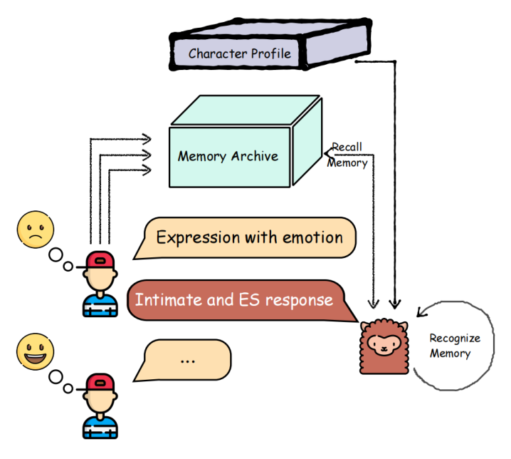
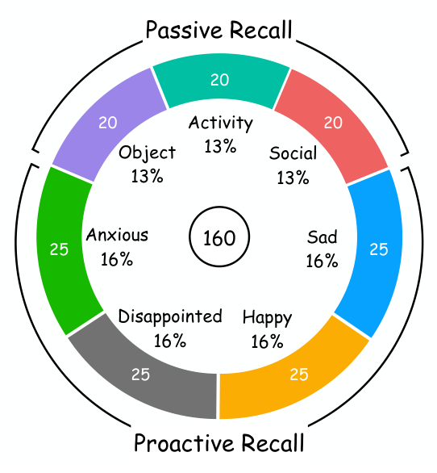
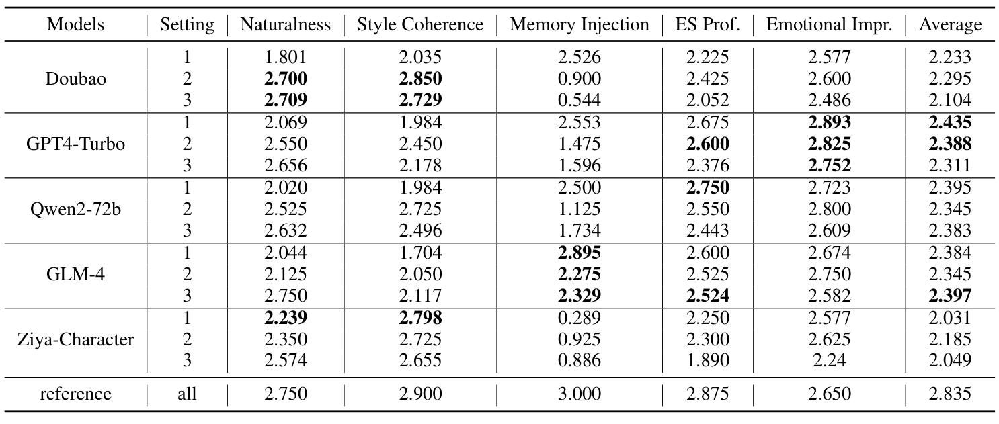
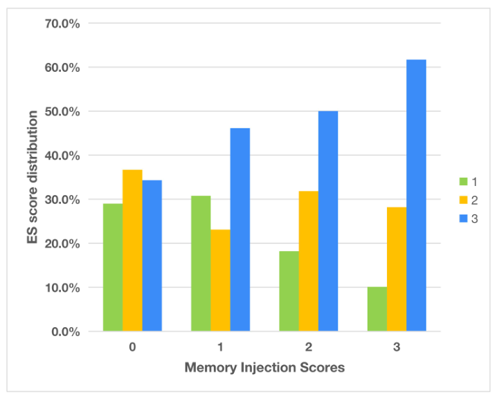

# MADial-Bench｜对话助手何时想起旧事，怎样自然用进去

> Junqing He、Liang Zhu、Rui Wang、Xi Wang、Reza Haffari、Jiaxing Zhang，*MADial-Bench: Towards Real-world Evaluation of Memory-Augmented Dialogue Generation*，NAACL 2025，pp. 9902–9921。 [ACL Anthology](https://aclanthology.org/2025.naacl-long.499/)

MADial-Bench 将对话记忆拆成三项可观察的能力：从记忆库找候选、从候选认出合适的记忆，以及在回复中把它用对。数据同时覆盖用户主动提起旧事时的被动召回，以及由情绪与场景触发的主动召回。

## 一、为什么普通记忆问答覆盖不了这个场景

事实回忆可以直接从用户的问法推出检索目标。情感支持时，用户可能只说自己很失望，没明确要求回忆任何事。模型需要从当前情绪、场景和历史中找可能有用的关联，再决定怎样开口。

*原文图 1，p. 9903。把候选检索和候选识别分开评估。*

作者借用两阶段记忆理论区分检索和识别，也用编码特异性解释为什么保存记忆时的情绪和场景会成为将来检索时的线索。心理学理论在这里主要用于选择字段、构造任务和制定评分规则。

## 二、基准怎样构造

两名虚拟儿童 Bart 和 Lisa 与助手对话，得到 **171 条历史记忆、160 段对话、1,474 轮**。对话平均 9.21 轮。每条历史包含时间、情绪、场景和事件。GPT-4 生成对话与记忆草稿，作者从嵌入检索的前 20 项中人工选适合该段对话的金标准，必要时改写引入记忆的内容，再按情感支持指南核查回复。每个金标准记忆列表含 1–7 条并有适切性次序。（§3）

*原文图 2，p. 9905。主动 100 段，被动 60 段。*

主动召回的开心、伤心、焦虑和失望各 25 段。被动召回的活动、物品和社交关系各 20 段。附录表 10 为主动类型定义基本匹配规则，例如开心且谈活动时可回想类似的开心经历，焦虑时可回想类似的焦虑事件。规则服务于这套对话构造和评分。

## 三、任务和指标怎么分

| 阶段或设置 | 输入及任务 | 可观察的问题 |
| --- | --- | --- |
| 记忆召回 | 用对话从记忆库找出金标准记忆列表 | 候选中是否包括合适记忆 |
| Setting 1 | 给最合适的一条金标准记忆来生成回复 | 在已找对的条件下会不会自然使用 |
| Setting 2 | 一条金标准加四条采样干扰记忆 | 会不会从干扰中识别并使用正确条目 |
| Setting 3 | 给嵌入检索得到的候选 | 真实检索链会怎样影响最终回复 |

召回阶段用 MAP、MRR、nDCG、Recall、Precision。回复阶段的人工维度包括自然度、风格一致性、记忆注入、情感支持技巧（ES Proficiency）和情绪改善表达。记忆注入关注是否引用了适切记忆、是否有事实错误或虚构、是否重复提起。亲密感用并排比较或从候选中选最佳。文中的“情绪改善”来自回复里的共情与积极表达评分。（§3.3–4.2，附录 C）

## 四、各组实验分别说明什么

### 1. 嵌入检索能找回多少记忆

| OpenAI text-embedding-3-large，表 4 | 英文 | 中文 |
| --- | ---: | ---: |
| Precision@1 | 62.50% | 64.38% |
| Recall@1 | 36.78% | 36.28% |
| Recall@10 | 80.59% | 82.37% |
| Precision@10 | 17.81% | 18.81% |
| 五类检索指标的 Average@10 | 61.85% | 62.72% |

论文正文所说“@10 约 62%”是五类指标的综合平均。只读 Recall@10 会得到约 81%–82%。多给候选能覆盖更多适切记忆，同时候选中无关项比例会增高，给下一阶段造成干扰。

### 2. 给对记忆和从候选中挑记忆的差别

*原文表 5，p. 9909。各方面分数为 0–3。*

GPT-4-Turbo 在 Setting 1／2／3 的记忆注入分别为 **2.553／1.475／1.596**，Doubao 为 **2.526／0.900／0.544**。真实检索条件下 GLM-4 的注入为 **2.329**，人类修订参考为 **3.000**。筛干扰确实会拖累部分模型。Setting 2 与 3 也加强了自然度和风格提示，跨设定分差同时包含候选变化和提示变化。

### 3. 记忆注入、支持技巧与亲密感

*原文图 3，p. 9909。蓝柱对应情感支持技巧评分为 3。*

记忆注入得 3 分的一组，支持技巧也得 3 分的比例约 **61%**。这是评分间的关联，语言能力、评审偏好和样本难度也可能影响两者。并排比较 GPT-4-Turbo 有记忆和无记忆条件时，有记忆版本 **61.9% 胜、28.8% 平、9.4% 负**。若把平局合并，比例会高于纯胜率。另一个选优实验中，五位评审选出的最佳答复平均 **73%** 来自有记忆条件。（表 6–7）

### 4. 为什么还要人工评估

BERTScore、ROUGE-L、BLEU 与 Dist-1 衡量不同性质，排名未能重现人工对记忆使用与情感支持技巧的评分。人工评价本身也有不确定性，附录表 13 报告三个设置的评审间平均 Spearman ρ 为 **0.55、0.55、0.41**，真实检索设置最难达成一致。

## 五、结论的适用边界

- **参考记忆池来自候选检索。** 人工从嵌入 Top-20 筛金标准，可能漏掉远离词面但也有帮助的旧事。测得的是对已标集合的召回。
- **对话与人物规模有限。** 两个儿童画像、合成后人工修订的中英文对话，适合控制触发条件。亲密感和情感支持分数来自评审判断，真实用户的关系感与情绪变化需要另测。
- **主动召回仍需区分“该用”与“可以不用”。** 标准样本围绕应使用记忆的场景设计，现有数字对拒绝引用不恰当或过时记忆的能力覆盖有限。

## 六、R&Q

1. **同一场景有没有多条合适旧事？** 让人工复核语义检索之外的候选，并报告多个可接受记忆的集合匹配情况。
2. **好记忆是否有助于回复？** 固定提示，比较金标准、近似干扰、无记忆与用户主动拒绝提及历史的条件。
3. **和 ENPMR-Bench 怎么衔接？** 把 MADial 的被动／主动触发与 ENPMR 的情感需求识别联起来，分别测何时调用、需支持什么、如何自然使用。
