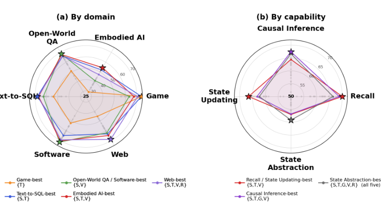
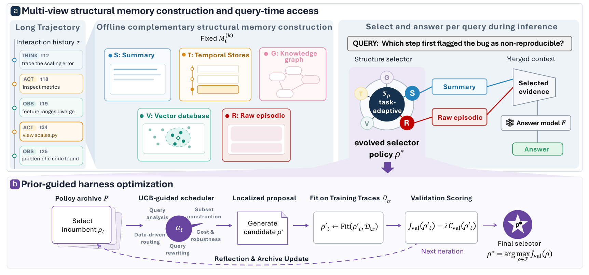
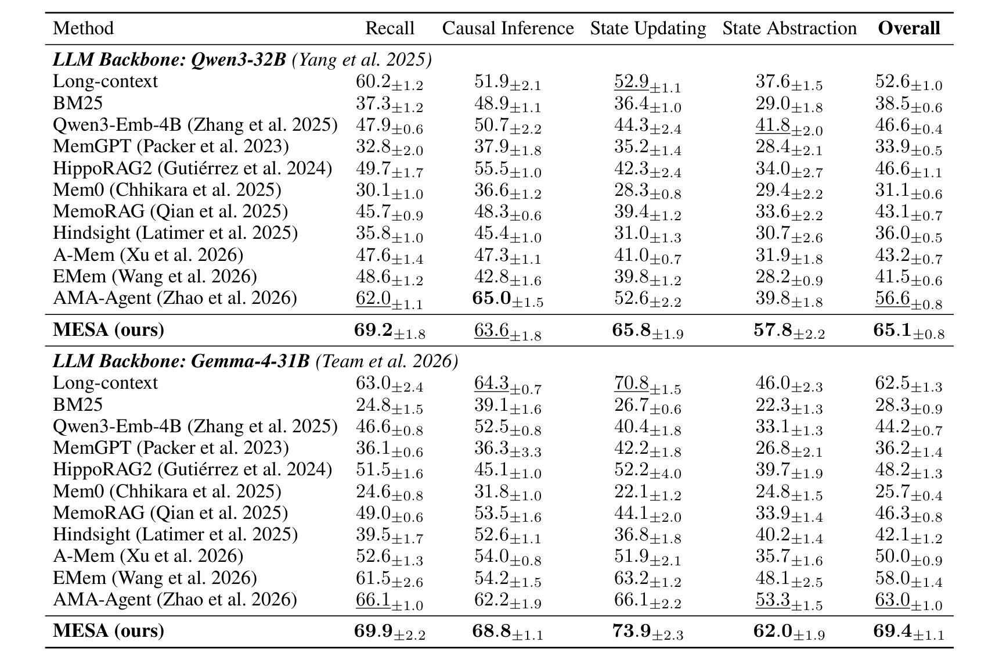
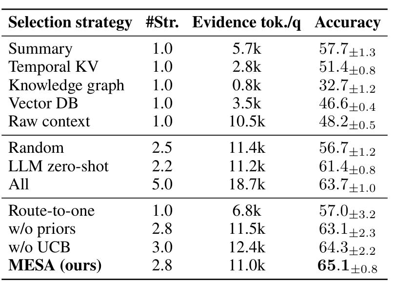

# MESA：长程 Agent 记忆的任务自适应多结构证据选择

> 论文：Beidi Zhao 等，*MESA: Task-Adaptive Multi-Structure Evidence Selection for Long-Horizon Agent Memory*，arXiv:2608.10108v1，所附 PDF 共 18 页。以下页码为 PDF 页码。 
> 阅读结构沿用前次的 [ENPMR-Bench 精读模板](https://mr-iodin.github.io/my_wiki/2026/ENPMR-Bench%20%E6%96%87%E7%8C%AE%E9%98%85%E8%AF%BB/)。

**一句话概括。** MESA 预先把同一条 Agent 执行轨迹存成摘要、时间索引、知识图谱、向量索引和原始片段五种视图；回答问题时，学习选择其中一组互补视图，再把检索证据交给固定的回答模型。

**先给判断。** 这篇论文的核心贡献是把记忆选择提升到「结构／检索接口」层：问题需要哪几种证据，不一定等于选一个最好的索引，也不必每次读取全部索引。AMA-Bench 上的准确率和回答证据 token 均有改善。不过，所报 token 节省只覆盖交给回答模型的证据；离线建库、选择器训练、查询时预览和检索的完整成本，需要另算。

## 一、为什么要在记忆结构之间做选择

长程 Agent 轨迹交错记录思考、动作、工具调用与观察。一个后来的问题可能需要很早以前的某一步，也可能要把跨步骤的状态变化与精确代码行、错误信息联系起来。单一记忆表示难以同时兼顾全局概括、时间顺序、实体关系和局部原文。（第 1–3 页）

论文把「记忆结构」定义为**存储表示及其专用访问方式的一对组合**，而不是单指数据格式。例如，时间存储配合按步骤号访问，图谱配合实体与邻居遍历，原始片段配合 BM25。五种视图如下。（第 3 页及附录 A，第 10–11 页）

| 视图 | 保留什么、怎样访问 | 强项与典型遗漏 |
| --- | --- | --- |
| S：摘要 | 分段压缩轨迹，保留重要状态与关键步骤 | 全局脉络好；可能省掉细节 |
| T：时间存储 | 按步骤号保存动作与观察，按显式时间锚点取片段 | 顺序清楚；问题没有步骤提示时难定位 |
| G：知识图谱 | 从轨迹抽取实体关系，按实体和邻居取事实 | 跨步骤关联；图抽取可能丢失原文或步骤精度 |
| V：向量库 | 按单步编码，取语义相近的 5 步 | 发现近义线索；可能找错相似步骤 |
| R：原始片段 | 将原轨迹切成重叠窗口，BM25 取最多 3 个 | 精确措辞与局部上下文；噪声和 token 较多 |

作者先枚举五种视图的全部 **31 个非空子集**。图 2 显示，不同领域和问答能力的最佳组合不同，且多数类别的获胜组合位于「只选一个」与「五个全读」之间。这是提出自适应选择的直接动机。图 2 是按领域或能力汇总后的最佳子集，不等于每道问题都已有一个唯一的真实最优子集标签。（第 2–3 页）

*图 2｜不同任务类别的最优结构组合。原文 PDF 第 2 页。分别按任务领域和记忆能力汇总。星标表示该轴上的获胜组合。*

## 二、方法到底如何运转

*图 3｜离线构建多种记忆与查询时选择。原文 PDF 第 4 页。上图是建库和答题流程，下图是在训练及验证数据上搜索选择策略。*

给定历史轨迹 $\tau_i$，五个固定构建器 $B_k$ 离线生成记忆视图 $M_i^{(k)}$。查询 $q_i$ 和可观察上下文 $c_i$ 输入选择器 $S_\rho$，得到一个非空二值向量 $z_i\in\{0,1\}^5$；向量中的 1 表示启用对应视图。各视图的固定访问接口 $\Gamma_k$ 检索证据，合并后交给**冻结的**回答模型 $F$。（公式 1–6，第 3–4 页）

$$
z_i=S_\rho(q_i,c_i),\qquad
E_i(z_i)=\operatorname{Compose}\{\Gamma_k(q_i,M_i^{(k)}):z_i^{(k)}=1\},\qquad
\hat y_i=F(q_i,E_i(z_i)).
$$

这里的 $c_i$ 可包含领域、任务、问题类型等元数据；附录还说明它可包含各固定检索器生成的**查询相关证据预览**。它不包含标准答案或测试分数。这个细节影响对成本的理解：选择器可能在决定最终送入回答模型的证据前，已经为预览访问了多个结构。（第 4、10、15 页）

### 怎样在没有「正确子集」标签时学习

论文只有最终答案的对错反馈，没有每道题每个结构的金标准效用。MESA 因此把选择器写成可执行策略，使用 LLM 提案者在预先设计的方向中提出局部修改；候选策略在训练集上拟合，在验证集上按照「答案准确率减去证据 token 成本」打分：（第 4–5、13 页）

$$
\tilde J_{\mathrm{val}}(\rho)
=J_{\mathrm{val}}(\rho)-\lambda C_{\mathrm{val}}(\rho),
\qquad \lambda=10^{-6}.
$$

按作者的标定，每多 1 万个证据 token，验证准确率至少需提高约 1 个百分点，才值得被目标函数偏好。搜索从「五结构全选」策略开始，共进行 30 轮；每轮提议利用已有成功经验、探索较少尝试的方向、修补常见失败的三类候选。UCB 用验证成绩和探索奖励安排**提案方向**；它不是推理时为每道题选结构的公式。最终取验证目标最高的策略，冻结后评估测试集。（算法 1；附录 B.2）

图 5 展示的策略演化最终形成可检查的规则，例如看到时间／顺序提示时偏向摘要、时间和向量视图，看到数据库／SQL 提示时偏向摘要、时间和原始片段。换言之，推理时执行的是学到的选择策略，未必需要再运行一轮昂贵的策略搜索。（第 7 页）

## 三、数据与评测口径

主基准 AMA-Bench 使用真实场景子集：**208 条 Agent 轨迹，每条 12 个专家整理的问题，共 2,496 道题**。它覆盖网页任务、开放式工具问答、Text-to-SQL、软件工程、游戏、具身 AI 六个领域，以及回忆、因果推断、状态更新、状态抽象四类能力。论文按轨迹而非问题切分训练／验证／测试，比例 2:2:6，随机重复五次并报告均值和标准差；这有助于减少同一轨迹的问题横跨训练与测试的泄漏。（第 5–6 页）

另在 LoCoMo 测长期会话记忆：原数据有 10 段多会话对话、1,986 道题，按协议排除 446 道对抗题后评测 1,540 道。主比较使用一个按对话划分的 2:2:6 切分；附录另对 MESA 做五次切分敏感性分析。AMA-Bench 用模型裁判判断答案是否正确，LoCoMo 用 token F1。前者还用其他裁判模型复核相对排名。（第 5–6、16–17 页）

实验比较长上下文、BM25、单向量检索、MemGPT、HippoRAG2、Mem0、MemoRAG、A-Mem、EMem、Hindsight 与 AMA-Agent 等。AMA-Bench 的同一回答模型分组内共享回答提示，但各系统的记忆建设与读取方式不同；附录记载了适配细节，故跨系统排行应读作**该实现和预算下**的结果。（第 5、11–13 页）

## 四、各组实验分别证明什么

### 1. 主结果：准确率与证据长度

*表 1｜两种回答模型在 AMA-Bench 上的表现。原文 PDF 第 6 页。同一回答模型内比较各系统。Qwen3-32B 组的因果推断是完整方法弱于 AMA-Agent 的一列。*

| AMA-Bench 回答模型 | 较强基线 AMA-Agent | MESA | 提高 |
| --- | ---: | ---: | ---: |
| Qwen3-32B，裁判准确率 | 56.6±0.8% | **65.1±0.8%** | **+8.5 个百分点** |
| Gemma-4-31B，裁判准确率 | 63.0±1.0% | **69.4±1.1%** | **+6.4 个百分点** |

Qwen3-32B 下，长上下文为 52.6%，MESA 比它高 12.5 个百分点。分能力看，MESA 在回忆、状态更新和状态抽象领先；**因果推断为 63.6%，低于 AMA-Agent 的 65.0%**。因此，提升并非对四种能力都成立。（表 1，第 6 页）

按领域看，Qwen3-32B 下软件工程从 AMA-Agent 的 38.3% 到 MESA 的 67.5%，Text-to-SQL 从 57.8% 到 66.7%；开放式工具问答和游戏各落后 AMA-Agent 0.7 个百分点。Gemma-4-31B 下 MESA 的软件工程为 48.8%，也低于 AMA-Agent 的 50.9%。这些差异说明结构组合的价值与领域、回答模型有关。（附录表 4，第 16 页）

### 2. 消融：为什么不是只选摘要或全都读

Qwen3-32B 的表 3 给出以下对照（第 7 页）：

*表 3｜记忆结构、选择策略和证据成本。原文 PDF 第 7 页。同时对照回答准确率与给回答器的证据 token。每种策略选用的结构数不同。*

| 选择方式 | 平均结构数 | 平均回答证据 token／题 | 准确率 |
| --- | ---: | ---: | ---: |
| 单独摘要 S | 1.0 | 5.7k | 57.7±1.3% |
| 零样本 LLM 选子集 | 2.2 | 11.2k | 61.4±0.8% |
| 五结构全部读取 | 5.0 | 18.7k | 63.7±1.0% |
| 只允许选一个结构 | 1.0 | 6.8k | 57.0±3.2% |
| MESA | 2.8 | **11.0k** | **65.1±0.8%** |

MESA 比五结构全读高 **1.4 个百分点**，送入回答模型的证据 token 少约 **41.2%**。它也比只选一个结构高 8.1 个百分点。这个实验直接支持「有选择地组合」比两个极端更合适；但准确率提升 1.4 个百分点较小，论文没有报告配对显著性检验。

去掉先验方向，准确率为 63.1±2.3%；去掉 UCB，准确率为 64.3±2.2%；完整方法为 65.1±0.8%。这支持两个搜索设计对均值或稳定性有帮助，但不要把 UCB 的作用误写成查询时的检索策略。（表 3）

### 3. 对话记忆能否迁移

LoCoMo 主切分上，MESA 的 F1 为 **49.0%**，比表 2 中最强的 EMem（47.2%）高 **1.8 个百分点**。附录五种对话切分中，MESA 为 49.0±3.3%，EMem 为 47.0±4.6%。这提供了跨场景可用的初步证据；但 LoCoMo 只有 10 段对话，差距也小于切分间波动，尚不宜称为稳定的大幅领先。（表 2；附录表 7）

### 4. 额外核验

附录用 Qwen3-32B、Gemma-4-31B 和 GPT-5.4 三种裁判重评同一批答案，MESA 的总体分数分别是 65.1%、59.5%、52.9%，在三个裁判下都居所列方法首位。**绝对分数随裁判变化明显**，因此应把这些数视作该裁判协议下的成绩，而非独立的人类正确率。（附录表 6，第 17 页）

另与验证集挑选的固定类别规则比，MESA 为 65.1±0.8%，按领域固定选子集为 64.4±1.7%，按问题能力固定为 63.8±1.2%，两者结合固定为 64.0±2.2%。这说明查询级选择超出粗类别映射，但相对最强固定规则只多 **0.7 个百分点**；其价值也体现在更低的跨切分波动。（附录表 9，第 18 页）

## 五、怎样解读贡献和边界

1. **最可信的结论是「选择结构有用」。** 论文把五种存储与访问接口、证据拼接器和回答模型固定，只优化选择器；表 3 提供了单结构、全结构、零样本与学习选择的同基准对照。这使结构级选择的贡献比跨系统主表更容易识别。
2. **41.2% 是回答证据 token 节省，不是总成本节省。** 附录显示 MESA 五种记忆的离线构建平均 73.3 秒／轨迹（顺序），AMA-Agent 为 38.2 秒；并行构建的估计／测得时间为 38.2 秒。选择器还要经过 30 轮、多候选的离线验证。推理时的预览与各检索接口成本也没有在「证据 token」一栏完整计入。（附录表 8；第 10、15 页）
3. **已有方法的适配影响比较。** 例如附录写明 Hindsight 在此配置关闭自动观察整合，未提供任务专用 mental models；AMA-Agent 的可选因果图也关闭。主表反映的是这些具体配置与统一答题流程，不应泛化为原系统在全部可能设置下的能力排名。（附录 B.1）
4. **策略可能依赖可见元数据。** 选择器能看任务、领域、问题类型及证据预览。落地到一个没有可靠问题类型标签或预览代价昂贵的新系统时，应重新测准确率、延迟和成本。
5. **因果与跨结构推理仍弱。** Qwen3-32B 下因果推断没有超越 AMA-Agent；作者也承认尚未显式建模跨事件、跨结构的证据依赖。选择对的视图不自动等于把其中的事实正确连成因果链。（第 6、18 页）

## 六、R&Q：可以继续做什么

**RQ1｜查询前到底要花多少代价才能知道该选哪个结构？** 分别报告五结构预览、策略执行、实际检索、证据整理、回答生成的延迟和 token，才能判断端到端收益。

**RQ2｜查询级规则比简单类别映射值得复杂多少？** 在域外任务或不给问题类型标签时，比较 MESA、固定领域规则和低成本分类器，尤其关注那 0.7 个百分点的增益是否稳定。

**RQ3｜遇到跨结构冲突怎么办？** 摘要说「已修复」，原始日志却显示修复失败时，应给证据标注来源、时间和可信度，而不只是拼接文本。

**RQ4｜可否将结构选择与证据选择分层优化？** 先挑所需视图，再在视图内做步骤／片段级挑选，并衡量每一层对答案、成本和可解释性的增量。

**最终收获。** MESA 的研究视角是：**长期记忆不是一个检索库，而是一组保留不同信息的访问接口；正确的读取组合随问题改变。** 其主实验清楚展示了这种组合的潜力，下一步的关键是把完整成本、跨域稳健性与跨视图推理一起纳入评测。
