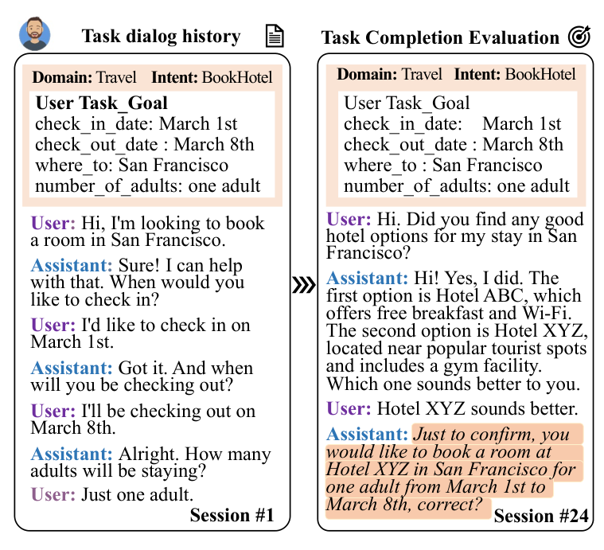
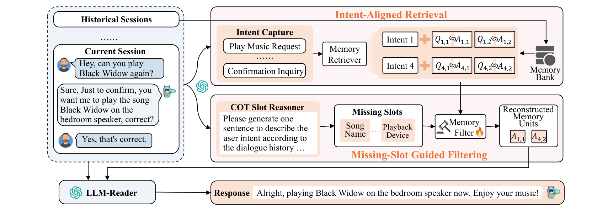
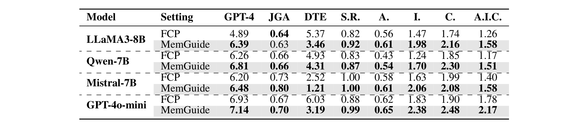
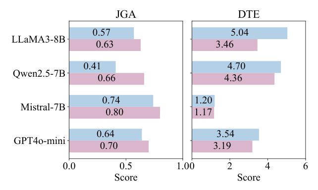

# MemGuide：面向目标导向型多会话 Agent 的意图驱动记忆选择

> 论文：Yiming Du 等，*MemGuide: Intent-Driven Memory Selection for Goal-Oriented Multi-Session LLM Agents*，AAAI 2026，论文页码 30584–30592。以下页码均指所附 PDF 的第 1–9 页。 
> 阅读结构参考：[ENPMR-Bench 文献阅读模板](https://mr-iodin.github.io/my_wiki/2026/ENPMR-Bench%20%E6%96%87%E7%8C%AE%E9%98%85%E8%AF%BB/)。

**一句话概括。** MemGuide 将「当前要完成什么任务」与「还缺哪些槽位」依次用于跨会话记忆检索：先按意图找到相关历史任务，再筛出能够补全当前信息缺口的问答式记忆，最后生成更少重复追问的回复。

**先给判断。** 论文的主要价值是把长期记忆的相关性从「文本像不像」推进到「能否帮助当前任务完成」，并提供相应的多会话任务型对话基准 MS-TOD。实验显示明显的成功率和轮数收益；但数据以合成对话为主，方法包含多个同时变化的组件，且论文有几处数值和描述不一致。因此，这些结果更适合支持「目标与槽位信息有用」，尚不足以精确归因每个组件的独立贡献，也不能直接代表真实用户场景的效果。

## 一、为什么需要这种记忆选择

传统任务型对话（Task-Oriented Dialogue，TOD）通常在单次会话里填写任务槽位。例如订酒店需要城市、入住日期、退房日期和人数。用户隔几天再次询问同一任务时，系统若不利用历史信息，就会重复追问已说过的条件。把所有历史原文塞进上下文，又可能因无关内容太多而遗漏关键条件；只按语义相似度检索，也可能找回话题相近、却无法帮助当前步骤的记忆。（第 1–3 页）

论文以酒店预订为例：用户在早先会话里给出「3 月 1 日入住、3 月 8 日退房、1 位成人」，后续会话只问酒店选项。此时好用的记忆不是笼统的「曾经聊过酒店」，而是与这次预订目标一致、且能补齐确认回复所需条件的具体槽值。（图 2，第 3 页）

*图 2｜MS-TOD 跨会话酒店预订示例。原文 PDF 第 3 页。对照左侧第 1 次会话给出的日期与人数，以及右侧第 24 次会话重新使用这些条件的确认回复。*

这里的关键区分是：

| 层次 | 要回答的问题 | 例子 |
| --- | --- | --- |
| 语义相关 | 这段历史与当前话语是否相似？ | 都提到「酒店」 |
| 意图一致 | 它是否属于当前要推进的任务？ | 都在处理同一次订房目标 |
| 槽位有用 | 它是否补上当前缺的信息？ | 提供入住日期和人数 |

作者提出的 MemGuide 就按后两个层次组织选择过程。论文还提出 MS-TOD，以测试跨会话的意图延续、槽位追踪和任务完成，而不是只测能否回忆一段历史文本。（第 2 页）

## 二、MS-TOD 基准是怎样构造的

数据从 Schema-Guided Dialogue（SGD）的任务目标出发。作者用 GPT-4 为每个任务生成三个按时间排序的会话：第一段留下未填槽位，第二段更新信息，第三段走向最终确认。随后标注确认式回复，把对话按人物汇入个人记忆库；再由 GPT-4 从已完成会话提炼意图描述与槽位问答对。检索当前测试会话时，只允许访问时间上更早的历史。最后，三位具有 NLP 经验的标注者检查目标和槽值、删除过度重复或不自然的样本，并检查确认标签。（第 3–4 页）

论文报告的规模如下（表 2，第 3 页）：

| 指标 | 数值 |
| --- | ---: |
| 领域 / 意图 | 16 / 19 |
| 任务目标 | 956 |
| 对话 / 话语 | 2,861 / 18,530 |
| 模拟人物 | 132 |
| 每人物平均会话数 | 21.67 |
| 每任务目标平均槽位数 | 4.24 |

**怎样理解这一基准：** 测试点主要是任务最终会话中的确认式回复。系统需要从前几次会话恢复当前目标所需的槽值，再判断如何继续或确认。它不是开放场景里任意时刻、任意任务的长期记忆测评。生成流程事先规定了三段式任务进展，因而对结构化槽位回忆尤其友好；真实用户的反复修改、任务中断和跨任务混杂可能更难。

**数据描述中的一个疑点：** 正文称每个人物记忆库跨「至少六种任务意图」，但表 2 报告「每人物平均意图数 5.45」。两处陈述无法同时按字面成立；论文未在这份 PDF 中解释差异。（第 3–4 页）

## 三、任务与方法：MemGuide 实际做了什么

*图 3｜MemGuide 的两阶段记忆选择。原文 PDF 第 4 页。先按当前意图缩小候选范围，再让缺失槽位决定哪些历史事实进入回复。*

输入包括当前会话上下文 $c$ 与该用户的历史记忆库 $M$，输出是下一句系统回复 $r_t$。记忆库按历史任务组织：一个任务有意图描述 $k_i$，以及若干问答式槽位事实 $(q_{i,j},a_{i,j})$。例如意图是「预订去旧金山的航班」，问答对是「出发日期是什么？—7 月 28 日」。（第 4 页）

**阶段 1：意图对齐检索。** GPT-4o-mini 从当前上下文生成简短的任务意图描述，作为当前检索键 $k_{cur}$。系统对它与历史意图／记忆单元做嵌入相似度计算，取最相关的一批历史任务及其问答对。目的在于先限制任务范围，减少「话题像，但不是这次任务」的历史干扰。（图 3，第 4 页）

**阶段 2：缺失槽位引导筛选。** 一个带链式推理提示的模型先列出当前任务所需槽位，检查哪些已在当前对话中给出或确认，形成缺失槽位集合 $L_{miss}$。随后，一个经过二分类微调的 LLaMA-8B 过滤器对候选问答对打分：

$$s_{i,j}=P(y=1\mid c,L_{miss},q_{i,j},a_{i,j})$$

其中 $y=1$ 表示该历史答案可补上一个缺失槽位。过滤器训练数据也由论文的数据构造流程产生：模拟缺失槽位的上下文，将能补槽的历史问答对标为正例。最终排序混合原检索分数与过滤器分数：

$$s^{final}_{i,j}=\alpha s^{pre}_{i,j}+(1-\alpha)s_{i,j}$$

系统选择靠前的 $K$ 个问答对（文中举例 $K=5$），只把答案事实、当前上下文与缺失槽位交给回复模型。模型可据此确认历史条件或提出建议，而不必再次从头询问。（第 5 页）

**一个易混点：** 作者称第二阶段按「边际槽位完成收益」排序，但实际训练标签是「这条问答是否能补一个缺失槽位」，并未直接测量每条记忆对最终任务成功率的边际因果贡献。这个名称表达了设计动机，公式实现的是槽位补全概率与语义分数的加权排序。

## 四、实验分别说明了什么

### 1. 初步实验：为什么不直接给完整历史

在统一使用 GPT-4o-mini 生成确认式回复时，当前会话上下文的 GPT-4 评分为 2.60、槽位准确率为 0.13；完整历史提高到 4.76 / 0.61；稠密检索为 7.01 / 0.67，混合检索为 7.04 / 0.68；Oracle 为 8.51 / 0.82。（表 1，第 2 页）

这说明筛出相关历史比直接塞入全部历史更有效，也说明普通检索与 Oracle 仍有差距。但表 1 只比较输入历史的方式，不能单独证明「意图」或「缺失槽位」哪个设计带来了后续收益。

### 2. 多会话主实验：收益有多大

论文主要比较同一回复模型在完整历史提示（FCP）和接入 MemGuide 时的表现。GPT-4 评分范围为 1–10，越高越好；JGA 是联合目标准确率，成功率（S.R.）越高越好；DTE 是完成任务所需轮数，越低越好。人工评价的 A./I./C. 分别是准确性、信息性和连贯性，A.I.C. 为三者均分。（表 3，第 5–6 页）

*表 3｜完整历史提示与 MemGuide 的主实验。原文 PDF 第 6 页。同一模型的两行是一组。DTE 越低表示轮数越少，S.R. 表示任务成功率。*

| 回复模型 | 设置 | GPT-4 评分 | JGA | DTE | 成功率 |
| --- | --- | ---: | ---: | ---: | ---: |
| LLaMA3-8B | FCP → MemGuide | 4.89 → 6.39 | 0.64 → 0.63 | 5.37 → 3.46 | 0.82 → 0.92 |
| Qwen2.5-7B | FCP → MemGuide | 6.26 → 6.81 | 0.66 → 0.66 | 4.93 → 4.31 | 0.83 → 0.87 |
| Mistral-7B | FCP → MemGuide | 6.20 → 6.48 | 0.73 → 0.80 | 2.52 → 1.21 | 1.00 → 1.00 |
| GPT-4o-mini | FCP → MemGuide | 6.93 → 7.14 | 0.67 → 0.70 | 6.03 → 3.19 | 0.88 → 0.99 |

摘要所说的「成功率 88%→99%、减少 2.84 轮」对应最后一行：成功率增加 **11 个百分点**，平均轮数由 6.03 降到 3.19，约减少 47.1%。这个改善很有实际意义；与此同时，JGA 只增加 0.03，GPT-4 评分增加 0.21。不要把 11 个百分点写成「相对提升 11%」。

**不能只看加粗的最好值：** LLaMA3-8B 的 JGA 从 0.64 略降到 0.63；Qwen2.5-7B 的 JGA 持平；Mistral-7B 的成功率原本已经是 1.00。因此，结果支持「多数指标、多数模型受益」，不支持「每个模型的每项指标都改善」。（表 3）

### 3. 与传统 TOD 和摘要记忆方法比较

在论文的多会话设定下，MemGuide 的 GPT-4 评分 / JGA / DTE / 成功率为 **7.14 / 0.70 / 3.19 / 0.99**；摘要式 ChatCite 基线为 **6.59 / 0.66 / 4.71 / 0.84**；简化版 AutoTOD 为 **6.49 / 0.44 / 7.80 / 0.81**。（表 4，第 6 页）这支持作者关于结构化、目标相关记忆有用的判断。

不过，BERT-DST 和 LDST 在该表只报告 JGA，AutoTOD 也被标注为简化流程。它们与 MemGuide 的系统能力及输入方式不完全一致，因此表 4 是该实验设置下的系统比较，不宜直接作为各方法通用优劣的排名。

### 4. 消融：两阶段各自有多重要

*图 4｜Hybrid RAG 与 MemGuide 的 JGA 和 DTE。原文 PDF 第 7 页。蓝色为 Hybrid RAG，紫色为 MemGuide。左图越高越好，右图越低越好，正文与原图的个别差异见后文。*

- **意图—QA 记忆 vs. 原始历史。** 表 6 中，四个回复模型接收「意图标注的问答记忆」后，GPT-4 评分均高于接收检索出的原始历史：LLaMA3-8B 为 5.09→6.34，Qwen-7B 为 6.38→6.56，Mistral-7B 为 5.86→6.71，GPT-4o-mini 为 7.01→7.14。（第 6 页）这同时改变了意图组织、记忆格式和可能的内容压缩方式，所以不能把全部增益单独归因于「意图检索」。
- **缺失槽位筛选。** 图 4 将 Hybrid RAG 与 MemGuide 对比：Qwen2.5-7B 的 JGA 为 0.41→0.66，GPT-4o-mini 为 0.64→0.70；对应 DTE 分别为 4.70→4.36、3.54→3.19。论文另称加入槽位筛选后 Recall@5 平均提升 7.7%，并举出 text-embedding-3-small 从 0.792 到 0.832 的例子。（第 7 页）方向上支持精细筛选的价值，但不同模型的收益差异明显。
- **单会话迁移。** 表 5 在 SGD 和 MultiWOZ 2.2 上报告了 JGA 0.846 和 0.879。这里测试的是标为 MemGuide* 的单会话变体，**关闭了缺失槽位筛选**，因此不能据此断言完整两阶段方法在单会话任务同样有效。（第 6–7 页）

### 5. 案例：为什么「想起对的槽位」会影响回复

用户说「能再播放一次《Drive》吗？」历史中还记录了卧室音箱，以及另一项音乐会购票任务。完整历史提示的回复带入多余话题；混合 RAG 转向音乐会门票；摘要基线只说开始播放，漏掉关键设备；MemGuide 则确认是否在卧室音箱播放《Drive》。（表 7，第 7 页）这个例子展示了意图对齐与槽位筛选的直观作用，但只是一个定性案例，不能代替总体误差分析。

## 五、结论应读到哪里为止

**论文真正证明得较充分的是：** 在 MS-TOD 这种由结构化任务目标、合成跨会话对话与历史问答记忆组成的评测里，围绕当前意图和未填槽位组织记忆，通常能让回复更有针对性、减少完成任务的轮数，并提高成功率。相比全文上下文或普通检索，任务状态对记忆选择是有用信号。

**仍需保留的判断：**

1. **数据的外部有效性。** 会话由 GPT-4 根据 SGD 目标按固定三阶段生成，记忆又被整理成槽位 QA。真实用户可能反复修改同类目标、说法含糊，或在同一会话切换任务；这些情况在该构造流程中的覆盖程度有限。作者还强调同一记忆库中的意图「不同且不冲突」，这会降低跨意图干扰。（第 3–4 页）
2. **组件归因不够细。** 意图检索、问答式记忆、缺失槽位推理、微调过滤器和生成提示共同变化。表 6 与图 4 提供了部分消融，但没有把上述因素逐个独立控制。因此，看到收益后不能直接断言哪一个组件独自最关键。
3. **复现细节有限。** 所附 PDF 共 9 页，没有它多次引用的 Appendix；例如提示模板、过滤器训练配置、$\alpha$ 与 $K$ 的完整选择流程、人工标注一致性数值，以及模拟用户评估协议，在这份文件中未完整展示。论文虽提到代码与数据地址，但本文阅读未据此验证其可用性。
4. **若干正文与图表不一致。** 表 6 的 LLaMA 原始历史评分为 **5.09**，第 7 页正文却写 **5.05**；图 4 中 Qwen 的 JGA 是 **0.41→0.66**，正文写成 **0.41→0.74**；图 4 中 GPT-4o-mini 的 DTE 是 **3.54→3.19**，正文却写成 **4.30→3.19**。本笔记采用表／图所示数值，并把差异标出，避免误抄。（第 6–7 页）
5. **缺少不确定性报告。** 主表没有置信区间、方差或显著性检验；尤其是 GPT-4 评分 6.93→7.14、JGA 0.67→0.70 等较小差距，不宜只凭点估计断定效果稳定。

## 六、R&Q：读完之后可以继续问什么

**RQ1｜到底是「意图」有用，还是「槽位 QA」有用？** 固定同一批历史原文与同一检索器，分别只加入意图键、只改成 QA 记忆、两者都加入，才能把贡献拆开。

**RQ2｜系统能处理过时或冲突的历史槽值吗？** 例如用户上周说 3 月 1 日入住，今天改成 3 月 3 日。检索到旧答案时，系统应识别时间与修改关系，而不是把旧值当成缺失槽位的正确补全。

**RQ3｜少问几轮是否总是更好？** 对高风险或需要最终确认的任务，直接沿用旧偏好可能快，却不一定符合用户当前意愿。后续评测可同时记录「省去的轮数」「错误沿用旧信息的比例」及用户对主动确认的接受度。

**RQ4｜如何把这篇方法迁移到非结构化长期记忆？** MemGuide 的可迁移部分是先识别当前目标，再判断哪条记忆能填当前信息缺口；而标准槽位表、二分类补槽标签未必存在于开放式聊天。可以研究如何自动定义「信息缺口」，同时允许系统判断「此轮不该调用记忆」。

**最终收获。** 这篇论文把记忆检索写成一个清楚的决策链：**识别当前目标 → 找相关历史 → 识别当前缺口 → 选择能补缺口的事实 → 在回复中谨慎使用。** 它的实验价值主要在这个任务视角和 MS-TOD 基准；最值得后续验证的，是当历史会过期、目标会变、槽位不再标准化时，这条链是否仍然可靠。
