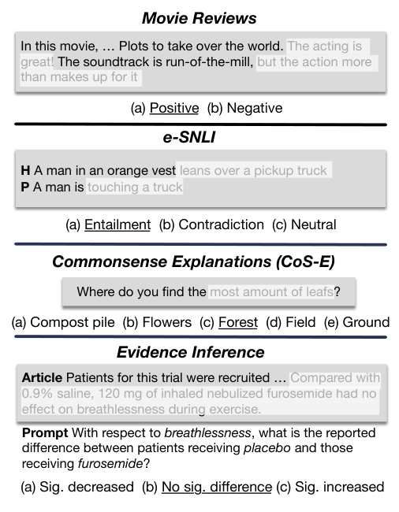
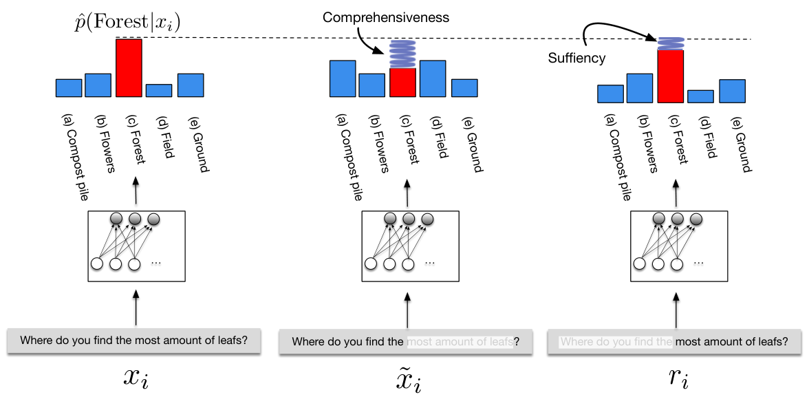
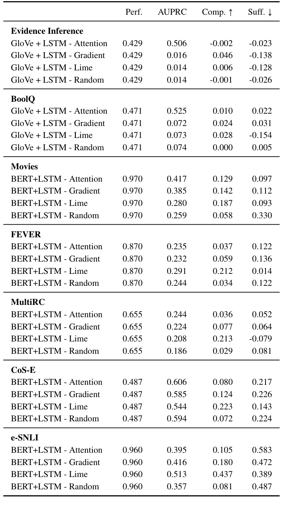

# ERASER｜怎样评估模型选出的解释证据

> Jay DeYoung、Sarthak Jain、Nazneen Fatema Rajani 等，*ERASER: A Benchmark to Evaluate Rationalized NLP Models*，ACL 2020，pp. 4443–4458。 [ACL Anthology](https://aclanthology.org/2020.acl-main.408/)

ERASER 把七项 NLP 任务统一为「输入、任务标签、支持标签的文本片段」，再用两类实验分别测量模型选出的片段是否与人工证据重合、删除或单独保留这些片段会怎样改变模型预测。

## 一、为什么要把证据重合度和忠实性分开

Rationale 在本文指从输入中抽取的支持片段。以影评分类为例，人可以划出“表演很好”等句子来解释正面标签。模型也可能划到这些句子，但实际主要借助了无关词或写作风格作答。人工重合度（plausibility）描述前者，忠实性（faithfulness）关心后者，即片段对该模型预测的作用。（§1–2）

*原文图 1，p. 4443。图中被淡化的片段就是 rationale。*

图中包括影评、自然语言推断、常识选择题，及从研究文章抽取支持结论的片段。这些任务的证据粒度不同，有些只需几个词，有些需跨句阅读。

## 二、基准数据怎样构造

| 数据集 | 任务 | 测试样本数 |
| --- | --- | ---: |
| Evidence Inference | 按文章报道推断干预的结果方向 | 959 |
| BoolQ | 从文章回答是非题 | 2,817 |
| Movie Reviews | 影评情感分类 | 200 |
| FEVER | 根据来源支持或反驳声明 | 6,111 |
| MultiRC | 逐个判断候选答案，可有多个正确项 | 4,848 |
| CoS-E | 常识选择题 | 1,092 |
| e-SNLI | 蕴含、矛盾或中立分类 | 16,429 |

数字来自原文表 1。作者复用和补充了多个已有数据源，将原先异质的证据标注转成共同格式。FEVER 只保留支持与反驳。CoS-E 和 e-SNLI 的自由文本解释没有纳入这个版本。作者为 Movie Reviews 测试集以及 Evidence Inference、BoolQ 的部分样本补做了尽量穷尽的证据标注。其余情形应先看标注是否覆盖了不同的有效证据路径，再解释召回率。（§3、附录 A–B）

原文表 2 的 Cohen κ 例如 BoolQ 为 **0.618**，FEVER 为 **0.854**。不同任务参与复标的文档数和比较方式不同，且 Evidence Inference 的补充标注缺少冗余复标，因此表中未给 κ。这提示人工高亮本身也存在选择差异。

## 三、两个评价维度怎么计算

**与人工证据重合。** 离散片段可用 token 级 Precision、Recall、F1，也可用基于区间交并比的 F1。IoU 比对两个 span 的 token 交集和并集，论文使用 0.5 阈值给部分匹配计分。连续重要性分数则把 token 按分数排序计算 AUPRC。（§4.1）

*原文图 2，p. 4448。左为原输入，中为删除所选证据，右为仅保留所选证据。*

**对模型预测的影响。** 固定原输入 $x$ 的预测类别 $j$，设 $p_j(\cdot)$ 为模型对该类别的概率，$r$ 为模型所选片段。

| 指标 | 计算方式 | 理想方向 |
| --- | --- | --- |
| Comprehensiveness（完整性） | $p_j(x)-p_j(x\setminus r)$ | 高。去掉这组证据后，原类别信心明显下降 |
| Sufficiency（充分性差值） | $p_j(x)-p_j(r)$ | 低，通常期望接近 0。只给这组证据仍能维持原判断 |

比如原模型预测 Forest 的概率是 0.80，删掉证据后变成 0.30，完整性就是 0.50。只给证据时概率是 0.75，充分性差值为 0.05。这里始终看原预测类别，原预测本身仍可能是错的。

对于连续 token 分数，可以按人工平均证据长度截成离散集合，也可以分别取重要性排名的前 1%、5%、10%、20%、50%，对多档扰动结果聚合成 AOPC。论文以随机 token 排序作参照。（§4.2）

## 四、各组实验分别说明什么

### 1. 硬选择模型能定位证据吗

硬选择先抽片段，再让分类器仅使用该片段。原文比较了 Lei 等的端到端离散选择和分开训练的流水线。例子是 FEVER 的 BERT-to-BERT，主任务 Macro-F1 为 **0.877**，IoU F1 为 **0.835**，Token F1 为 **0.812**。BoolQ 用同一流程的 IoU F1 只有 **0.052**。模型、证据标注和输入长度都会影响这个差距。（表 3，p. 4450）

影评上，Lei 模型加人工证据监督后，IoU F1 由 **0.012** 增到 **0.124**，主任务分数却从 **0.920** 变为 **0.914**，Token F1 也由 **0.322** 变为 **0.285**。片段匹配、逐词匹配及预测表现需要分别报告。

### 2. 软评分下，人工重合与删除效应会分离吗

*原文表 4，p. 4450。Comp. 高为佳，Suff. 一列为差值。*

以 MultiRC 为例，在同一预测模型上，Attention 的 AUPRC 是 **0.244**，高于 LIME 的 **0.208**。但 LIME 的完整性 AOPC 为 **0.213**，高于 Attention 的 **0.036**。因此，更像人类高亮的排序，可以在删除测试中产生更小的预测变化。论文报告 Gradient 和 LIME 通常比 Attention 有更高的完整性，各数据集上的排序仍有差异。

## 五、结论的适用边界

- **删除测试改变了输入分布。** 删词后出现不自然的语句，模型也会受这类变化干扰。负充分性差值表示仅给证据时模型反而更自信，需结合具体例子判断。
- **硬选择限制分类器可见文本。** 在编码选择与分类相互独立的前提下，可追踪分类器读到了什么。选择器可能仍依赖原文来决定抽哪些词，且不能仅凭信息瓶颈断定选中片段的语义推理正确。
- **人工证据可能有替代路径。** 未标片段也可能成立。比较证据选择器时，适合同时报告证据长度、预测性能、人工重合与扰动结果。

## 六、R&Q

1. **怎样减少删除带来的语法干扰？** 可以比较同长度的随机删除、无关文本替换与保持语法的重写，并检查趋势是否一致。
2. **多段证据怎样联合评估？** 逐段与成组删除，测量是否有冗余替代或必须组合的信息。
3. **怎样迁移到 RAG 引用？** 检查引用段落是否支持陈述，再比较移除引用、仅给引用时生成内容如何改变，两组结果可分别衡量证据的支持与模型对证据的依赖。
