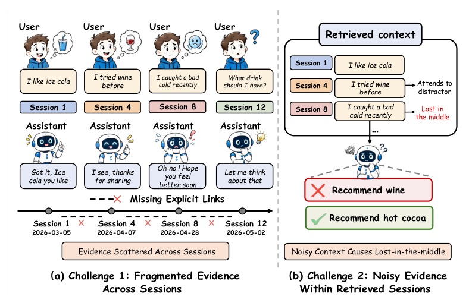
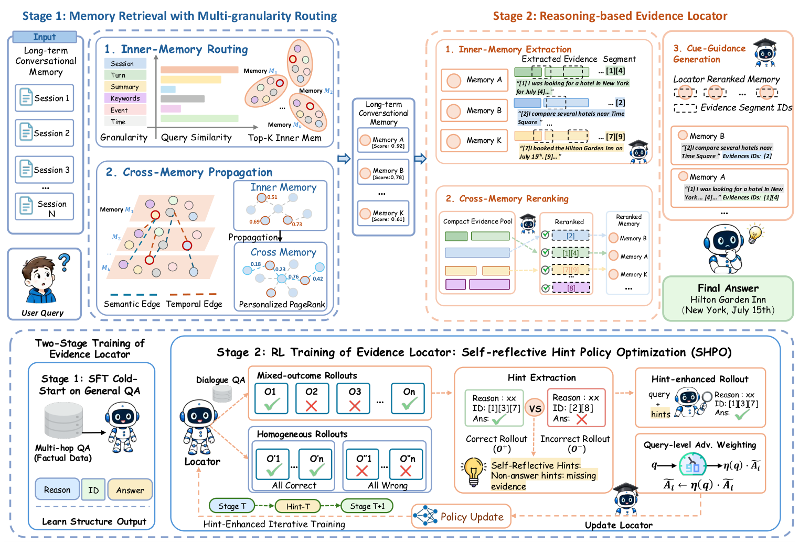
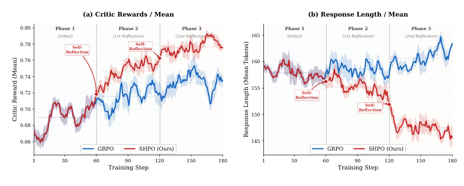
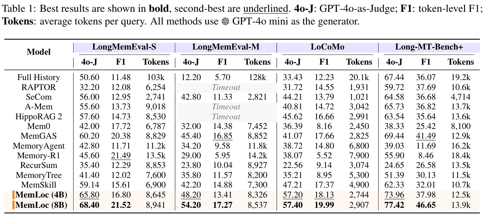
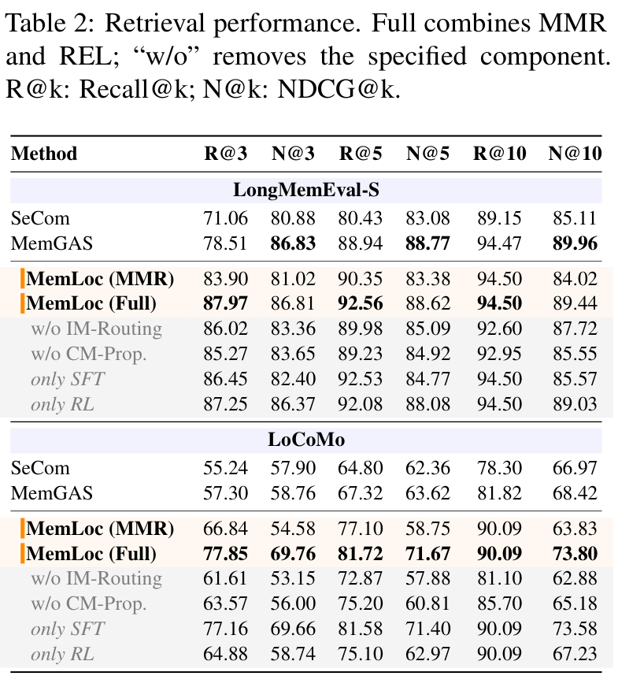
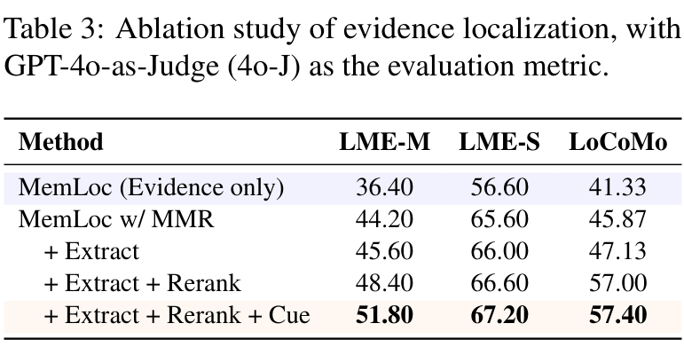
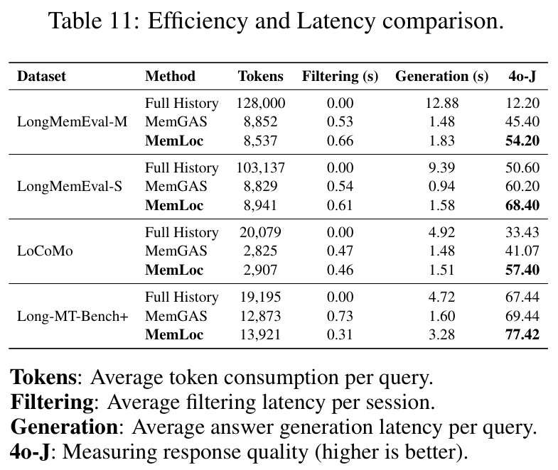

# MemLoc｜找回会话之后，还要定位答案依据

> Yifan Wang、Xinkui Lin、Yongxiu Xu、Shen Gao 等，*Where to Look and What to Use: Retrieve–Localize–Generate for Long-Term Conversational Memory Question Answering*，EMNLP 2026，pp. 27680–27701。

**一句话概括。** MemLoc 先通过多粒度索引和跨会话图召回相关会话，再定位会话内的证据、据此重排，最后把选中的原会话和证据编号一起交给生成器。

**先给判断。** 这篇的关键设计是让证据承担两种角色。短证据片段用于比较和筛选候选，原会话和片段位置用于最终回答。实验中，完整流程改善了四个基准上的问答表现。LoCoMo 的消融收益主要出现在重排阶段，位置提示的额外收益在 LongMemEval-M 上更大，两个模块的价值要结合任务来读。

## 一、为什么召回会话还不够

长期对话问答容易在两个地方失败。第一，有用线索可能散在时间相距很远的会话里，单条匹配分数高的历史只能回答一部分。第二，即使找到了正确会话，回答所需的几句话也可能埋在大量旁枝里。直接压缩历史虽然能缩短输入，却可能删掉时间、指代或例外条件。（§1–2）

*原文图 1，PDF 第 1 页。左侧画出线索散在不同会话的问题，右侧画出召回后仍可能注意到错误细节的问题。*

## 二、方法如何串起检索、定位和生成

*原文图 2，PDF 第 3 页。上半部分是推理流程，从召回会话到标记证据、生成答案。下半部分是证据定位器的两阶段训练。*

### 1. 先为每场会话打分，再让分数沿图传播

一场会话用六种视图表示：**整场会话、轮次、摘要、关键词、事件和时间**。每种视图分别与查询计算相似度，再对候选做温度缩放的 softmax。归一化熵较低，说明这一视图的分数更集中在少数候选上，路由器就给它较大权重。六种视图软加权。分数集中度是区分候选的启发式信号，其可靠性仍要用标注证据检验。（§3.3.1–3.3.2）

随后，系统将较强的匹配作为起点，在跨会话图上做个性化 PageRank。语义边连接同粒度且内容相似的节点，时间边连接相邻会话的同粒度节点。传播后将同一会话内六个粒度的分数加总。实验配置召回前 **10** 场会话。（§3.3.3–3.3.5、附录 F）

### 2. 先在会话内找句子，再比较哪几场会话值得保留

定位器对每个候选会话输出相关片段的局部编号。系统先把各场会话抽出的证据放进一个较短的候选池，再用定位器比较哪些会话合起来能支撑答案。实验最终使用重排后的前 **3** 场会话。这里的证据抽取决定重排时看什么，因此若前一轮漏掉时间条件或否定语句，后一轮仍可能选错。（§3.4、附录 F）

### 3. 把原会话和证据位置一并交给生成器

生成器输入包含问题、选中会话的原文以及相应的证据编号。编号用来标出优先核对的位置，周围原话继续提供时间、指代和语境。论文将这一步称为 Cue，并用消融实验比较只读抽取证据、只读候选会话和带位置提示的效果。（§3.4、§4.4.1）

## 三、证据定位器如何训练

1. **监督微调冷启动。** 用约 4,000 道来自 HotpotQA、MuSiQue 和 2WikiMultihopQA 的样本学习输出推理、证据编号和答案。
2. **用对话数据做自反思提示策略优化（SHPO）。** 用 Time-Dialogue 和 HaluMem 改编的约 6,000 道题，每题采样四条轨迹。若同题同时出现定位成功与失败的轨迹，模型对照两者，总结遗漏证据或定位错误的提示，追加到下一阶段的训练提示。GRPO 更新时，这类题的优势权重也更高。

奖励由**答案字符串命中、金标准证据召回、输出格式**组成。按正文定义，证据召回为 1 就算定位成功，因此全选证据编号也可能拿到这一项满分。若研究目标是「最小而充分的证据链」，还应独立报告精度、片段数或冗余率。附录算法将混合组写成奖励同时包含 0 和 1，正文将低于 1 的轨迹都视为失败。遇到部分命中的样本时，两种写法可能产生不同分组。（§3.5、附录 A、F）

*原文图 3，PDF 第 8 页。加入反思提示后，8B 定位器的平均训练奖励更高、输出更短。证据定位的实测增益可另外查看表 4。*

## 四、实验结果怎样读

### 1. 主结果固定回答模型，比较整套记忆流程

论文使用 LongMemEval-S、LongMemEval-M、LoCoMo 和 Long-MT-Bench+。会话检索以 Recall@K 和 NDCG@K 评估覆盖和排名，Long-MT-Bench+ 缺少检索金标准，只有问答评估。主表让各方法使用 GPT-4o mini 生成回答，以 GPT-4o 评审分和词元 F1 为主指标。MemLoc 的 4B 和 8B 指**证据定位器**的规模。（§4.1–4.3、附录 B、F）

*原文表 1，PDF 第 7 页。横向对照各数据集时，应同时看评审分、F1 和输入成本。*

同样使用 GPT-4o mini 时，MemLoc（8B）的评审分在 LongMemEval-S、LongMemEval-M、LoCoMo、Long-MT-Bench+ 分别为 **68.40、54.20、57.40、77.42**。相比 MemGAS，分别增加 **8.20、8.80、16.33、7.98** 分。附录更换生成器后，评审分对 MemGAS 的优势仍在，但部分条件的 F1、BLEU 或 BERTScore 下降。例如在 LongMemEval-S 上，Qwen3-30B-A3B 的评审分从 58.40 升至 71.20，F1 从 26.65 降到 17.72。这说明各指标捕捉到的回答特征不同。（表 1、表 10）

### 2. 重排改善前排召回，效果随指标而变

*原文表 2，PDF 第 8 页。MMR 是仅做多粒度检索的版本，Full 再加入证据定位器。*

LoCoMo 上，加入定位器后 Recall@3 从 **66.84** 升至 **77.85**，Recall@10 保持 **90.09**。LongMemEval-S 也出现相同现象，符合对固定候选池重排的结果。附录表 7 显示，LongMemEval-M 的完整方法 Recall@3 为 **63.41**，高于 MemGAS 的 **51.06**，但 Recall@10 为 **72.16**，低于 MemGAS 的 **77.02**。因此论文最稳的检索增益在短列表，评价覆盖率时仍应区分 K 值。

### 3. 保留原文的收益大于只给抽取片段

*原文表 3，PDF 第 8 页。使用 GPT-4o 评审。比较相邻两行可以看到不同步骤的增量。*

- **只给抽取证据。** LongMemEval-M 得 **36.40**，低于仅用多粒度检索得到会话的 **44.20**。另两个数据集也有下降。这支持保留原会话语境的设计。
- **证据重排。** 在 LoCoMo 上，从只加证据抽取的 **47.13** 升到同时重排的 **57.00**，随后再加位置提示只升到 **57.40**。
- **位置提示。** LongMemEval-M 在已有抽取和重排后，从 **48.40** 升至 **51.80**。表 3 的消融终点与表 1 的 8B 主结果相差 2.40 分，各自应以表内对照为准。

## 五、边界与可继续验证的问题

*原文表 11，PDF 第 16 页。过滤耗时按会话计，生成耗时按查询计，两列分母不同。*

- **成本要分离线和在线看。** LongMemEval-M 的历史平均约 102 万 tokens，主表中全文对照实际使用 128k，MemLoc（8B）平均用量为 8,537。离线仍要抽取多粒度信息，并按论文的分析承担与视图数和会话数平方相关的建图开销。附录耗时分别报告每会话过滤和每查询生成，无法直接相加当作端到端延迟。（表 6、表 11–12）
- **要直接验证位置提示能否缓解中段遗漏。** 表 3 支持同一条流程里添加位置提示能提升评审分。可固定问题、候选会话和证据，把关键句移动到开头、中段和结尾，再比较带编号和去掉编号时的答案正确率及证据忠实性。
- **训练策略的增益可以再拆开。** 表 4 中，LongMemEval-S 的 SFT＋GRPO 与 SFT＋SHPO 的 Recall@3 相差 **0.34** 分，NDCG@3 相差 **1.35** 分。SHPO 同时引入提示和优势加权，可各关一项来判断贡献。附录的多评审器与人工复核为 LongMemEval-S 提供了额外佐证，其他基准的评审器敏感性仍有待验证。

与 [MESA](../01_意图分析/MESA_论文精读.md) 对照，两篇都为同一份历史建立多视图。MESA 按查询选记忆结构组合，MemLoc 对表示粒度软加权，并把跨会话传播和会话内定位分开。也可对照 [SETR](SETR_论文精读.md)，比较按线索覆盖选择证据集合，以及先提取局部证据再重排整场会话，两种做法分别怎样处理多跳问题。
