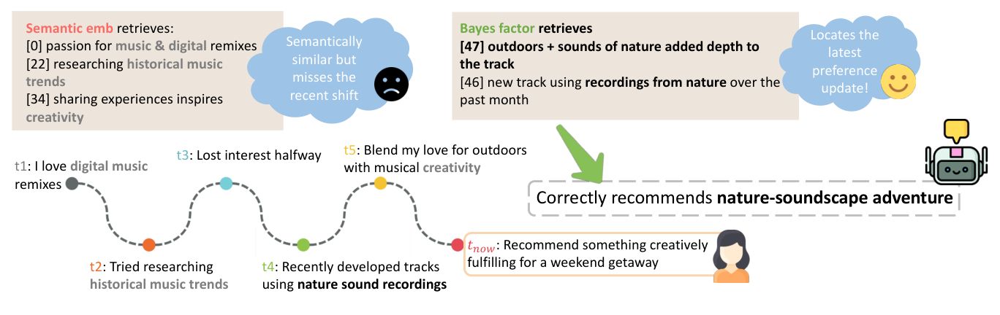
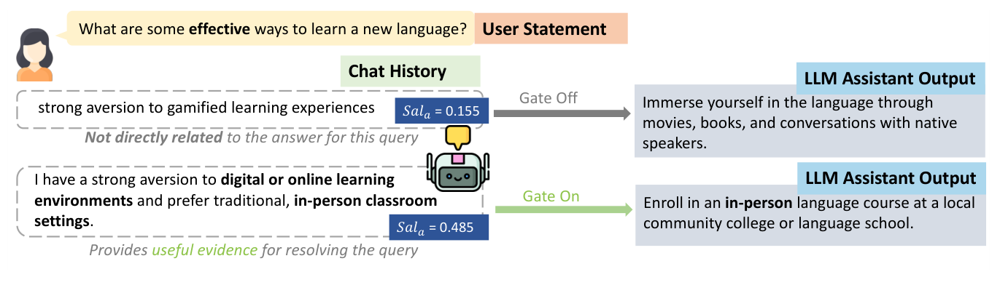
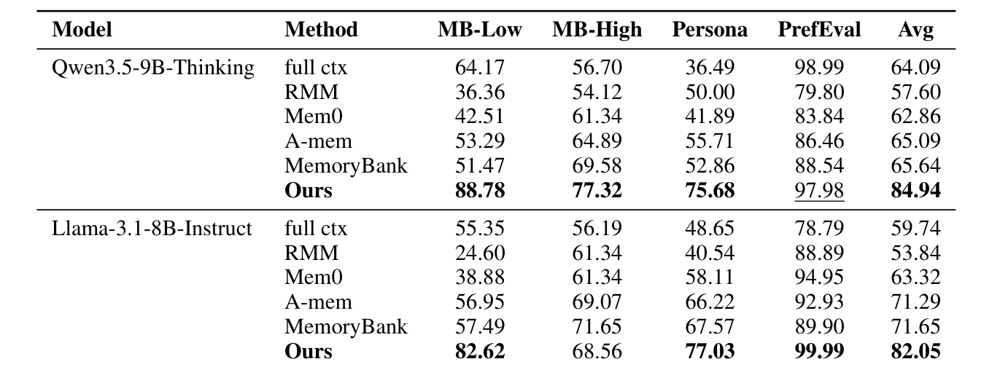
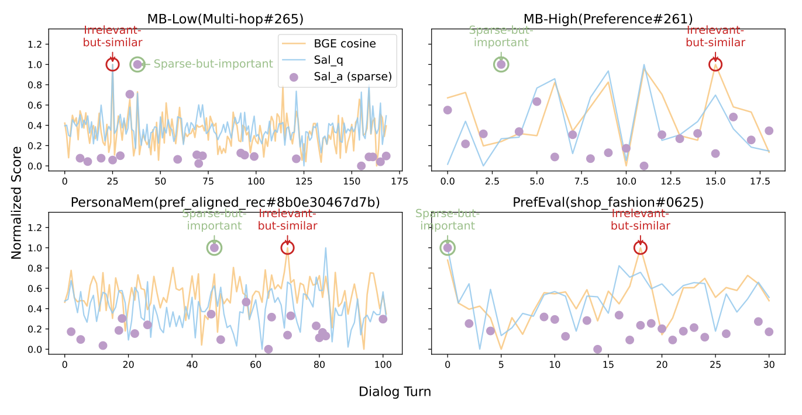
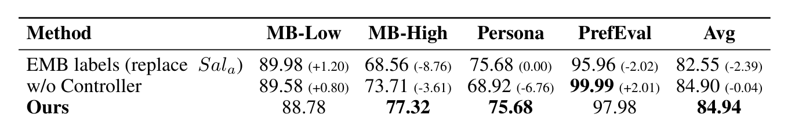

# Memory Retrieval for Changing Preferences：用答案效用选择变化中的用户记忆

> 论文：Yuehan Qin 等，*Memory Retrieval for Changing Preferences*，arXiv:2606.02976v1；

**一句话概括。** 作者用「加入某条历史后，模型给标准答案的概率提高了多少」为记忆打训练标签，再训练一个控制器判断是否调用记忆、该取哪几条，同时训练回答器做个性化四选一题。

**先给判断。** 这篇论文的有用想法是把检索目标从「与问题像不像」换成「是否改变正确答案的判断」。但它报告的大幅收益来自**选择器与回答器联合微调**，不能全部算作检索改进；「何时不调用记忆」也缺少独立的真实负例评测。尤其在多条历史必须合起来才有意义时，逐条效用评分的理论保证较弱。

## 一、问题是什么：同一话题，哪条旧事现在有用

用户长期使用助手时，偏好可能变化。同样是「音乐」话题，早年的数字混音爱好、最近对自然录音的尝试，可能指向不同的周末活动推荐。如果系统只取与提问表面词最相似的句子，可能命中旧话题，却错过决定当前推荐的较新线索。（图 1，第 2 页）

*图 1｜同一推荐问题下，语义相似与答案效用选出的记忆。原文 PDF 第 2 页。案例中，近期把自然声音融入音乐的经历为活动建议提供了具体线索。*

作者把长期记忆使用拆成两个联动决策：**这道题是否应该读取个人历史**，以及**若要读取，历史中的哪几轮值得给回答模型**。常见方法把第一步设成始终开启或启发式触发，第二步按嵌入相似度排序。作者认为两步都应围绕同一个「对答案是否有用」的效用信号。（第 1–3 页）

这里的「Changing Preferences」是研究动机：旧偏好可能被新偏好取代，不能把同主题的旧句子当作永远正确的用户状态。需要注意，主实验还包含一般记忆问答，并不是专门测量「偏好何时改变、系统是否正确更新」的单一基准。

## 二、四阶段方法：训练时知道答案，推理时不知道

设历史 $H=(c_1,\ldots,c_T)$，当前问题为 $q$，标准答案为 $a$。作者先给每条候选历史 $c_i$ 一个**答案条件显著度**：

$$
\operatorname{Sal}_a(c_i\mid q,a)
=\log p(a\mid q,c_i)-\log p(a\mid q).
$$

如果加入这条历史使模型更相信标准答案，分数为正；若它无帮助或误导，分数接近零或为负。这个对数似然比被作者称为 log Bayes factor。实际分数由较小的 **Qwen3.5-0.8B** 模型估计，因此它是**特定评分模型的答案似然变化**，不是客观、模型无关的用户偏好强度，也不直接证明一条历史的因果作用。（公式 1，第 3 页）

但推理时标准答案不可用。作者再计算只依赖可见问题的代理分数：

$$
\operatorname{Sal}_q(c_i\mid q)
=\log p(q\mid c_i)-\log p(q).
$$

这个量也可视为问题与历史的点互信息：某条历史让当前问题在语言模型看来更可预期。推理时先用它从全历史预筛 **20 条**候选；PersonaMem 的单轮更长，预筛 **10 条**。之后训练好的控制器在候选中挑最多 **5 条**，回答器看到四个选项与选中历史后输出选项字母。（公式 3、10–12；附录 B，第 13–14 页）

训练阶段把标准答案可见的 $\operatorname{Sal}_a$ 用于银标签：给高效用历史打标签，训练控制器输出是否触发记忆、要关注的历史索引；再用被选证据训练回答器完成四选一。控制器和回答器共享模型参数，用下一词预测目标联合微调。作者还用「问题和别人的历史错配」构造负例，防止控制器永远开启记忆。（第 4–6、13 页）

*图 2｜阈值如何决定示例中的记忆调用。原文 PDF 第 5 页。有关线下学习的偏好改变了推荐方向，阈值由训练和验证流程确定。*

### 理论保证究竟说了什么

作者证明，$\operatorname{Sal}_q$ 与 $\operatorname{Sal}_a$ 相关的一项分解恒等式成立；若每条历史本身已经包含足够的答案状态，而且各候选历史对答案的边际信息近似相同，两种分数的排序才会接近或相同。（命题 1、定理 3，第 4 页）

这两个条件不是一般长期对话的自动事实。附录在验证集测到代理残差的均值：PersonaMem 为约 **0.47 nats**，MemBench-High 为 **1.67**，MemBench-Low 为约 **2.2–2.3**，部分任务存在明显长尾。作者自己也承认，多条历史需要聚合时代理分数可能失真，控制器只能部分补救。（附录 D、图 5–6，第 14–16 页）

**直观例子：** 一条旧事说「我喜欢数字混音」，另一条说「我现在更喜欢用自然声音创作」。两条都与音乐有关，但给现在的活动建议时，后者可能更有用。若正确偏好必须从「先喜欢 A，后来逐渐转向 B」的多轮关系中推断，单条历史的似然增益甚至可能看不出两条证据组合后的价值。

## 三、数据与评测口径

论文使用四个测试集：MemBench-Low（显性记忆）、MemBench-High（隐含推理）、PersonaMem（变化中的用户画像与个性化回复）和 PrefEval（偏好识别）。所有任务转成或使用**四选一正确率**，并用四个基准的简单平均作为 Avg。作者报告固定种子分层训练／验证／测试切分，PersonaMem 还按人物隔离，避免同一人物跨训练与测试。（第 6 页；附录 A）

| 测试集 | 保留的测试题数 | 解读时的注意点 |
| --- | ---: | --- |
| MB-Low | 374 | 只保留答案位于用户话语中的子集，排除需要助手历史的题 |
| MB-High | 194 | 需要更隐含的跨历史推理 |
| PersonaMem | 74 | 测试只含 **3 个**独立人物 |
| PrefEval | 99 | 偏好通常表述较显性 |

MB-Low 的约四分之一助手侧场景被排除，因为方法的记忆池只存**用户话语**，而这些题的证据在助手过去的回复中。这个限制合理，但表明所报 MB-Low 分数不是完整原始基准的成绩。（附录 A、表 4，第 13 页）

主表比较完整用户历史、RMM、Mem0、A-MEM、MemoryBank 与本文方法；给出的阅读模型分为 Qwen3.5-9B-Thinking 和 Llama-3.1-8B-Instruct。各检索系统取回的记忆被送入相同回答提示。论文在适配时关闭了 RMM 的回顾式重排和 MemoryBank 的遗忘更新；因此跨系统成绩对应本论文的**单次四选一评测配置**，不能直接代表原系统的全部使用方式。（第 6 页）

另一个实验设计点：在显著度预处理后，作者删除了某些**没有可用单轮证据**的实例；阈值也在验证集选到使至少 **95%** 的保留记录具有非空显著集。天然「不该调用记忆」的测试比例因此被压低，控制器训练中的负例还有跨实例错配合成样本。（附录 A、B，第 13 页）

## 四、各组结果分别支持什么

### 1. 主结果：综合成绩高，但不是所有列都赢

*表 1｜两组回答模型的四基准主结果。原文 PDF 第 7 页。Avg 对四个基准等权。查看单列时可看到 Qwen 在 PrefEval、Llama 在 MB-High 的例外。*

| 阅读模型与方法 | MB-Low | MB-High | PersonaMem | PrefEval | 四基准平均 |
| --- | ---: | ---: | ---: | ---: | ---: |
| Qwen：完整历史 | 64.17% | 56.70% | 36.49% | **98.99%** | 64.09% |
| Qwen：MemoryBank | 51.47% | 69.58% | 52.86% | 88.54% | 65.64% |
| Qwen：本文方法 | **88.78%** | **77.32%** | **75.68%** | 97.98% | **84.94%** |
| Llama：完整历史 | 55.35% | 56.19% | 48.65% | 78.79% | 59.74% |
| Llama：MemoryBank | 57.49% | **71.65%** | 67.57% | 89.90% | 71.65% |
| Llama：本文方法 | **82.62%** | 68.56% | **77.03%** | **99.99%** | **82.05%** |

Qwen 组的四基准平均比 MemoryBank 高 **19.30 个百分点**；Llama 组高 **10.40 个百分点**。（表 1，第 7 页）但「每个基准都最好」不成立：Qwen 的 PrefEval 低于完整历史 1.01 个百分点；Llama 的 MB-High 低于 MemoryBank 3.09 个百分点。论文所谓「最佳总体」应按平均分理解。

平均分对四个测试集**等权**，并未按题数加权；其中 PersonaMem 测试只有 74 题、3 个人物。主表没有跨随机切分的方差或置信区间，尤其对小样本列和接近的差值应谨慎。（表 1；附录表 4）

作者在图 3–4 展示多个类别和个例：与问题词面接近的历史可能没有答案信息，真正有用的旧事却是时间上稀疏、语义上不那么直接的线索。这解释了方法动机，但图中的类别是**代表性选择**，图 4 的曲线也是每个基准各一段对话，不能据此独立估计总体检索命中率。（第 8 页）

*图 4｜每个基准选一段对话比较三种检索信号。原文 PDF 第 8 页。横轴是对话轮次。答案条件分数需要参考答案，图中用它诊断哪些轮次可能为标准答案提供证据。*

### 2. 消融：答案效用标签有贡献，控制器总体贡献很小

*表 3｜替换训练标签或移除控制器。原文 PDF 第 9 页。标签替换对 MB-High 的影响较明显，移除控制器的总体平均分变化较小。*

在 Qwen 组，改用嵌入相似度生成训练伪标签，平均分从 **84.94% 降到 82.55%**，MB-High 从 **77.32% 降到 68.56%**。这支持「标准答案似然变化」比纯嵌入标签更适合某些隐含记忆题；但 MB-Low 反而从 88.78% 升到 89.98%，PersonaMem 持平。

**去掉控制器**后，平均分为 **84.90%**，只比完整方法低 **0.04 个百分点**。MB-High 下降 3.61 个百分点、PersonaMem 下降 6.76 个百分点，但 MB-Low 和 PrefEval 反而上升。故表 3 支持「控制器可能帮助部分困难场景」，不足以单独证明统一的记忆访问门控普遍有效；论文也未报告真实无记忆问题的门控精确率／召回率。（第 9 页）

### 3. 为什么主表不能只归功于检索

表 2 用**未联合微调**的 Qwen 阅读模型搭配几种选证方式。即便用知道标准答案的 $\operatorname{Sal}_a$ 直接选历史，平均也只有 **66.09%**，明显低于完整方法的 **84.94%**；BGE 选证为 62.35%，完整历史为 64.09%。这是强烈的提醒：大部分主表差距包含模型经过任务训练后**更会读证据、更会按四选一格式作答**的收益。作者在第 9 页也承认「检索质量与 reader 适配共同作用」，所以不能将 +19.30 个百分点解释为纯检索器增益。

另有实现细节需要分开核对：附录明确写全参数联合微调的是 **Qwen3.5-9B**，训练采用 no-think 模板；主表又列出 Llama 阅读模型及「Qwen3.5-9B-Thinking」分组。所附 PDF 没有充分说明 Llama 阅读器是否也经过等价的 reader 微调，以及 thinking／no-think 配置如何对齐。跨阅读模型结果的机制解释因此应保持谨慎。（第 6–7、13–14 页）

## 五、结论的适用边界

1. **这里的效用是评分模型对标准答案的似然增益。** 它随标准答案、评分模型、提示格式变化；偏好过期、冲突或更新的事实并没有被显式建成时间状态模型。更稳妥的说法是「用答案相关的监督信号改进个性化记忆选择」。
2. **单轮打分难处理证据组合。** 一条历史单独不足以改变答案，但与另一条合在一起才说明「用户已改变主意」时，逐条筛选可能丢证据。论文的理论条件和附录残差分析也承认这一点。
3. **门控能力没有充分单独验证。** 测试数据经过无单轮证据样本过滤，保留样本中至少约 95% 被阈值标成非空；训练负例部分由问题—历史错配生成。真实问题中的「不应调用私人记忆」与此类错配并不等价。
4. **训练与基线的计算成本不同。** 本文要用 0.8B 模型离线打 $\operatorname{Sal}_a/\operatorname{Sal}_q$ 标签、全参数联合微调 9B 模型；推理时还对历史算 $\operatorname{Sal}_q$ 并运行控制器。论文没有给出完整建库／查询延迟和总 token 成本，不能只由准确率判断部署性价比。（附录 B）
5. **记忆范围只含用户侧发言。** 对需要助手过去建议、承诺或决定的题型，方法当前无法直接覆盖；MB-Low 相应场景也被排除。（附录 A、E）
6. **论文的符号描述有一处待澄清。** 公式 7 用 $\operatorname{Sal}_q$ 定义阈值集合，后文又将训练控制器的显著集合和标签描述为基于 $\operatorname{Sal}_a$；附录也同时讨论两者的阈值。读者若要复现，需进一步核对实际标签生成与阈值施加的先后顺序。（第 4–5、13 页）

## 六、R&Q：可继续研究什么

**RQ1｜怎样单独测检索质量？** 固定同一个未微调 reader，让不同选择器都提交相同数量的历史，分别比较记忆证据召回、答案准确率；再加入联合微调，量化选择与阅读适配各自贡献。

**RQ2｜真正的「偏好变化」如何评测？** 构造同话题、不同日期、明确互相冲突的偏好序列，单独测新旧偏好判断、时间条件、是否主动求证，而不只测最终四选一正确率。

**RQ3｜何时该完全不调用记忆？** 在自然分布中加入与个人历史无关、历史已过期、历史与当前意愿冲突的问题，报告门控精确率、召回率、误调用率和隐私代价。

**RQ4｜如何发现组合证据？** 在逐条似然增益之外，增加成对或集合级边际效用，比较它是否能保留「旧偏好 → 新偏好」的演变链，并控制额外计算量。

**最终收获。** 这篇论文提醒我们：**记忆相关性应看它能否帮助当前决策，而不只是和问题聊的是不是同一话题。** 它的训练信号和主实验很有启发性；最需要下一步补强的是纯检索归因、真实无记忆门控、偏好更新的专项评测，以及端到端成本。
