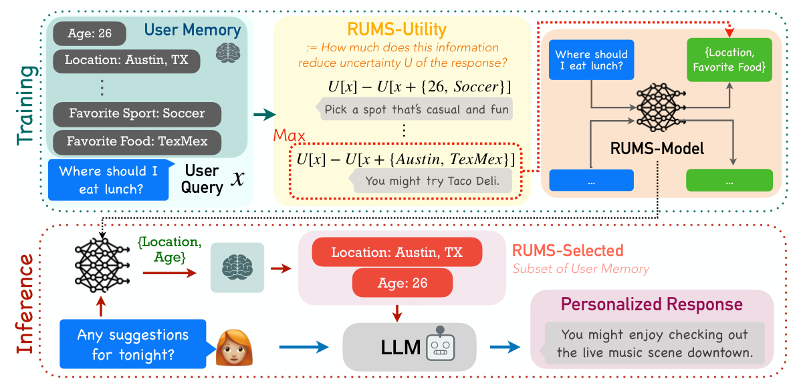
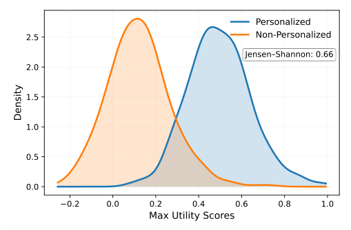
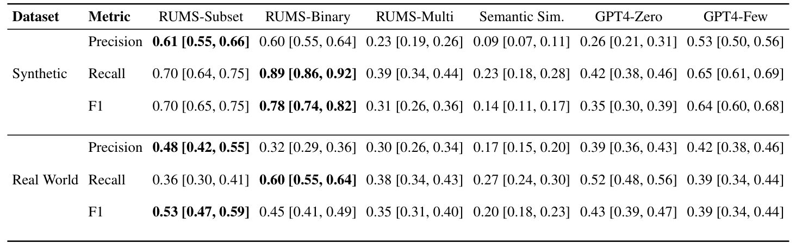
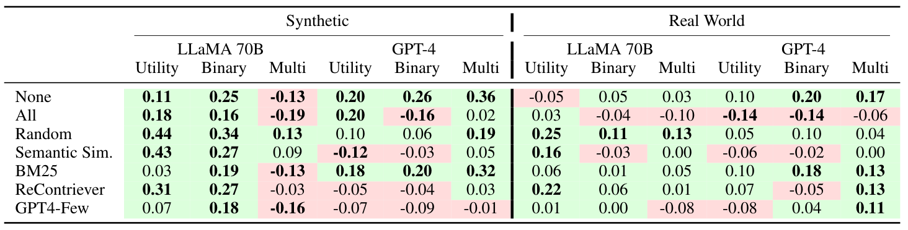
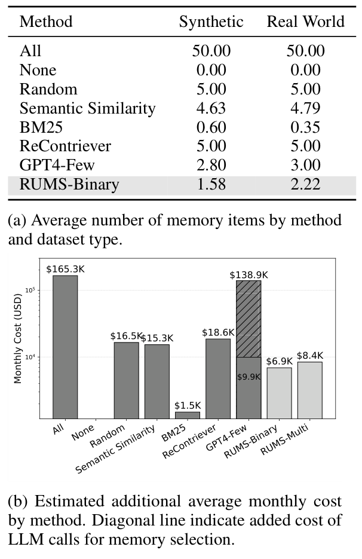

# RUMS｜哪些用户记忆真正影响模型的回答

> Jillian Fisher、Jennifer Neville、Chan Young Park，*Response-Aware User Memory Selection for LLM Personalization*，EMNLP 2026，pp. 4215–4267。 [ACL Anthology](https://aclanthology.org/2026.emnlp-main.185/)

`# EMNLP 2026`

​    RUMS 比较给定问题时，加入某组用户记忆前后，模型对接下来怎么回答有多不确定。作者用输出熵的下降自动生成选择标签，再训练轻量模型在线选字段。实验表明这种信号能帮助区分是否需要个性化。它能否改善回答，还取决于读入记忆的生成器、用户画像和问题分布。

## 一、为什么按回答来选记忆

用户问“今晚有什么推荐？”时，问题中没写城市，但位置通常影响推荐。用户问一个独立的知识题时，即使履历里有相似词，读入履历也可能让回答跑题。作者因此同时设定两个目标。需要个性化时选出有帮助的字段，无需个性化时可以选空集。

原文图 1 上半部分用参考模型打标签，下半部分用训练后的选择器服务新的查询。

举例说，“住在奥斯汀”和“偏好 Tex-Mex”可以一起缩小午餐建议范围，“26 岁”和“爱看足球”通常没有同等作用。图中比较的是候选**集合**，同一条记忆的作用可能随其它已选字段而变。

## 二、数据和三个研究问题

实验用 GPT-4 生成 **100 份画像**，每份都有 50 个固定字段及其值。候选包括位置、兴趣、饮食偏好等，方法最多选 5 项，也可不选。三类问题来源如下。（§4.1、附录 F.2–F.3）

| 输入来源 | 用途 |
| --- | --- |
| PersonaFeedback | 从画像生成、设计上需要个性化的问题，原中文翻成英文 |
| FreebaseQA | 常识与事实问答，按设计视为无需个性化 |
| WildChat | 人写的真实对话首条请求，经两人标记是否需要个性化 |

正文称前两组为 Synthetic，WildChat 为 Real-World。后者的**问题**来自真实互动，匹配的用户画像仍是合成的。H1 测是否应该个性化，H2 测选哪些字段，H3 测选择后生成的回答是否更好。三项研究的样本、标注与对照各不相同。

## 三、RUMS 的效用怎么算

令 $x$ 为当前问题，$Y$ 为生成器可能生成的回答，$m_{u,S}$ 为用户 $u$ 在字段集合 $S$ 上的实际值。作者用两种输入条件的预测熵之差近似该集合的效用。

$$
U_{\mathrm{RUMS}}(S,u)
=H_\theta(Y\mid x)-H_\theta(Y\mid x,m_{u,S}).
$$

熵下降意味着模型的输出分布更集中。直接枚举完整答案不可行，作者按 token 拆解熵，用多次生成得到的前缀估计下一 token 的分布熵，再按样本长度取平均。两种输入条件使用一样的采样预算。训练标注主要使用 Llama-3.1-8B，每个条件采样 5 次。GPT-4 先把 50 个字段粗筛到最多 10 个，再在候选子集中比较得分。最高分需超过验证阈值 **0.29**，否则标签是空集。（§3、§4.1、附录 E–F）

| 论文名称 | 实际输出 | 用在何处 |
| --- | --- | --- |
| RUMS-Utility | 熵差得分 | 判断是否调用，生成训练标签 |
| RUMS-Subset | 由效用评分选出的具体集合 | 与人工选择和回答效果比较 |
| RUMS-Binary | 逐条预测某个实际字段值应不应该选 | 可处理可变字段，编码次数随候选数增长 |
| RUMS-Multi | 仅凭问题一次输出固定字段的多标签预测 | 每题仅需一次前向计算，训练标签由同题多画像的结果合并 |

和前面读过的 *Memory Retrieval for Changing Preferences* 相比，那篇用**参考答案似然的变化**给历史发言打标签，RUMS 用**模型整个输出分布的变化**给字段集合打分。RUMS 无需给分阶段的标准答案，但其信号会受措辞分布、生成器校准和用户画像是否准确影响。

## 四、各组实验分别说明什么

### 1. H1：能否判断要不要个性化

原文图 2，p. 4219。蓝色为 PersonaFeedback，橙色为 FreebaseQA。

各抽 500 题时，个性化问题的最大效用平均为 **0.50**、非个性化为 **0.12**。两个数据源的题型与措辞也不同，强分离可能包含数据源特征。H1′ 另取四人一致标注的样本，用 20% 做阈值验证，主表的 WildChat 测试列标为 **31 条**。RUMS-Utility 的个性化 Recall 为 **92.3%**、非个性化 Specificity 为 **96.0%**，GPT-4 Few-shot 为 **76.9% / 100.0%**。筛去评审不一致的样本使结果更适用于意图明确的问题。（表 1，§4.2.1）

### 2. H2：选中的字段接近人工标注吗

*原文表 2，p. 4220。方括号为论文给出的 bootstrap 95% 区间。*

人工对 60 道题各看 50 个字段，至少 3/4 人同意才纳入金标准。在至少选一项的问题中，平均选 4.19 项。按原表，合成组 F1 最高的是 Binary（**0.78**），WildChat 组最高的是直接用效用选集合（**0.53**）。WildChat 中，Binary 的 Recall 高（0.60），Precision（0.32）低于直接子集的 0.48。附录表 26 显示，WildChat-Personal 的评审集合平均 Jaccard 只有约 0.30。这个任务容许多组合理选法。

**原表有一个复现时值得核对的数值问题。** 若真如表注所说，三项指标取同一组问题、同权平均，且逐题 F1 是逐题 Precision 与 Recall 的调和平均，则由调和平均的凹性，宏平均 F1 至多是宏平均 Precision 与 Recall 的调和平均。WildChat 的 RUMS-Subset 行是 **0.48 / 0.36 / 0.53**，前两项的调和平均约 **0.41**，小于所报 F1。单纯四舍五入难以解释差距，需核对空集合计分、纳入样本、汇总方式或表格值。上文保留原表数字。

### 3. H3：选择结果会改善最终回复吗

*原文表 3，p. 4222。正数为 RUMS 的胜率减去基线胜率，0.18 表示净胜率高 18 个百分点。*

合成组 200 题、WildChat 组 100 题，主要由 GPT-4 评判。用 LLaMA 70B 生成时，合成组的 Binary 相对 GPT4-Few 净胜率为 **+0.18**。用 GPT-4 生成时，WildChat 的 Multi 相对同一基线是 **+0.11**。在 WildChat、GPT-4 生成的设置中，三个 RUMS 变体都落后于读全画像的 All，净胜率为 **−0.14、−0.14、−0.06**。应按生成器和基线逐格解读。附录 A.9 还有两位标注者参与的比较，方向支持合成组 Binary 的这一优势，覆盖范围较窄。

### 4. 计算成本降在什么地方

*原文图 3，p. 4221。费用采用论文设定的调用量与定价。*

Binary 在合成组和 WildChat 分别平均选 **1.58 / 2.22 项**。按每日 100 万次请求和论文设定的价格，额外月成本估计为 **6.9 千美元**，Multi 为 **8.4 千美元**，读全画像为 **165.3 千美元**。摘要所说最多约 95% 降幅，主要对应与全量注入比较的附加成本。附录表 23 的 3 次计时中，直接算效用平均 **7.28 秒/例**，Binary **0.14**、Multi **0.04** 秒/例。部署收益主要来自轻量选择器，离线标注成本和最终生成开销需分开核算。

## 五、公式、理论与读数的边界

- **熵差取决于模型的信心。** 对固定画像值算的是局部预测熵差。通常定义的条件互信息还需对所观测字段的可能取值求期望，因此单次熵差可以为负。模型也可能更坚定地给出一个错误或狭窄的建议。
- **定理 3.1 的证明依赖额外近似。** 附录 C 的推导需要将 $H(Z_u\mid x,Y,m_{u,S})$ 近似看作不随集合变化。假设 2 约束的是给定 $Z_u$ 后记忆对 $Y$ 的影响，仅凭这一点不足以推出前述近似。实际选项质量仍要由 H2、H3 一类实验检验。
- **在线选择器近似集合效用。** 逐项 Binary 无法直接看项间相互作用。Multi 的同题标签跨用户合并，会忽略某个用户字段值能否真正帮上忙。实验主要用固定字段、完整画像和单轮查询，时序冲突和自由文本历史留待验证。

## 六、R&Q

1. **置信度变高时，回答也更对吗？** 固定内容、改变措辞，再对照 token 熵、语义熵、人工效用和事实准确率。
2. **怎样保留组合记忆的作用？** 在相同 token 预算下比较逐项分类、字段对子评分与逐步添加字段，并测错过互补证据的比例。
3. **怎样处理真实用户的变化？** 在时间戳、冲突值和缺失值并存的历史上，评估候选筛选、是否调用及答复质量。可与答案似然方法对照，检验两种效用信号各自偏向哪些证据。
