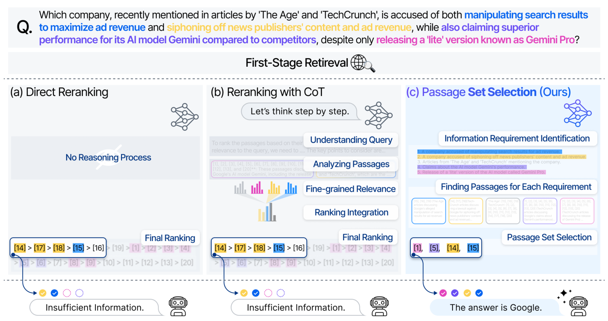
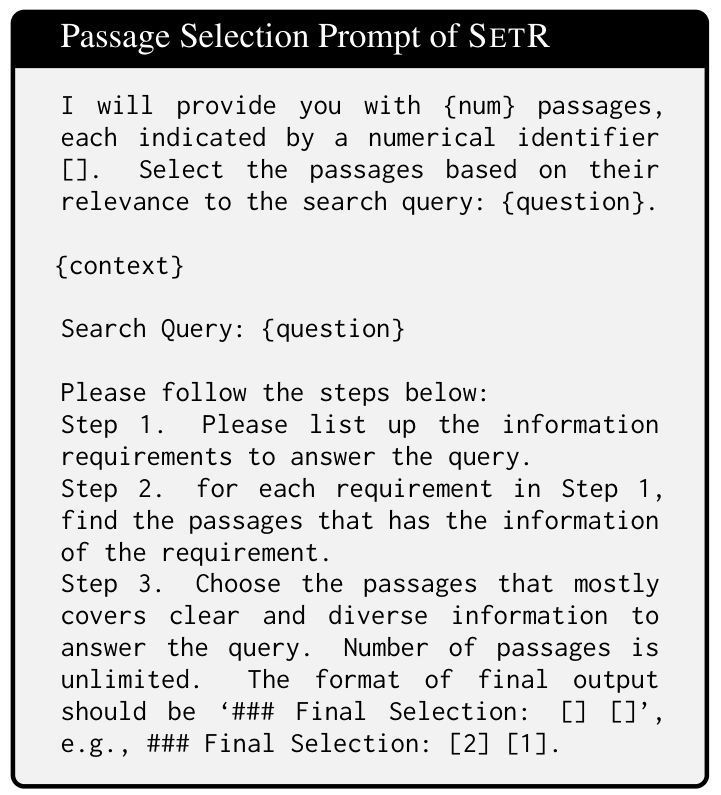
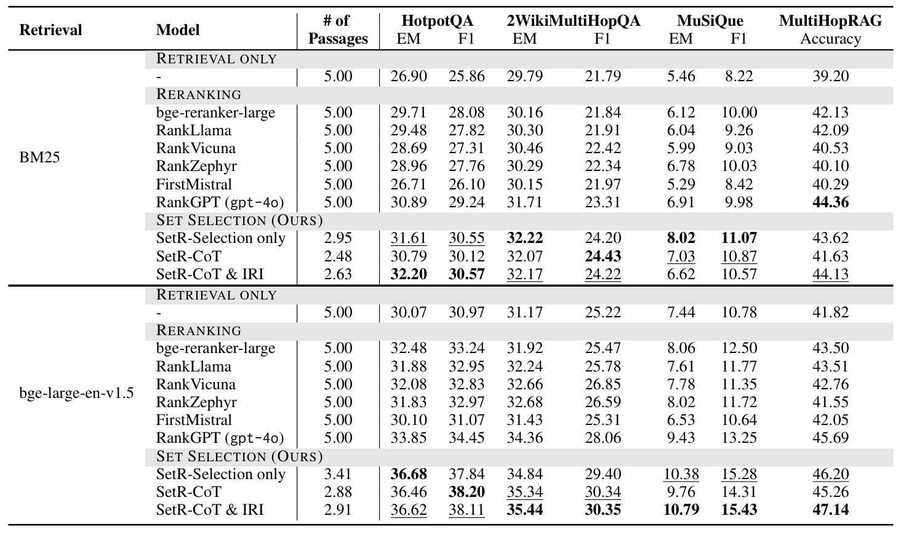
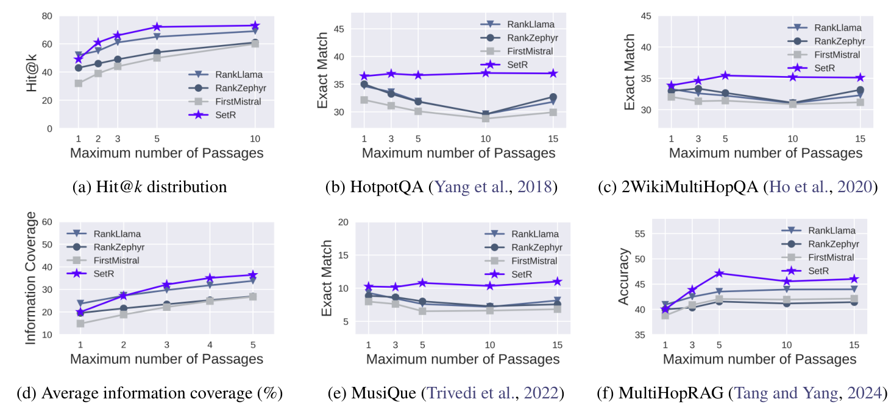

# SETR｜多跳 RAG 应该怎样挑选一组证据

> Dahyun Lee、Yongrae Jo、Haeju Park、Moontae Lee，*Shifting from Ranking to Set Selection for Retrieval Augmented Generation*，ACL 2025，pp. 17606–17619。 [ACL Anthology](https://aclanthology.org/2025.acl-long.861/)

SETR 先列出回答问题所需的信息，再从首轮召回的 20 个段落中挑一组能共同覆盖这些需求的证据。在 BGE 首轮检索设置下，完整模型平均给生成器 **2.91 个段落**，四项任务的主结果总体优于固定取 5 段的 RankGPT。BM25 设置、消融结果和推理成本都给这个结论加上了条件。

## 一、为什么想从重排改成集合选择

传统重排把候选段落排成一列，再截取前 k 个。如果前几段都在说同一件事，即使每段看起来都很相关，组合在一起仍可能漏掉推理所需的另一条线索。多跳问答关心的是，补进下一段后，整组证据能多回答哪一部分。

*原文图 1，p. 17607。颜色对应题目中的不同线索。*

图中的问题要求根据搜索广告争议、新闻内容争议和 Gemini 的产品说法识别公司。前两种方法最后仍提交一条排序，截出的五段没有覆盖所有颜色。SETR 把线索拆开查证，在这道题中选出 4 段，生成器答出 Google。这是一个解释机制的案例，整体效果要看后面的对照实验。

## 二、候选池和蒸馏数据怎样构造

训练使用源自 MS MARCO v1 的约 **4 万个查询**，每题配 20 个已检索候选。教师 GPT-4o 根据问题和候选段落生成选择结果及相应推理，学生 Llama-3.1-8B-Instruct 做监督微调。完整变体学习教师的需求分析和段落选择，无推理变体只学习输出选中的编号。训练 5 个 epoch，有效批量 512，学习率为 $5\times10^{-6}$。（§3.3、附录 A.3）

训练问题来自常见排序数据，测试跨 HotpotQA、2WikiMultiHopQA、MuSiQue 和 MultiHopRAG。前三个基准主要覆盖维基百科多跳问答，MultiHopRAG 使用英文新闻语料，带有可测量的标注证据。训练中的选择是教师标签，测试中的证据覆盖依据数据集标注。

## 三、SETR 实际做什么

*原文图 2，p. 17609。*

1. **识别信息需求（IRI）**。将问题拆成几项必须解决的信息子目标。
2. **为每项需求匹配候选段落**。同一段可以覆盖多项，同一需求也可以有多个候选。
3. **输出段落集合**。根据共同覆盖情况提交段落编号，数量由模型决定。答案仍由下游生成器生成。

模型通过提示和蒸馏学会集合决策，论文没有另外求解一个具有最优性保证的组合优化目标。它仍依赖首轮召回，漏在候选池之外的关键证据无法在这一步补回。Selection only、CoT、CoT & IRI 分别对应直接选、自由推理后选、明确列需求后选。

## 四、各组实验分别说明什么

### 1. 端到端答题与证据数量

*原文表 1，p. 17610。重排与集合选择都处理首轮 Top-20。重排送 5 段，SETR 自选数量。*

| BGE 首轮检索 | 平均段落数 | HotpotQA F1 | 2Wiki F1 | MuSiQue F1 | MultiHopRAG Acc. |
| --- | ---: | ---: | ---: | ---: | ---: |
| 仅检索 | 5.00 | 30.97 | 25.22 | 10.78 | 41.82 |
| RankGPT（GPT-4o） | 5.00 | 34.45 | 28.06 | 13.25 | 45.69 |
| SETR 直接选择 | 3.41 | 37.84 | 29.40 | 15.28 | 46.20 |
| SETR CoT & IRI | 2.91 | 38.11 | 30.35 | 15.43 | 47.14 |

完整 SETR 相对 RankGPT 平均少给 **41.8%** 的段落，四列答题指标各升 1.45–3.66 个百分点。HotpotQA 的 EM 最高值来自直接选择（36.68），F1 最高值来自普通 CoT（38.20）。BM25 设置下，RankGPT 的 MultiHopRAG 准确率为 44.36，仍高于完整 SETR 的 44.13。生成器也因数据集而异，附录 A.3 指明前三项用 Llama-3.1-8B-Instruct，MultiHopRAG 用 GPT-4o。同一任务内的可比性强于跨任务横比。

### 2. 证据覆盖与排序指标

MultiHopRAG 上，完整 SETR 的 Prec@5 / Recall@5 是 **0.2268 / 0.3669**，RankGPT 是 **0.1799 / 0.3601**。与此同时，SETR 的 MRR@10 为 **0.5742**，低于 RankGPT 的 **0.6358**。优先把一篇相关文档排到最前面，与让一组段落覆盖所需证据，是两种可分开的表现。（表 2，p. 17611）

*原文图 3，p. 17612。左侧两图用 MultiHopRAG 的标注证据，其余四图展示问答表现。*

Hit@k 看有没有命中证据。IC@k 用文本匹配找出各段中出现的标注证据片段，去重后计算覆盖比例。看 (a) 与 (d) 时，同一条证据出现两次，对覆盖的贡献只有一次。其余曲线改变的是**允许使用的段落上限**，所以横轴相同也不保证实际段落数相同。

### 3. 集合选择与显式 IRI 的贡献

同用 GPT-4o 当选择器时，直接重排、重排加 CoT 和完整集合选择的 HotpotQA F1 分别为 **34.45、35.26、40.49**。2Wiki 上完整方法的 F1（31.09）略低于直接集合选择（31.14）。统一底座、训练数据来源和教师后，完整 SETR 的 MultiHopRAG 准确率为 **47.14**，重训 RankZephyr 为 **43.90**，加 CoT 的重训版为 **43.60**。（表 3–4，p. 17613）

这些对照表明，收益在相同底座或教师下仍然存在。各方案也同时改变了训练目标、输出格式以及送给生成器的段落数。若要量化 IRI 的独立作用，还需固定最终证据预算。

### 4. 省的是哪一段计算

MultiHopRAG 上，完整 SETR 将生成器输入从 RankZephyr 的 **2,672** token 减至 **1,240**，选择阶段输出从 **80** token 增至 **409**。与带 CoT 的 RankZephyr 比，两个数字都更低（2,665→1,240 和 603→409）。表 5 报告的是这两处 token 数，未直接测端到端延迟或首轮召回成本。（p. 17614）

## 五、结论的适用边界

- **首轮召回设定影响收益。** 论文主要从 Top-20 中选证据。讨论里的百段候选池、迭代改写查询与可扩展性属于后续方向。
- **证据覆盖有标注和匹配边界。** IC 能衡量去重后的标注证据覆盖，但表达不同、意思相同的段落可能被文本匹配漏掉。
- **对照仍存在预算差别。** 可用相同 token 上限比较固定 k、按问题自选 k、显式去重以及按子问题覆盖选段，检验改进有多少来自证据互补。

## 六、R&Q

1. **什么时候该再搜一次？** 若 IRI 列出了三个需求而候选池只覆盖两项，可测试针对缺失需求二次检索的收益和成本。
2. **多条段落能否共同完成推理？** 除逐项覆盖率外，可测整条证据链的完整率，并检查关系、实体与时间是否连得上。
3. **能否迁移到个人记忆？** 可把段落替换成带时间和出处的历史会话，在相同 token 预算下检验互补选择能否找到变化轨迹中的关键证据。
