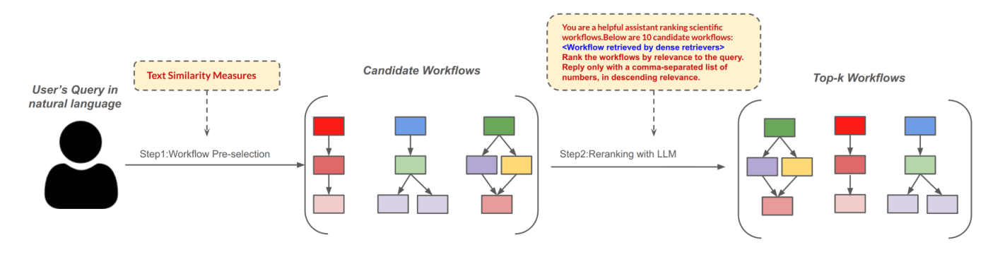
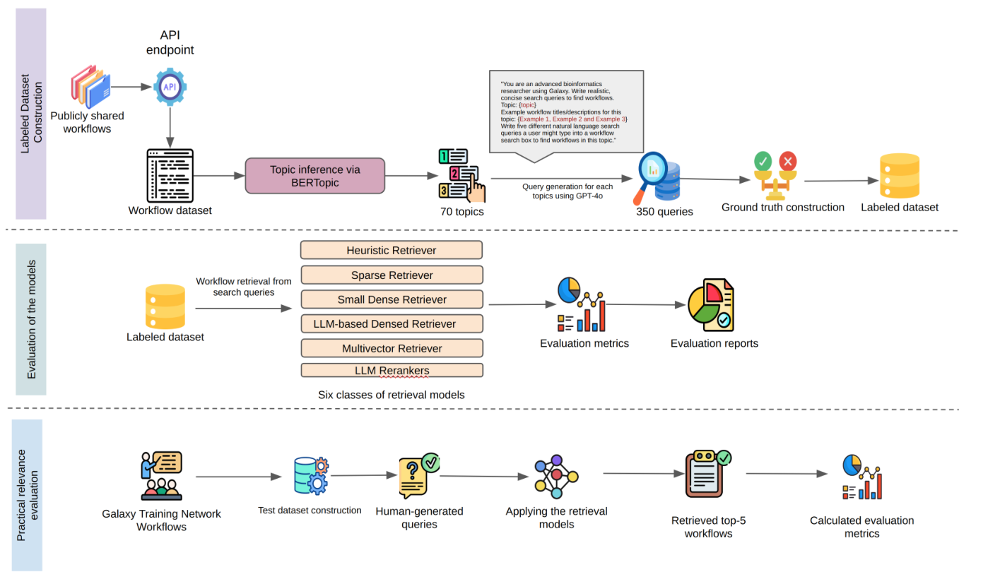
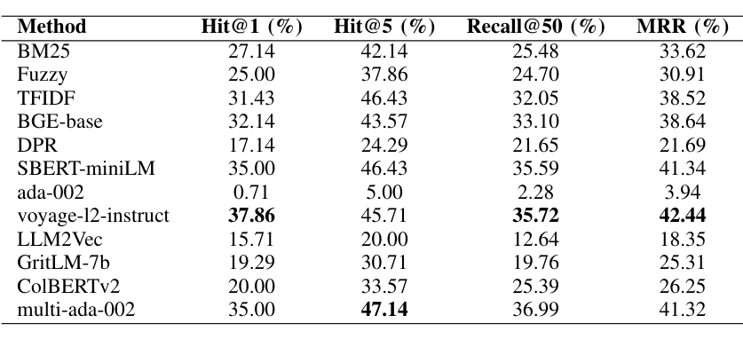
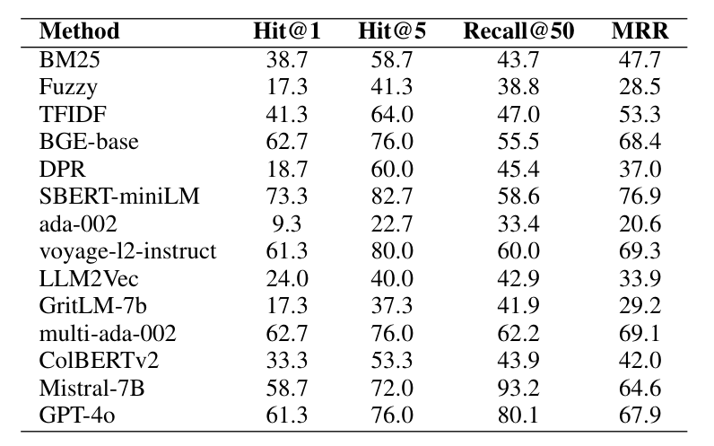

# WorkflowExplorer｜从自然语言任务检索 Galaxy 工作流

> Shamse Tasnim Cynthia、Banani Roy，*Towards LLM-Powered Task-Aware Retrieval of Scientific Workflows for Galaxy*，arXiv:2511.01757v1。页码按所附 10 页 PDF 计。

WorkflowExplorer 让用户用自然语言描述想完成的分析任务，先用向量检索找候选工作流，再让 LLM 比较候选与任务需求是否匹配。论文同时构造了两套检索评测，并将流程做成 Galaxy 原型。实验表中，首位命中、前 50 条召回和延迟分别由不同方法占优。尤其是重排带来的 Recall@50 增益，需要结合候选池的定义才能解释。

## 一、为什么要按任务找工作流

Galaxy 的公开工作流可以复用，但标题、描述和工具名的写法并不统一。用户往往知道分析目标，却未必知道原作者的术语。关键词检索容易漏掉同义描述，也可能给出主题接近、输入要求却不匹配的工作流。

*原文图 1，PDF 第 2 页。流程的输出是排序后的工作流候选。*

这里的检索单位是一条**已有工作流**。论文测量的是检索排序对标注任务的匹配程度。原型显示推荐的名称、描述和工作流文件入口，是否能直接用于用户的数据还取决于输入类型、依赖和版本等约束。

## 二、两套评测数据怎样构造

*原文图 2，PDF 第 3 页。上部展示公开库的主题聚类与标注，中部比较检索方法，下部是教学工作流评测。*

| 数据 | 来源与查询 | 相关工作流怎样确定 |
| --- | --- | --- |
| 公开工作流 | 从 Galaxy 抽取 ID、标题、描述和工具名，用 BERTopic 得到 70 个主题。每主题提示 GPT-4o 生成 5 条查询，原图标为 350 条 | 以提示里的示例工作流为种子，再添加同主题、达到文本或工具相似度阈值的条目 |
| Galaxy Training Network 教学工作流 | 从 27 个主题收集 463 条工作流。选 25 个非管理类主题，每个主题用 GPT-4o 写 3 条查询，论文报告 75 条，并由领域专家复核 | 以教程提供的工作流和预期主题为参照，检查生成查询是否与任务一致 |

公开库的同一批元数据参与了查询生成和相关标签构造。作者借此获得可自动扩展的评测，但标注可能偏爱题面与描述接近的条目，也可能漏掉跨主题的有效工作流。教学集的原始工作流经官方整理，查询仍是生成后复核。两套数据同时改变了工作流集合、查询和标签规则，分差不能直接归因于元数据清洁度。（§IV）

## 三、检索与重排分别做什么

**第一阶段召回候选。** 将查询和工作流的标题、描述等文本编码为向量，用相似度选前 k 条，论文称通常取 50 条。作者比较了 TF-IDF、BM25、模糊匹配、单向量与多向量等召回方法。元数据包括工具名和工作流文件，但实验主要说明文本表示的作用，缺少执行图结构与文本表示之间的独立对照。

**第二阶段比较任务匹配。** 把原问题和候选描述交给 GPT-4o 或 Mistral-7B-Instruct，由模型给出相关性分数或重排。这个阶段可以将排得较后的候选提到前面。若它只重排固定的 50 条，前 50 条包含的条目不会因换序增加。

原型部分写明采用 Voyage 向量召回和本地 Mistral 重排。方法章节描述的重排对照则把 multi-ada-002 作为首轮输入。读表时应区分所测配置与原型部署。（§III、§IV.E、§VI）

## 四、各组实验分别说明什么

### 1. 公开工作流上，哪种召回更强

*原文表 I，PDF 第 6 页。数值为百分比。*

| 方法 | Hit@1 | Hit@5 | Recall@50 | MRR |
| --- | ---: | ---: | ---: | ---: |
| TF-IDF | 31.43 | 46.43 | 32.05 | 38.52 |
| SBERT-miniLM | 35.00 | 46.43 | 35.59 | 41.34 |
| voyage-l2-instruct | **37.86** | 45.71 | 35.72 | **42.44** |
| multi-ada-002 | 35.00 | **47.14** | **36.99** | 41.32 |

Hit@1 看第一条是否相关，Hit@5 看前五条里是否至少有一条相关。Recall@50 看相关集合被前 50 条覆盖多少，MRR 则看第一条相关结果排得多靠前。**Voyage 在首位和 MRR 领先，multi-ada-002 在前五命中和前 50 条覆盖领先。** SBERT-miniLM 的 MRR 和 Voyage 只差 1.10 个百分点。表 I 也显示，换成任意一种向量模型未必胜过词项检索，例如原版 ada-002 的 MRR 为 3.94。

### 2. 教学工作流上，首位排序和覆盖率给出不同结论

*原文表 II，PDF 第 6 页。先分开看 Hit@1、MRR 和 Recall@50。*

SBERT-miniLM 的 **Hit@1 为 73.3、Hit@5 为 82.7、MRR 为 76.9**，三项都高于表中两个 LLM 重排行。Mistral-7B 的 Recall@50 为 **93.2**，GPT-4o 为 **80.1**，都高于表中的首轮检索方法。若重排确实只作用于同一个恰含 50 个条目的候选集，Recall@50 理论上不变。要把表中差值归因于重排，需要明确候选是否超过 50、首轮配置是否一致，以及各行是否使用相同的去重和计分口径。

因此，表 II 支持不同方法在排序和覆盖上各有优势。更直接的重排检验应该固定查询、候选及金标准，看同一列表重排前后的 Hit@1、MRR 和前几个位置发生了什么变化。

### 3. 案例、原型和延迟各说明什么

论文的单个论坛案例展示了首轮候选中既有泛相关结果，也有更贴近多约束任务的条目。重排后的前五条更集中在实际任务需求周围，但仍有部分匹配。这个例子说明可以怎样检查排序变化，平均效果需由固定候选的配对实验支持。（表 III–IV）

表 V 在 **5 条代表性查询**上计时。TF-IDF 与 BM25 约 **0.5 ms**，SBERT-miniLM **2.2 ms**，Voyage **0.32 s**，GPT-4o 重排 **1.0095 s**，本地 Mistral-7B 重排 **18.59 s**。这些是论文配置下的阶段耗时。两种重排器分别经过远程 API 和本地推理，也没有给出生产流量下的尾延迟，适合用作当时原型的成本参照。（§V.D）

## 五、结论的适用边界

- **相关性和可执行性是不同的评测目标。** 文本匹配可能找出主题正确、但输入、依赖或版本不合适的流程。实际复用还需要独立检查这些约束。
- **合成查询和相关标签有共同来源。** 公开库上，示例工作流既帮助生成问题，又进入相关标签。更独立的验证可以用真实用户查询，并让专家在不看生成种子的情况下标注。
- **单阶段与重排比较需要同一候选池。** 公开集表 I 只列首轮结果。教学集表 II 同时列出重排，但 Recall@50 对照需要澄清候选规模和排序前后的条目一致性。
- **个案和原型提供可行性证据。** 论文展示系统可在本地 Galaxy 中使用。真实用户找到并成功复用工作流的时间与成功率仍需评估。

## 六、R&Q

1. **文本与结构各贡献多少？** 固定查询与评测标签，比较标题描述、工具列表和工作流结构信息对消歧的增量。
2. **什么时候值得重排？** 在相同候选池上按简单查询、含多重约束的查询分组，报告首位命中增益与额外延迟。
3. **怎样测实际复用？** 增加输入兼容性、依赖可用性和版本约束的人工判断，并记录用户能否从结果中选到可用条目。
