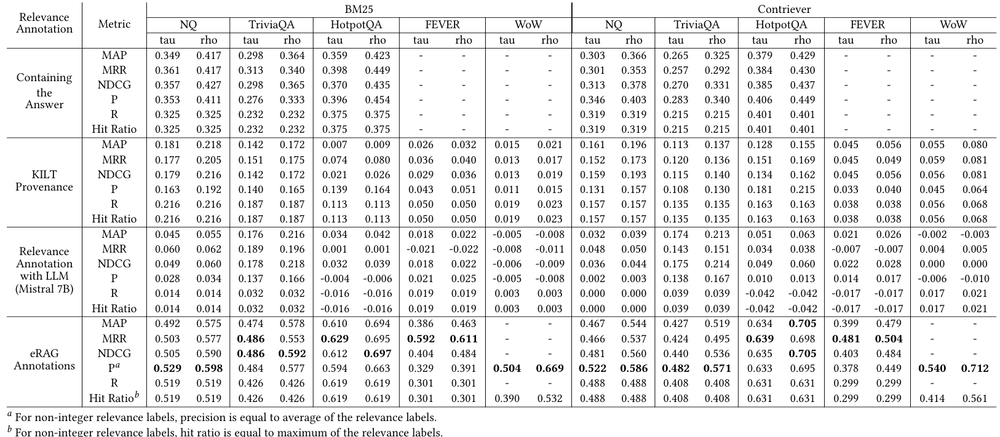
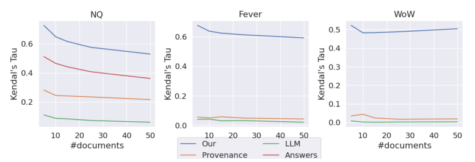
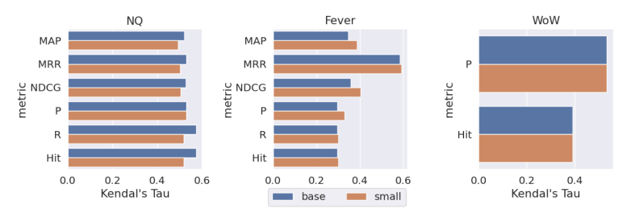
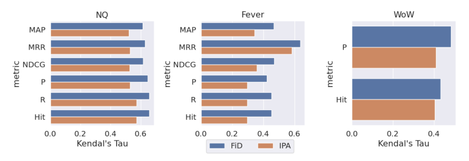

# eRAG｜用下游任务表现给检索文档打分

> Alireza Salemi、Hamed Zamani，*Evaluating Retrieval Quality in Retrieval-Augmented Generation*，SIGIR 2024，pp. 2395–2400。页码按所附 PDF 计。 [论文 DOI](https://doi.org/10.1145/3626772.3657957)

eRAG 把每篇候选文档单独交给同一 RAG 流程里的生成器，并用它得到的任务分数给文档打标签。在 KILT 的五项任务中，这种标签聚合出的检索分数与端到端分数更一致。它适合低成本地筛查检索方案，跨文档互补仍要靠端到端实验验证。

## 一、为什么要换一种相关性标签

KILT 原始来源标注告诉我们哪些文章支持参考答案。把文章切成段落后，若继承整篇文章的正例标签，没提供答案的段落也可能被标成相关。直接查答案字符串也有局限，文档可能给出了推理依据，却没有出现目标标签。FEVER 的分类标签和 WoW 的长文本回应就是典型例子。（§1–2）

端到端评测可以直接回答系统表现如何，但一次运行只给整张检索列表的结果。eRAG 为每个「查询—段落」建立可复用的分数，同一生成器和评分口径下，换排序或替换部分文档时可复用已有分数。

## 二、评测数据与对照怎么设置

作者使用 KILT 公共验证集，语料是切成最多 100 词的维基百科段落，给每段加文章标题。任务包括 NQ、TriviaQA、HotpotQA（Exact Match）、FEVER（分类 Accuracy）和 Wizard of Wikipedia，简称 WoW（F1）。主实验用分别由 BM25 和 Contriever 检索的 50 段列表，生成器默认为 T5-small + FiD。（§3.1）

比较的四种标签为 KILT 来源标注、答案字符串命中、Mistral-7B 给的二元相关性标签和 eRAG。答案字符串方法仅在前三个 QA 数据集上报告。主结果针对同一检索器、同一任务下各查询的评测分数与端到端表现，分别给出 Kendall τ 和 Spearman ρ。

## 三、eRAG 怎样给文档打标签

给定查询 $q$、候选段落 $d$、参考输出 $y$，用同一 RAG 生成器 $M$ 只读取这一段，再按任务指标 $E_M$ 打分。

$$
G_q(d)=E_M\bigl(M(q,\{d\}),y\bigr)
$$

例如在 FEVER 中，一段文本单独交给生成器后能否输出正确分类，就是该段的标签。WoW 则用生成回复与参考回复的 F1 得到连续分值。随后用 MAP、MRR、NDCG、Precision、Recall 或 Hit Ratio 等方式聚合。WoW 在本文只报告可直接处理连续标签的 Precision（均值）和 Hit Ratio（最大值）。因此，分数同时取决于任务、生成器、提示和参考答案。

## 四、各组实验分别说明什么

### 1. 哪类标签与端到端表现更一致

*原文表 1，PDF 第 3 页。每个数据集和检索器单列 τ、ρ。*

| BM25，检索 50 段 | NQ τ | TriviaQA τ | HotpotQA τ |
| --- | ---: | ---: | ---: |
| 答案字符串命中，各任务最佳指标 | 0.361 | 0.313 | 0.398 |
| KILT 来源标注，各任务最佳指标 | 0.216 | 0.187 | 0.139 |
| eRAG，各任务最佳指标 | **0.529** | **0.486** | **0.629** |

以 NQ 为例，答案命中标签的 MRR 与端到端结果的 τ 为 **0.361**，eRAG 的 Precision 达 **0.529**。这意味着排序一致性更高，0.168 是相关系数的绝对差值。表中对比的是各方法可选聚合指标中的最佳值，复用到新数据时，应先在验证集选定聚合方式。Mistral 基线测的是提示下的二元相关判断，结论针对所用模型与配置。

### 2. 文档数量和生成器怎么影响相关性

*原文图 1，PDF 第 3 页。BM25、T5-small + FiD。*

NQ、FEVER、WoW 的曲线里，eRAG 在所测的各文档数量下均领先。随文档变多，NQ 与 FEVER 的相关性下降，WoW 则在初降后略回升。作者认为，多段输入里的互补或干扰变得更常见，而 eRAG 标签是逐段独立得到的。曲线本身没有把互补与噪声的作用分别测出来。

*原文图 2，PDF 第 4 页。比较 60M 与 220M 的 T5 + FiD。*

*原文图 3，PDF 第 4 页。T5-small 读取 BM25 的 10 段。*

两档 T5 大小之间没有稳定的相关性优势。FiD 先分段编码，再在解码阶段融合各段表示。IPA 直接把多段拼进输入。原文报告 FiD 相关性整体略高，但差异不显著。这两图的模型与融合方式范围有限。

### 3. 评测成本怎么读

| 数据集（原文表 2 节选） | 端到端耗时 | eRAG 耗时 | 端到端显存 | eRAG 按查询批处理 | eRAG 单文档 |
| --- | ---: | ---: | ---: | ---: | ---: |
| NQ | 918 s | 351 s | 75.0 GB | 4.9 GB | 1.5 GB |
| HotpotQA | 1,844 s | 712 s | 52.4 GB | 5.5 GB | 1.5 GB |
| WoW | 912 s | 740 s | 47.9 GB | 6.5 GB | 1.5 GB |

原文在 T5-small + FiD、50 段和各自尽量大的推理批量下，报告五项任务的平均评测加速约 **2.47 倍**。NQ 的 50 倍显存比来自 **75.0 / 1.5**，对应单文档配置。若一次处理一个查询的整批文档，应看 4.9 GB 那一列。长回复要为每段分别解码，WoW 的实测加速约 **1.23 倍**。（表 2，PDF 第 4 页）

## 五、结论的适用边界

- **衡量的是单段可用性。** 多跳证据各自单读可能都答不出题，合起来才完整。反过来，一段文档取得高分也可能是生成器靠参数知识答对。原公式没有扣除无文档条件的成绩。
- **相关性指标是筛选依据。** 高 τ/ρ 表明在所测设置下更接近端到端分数。要证明按 eRAG 训练或选择的检索器会改善最终任务，还需实际运行并对比整个系统。
- **缓存依赖评分条件。** 更换生成器、提示、任务目标或参考答案后，应重新验证每段分数能否沿用。重复段落互相干扰、不同段落补足线索等现象仍需集合层面测试。

## 六、R&Q

1. **要不要扣除闭卷得分？** 可评估加入段落前后的准确率或参考答案似然增量，检查是否减少参数知识对文档评分的影响。
2. **如何捕获跨段互补？** 可选择高潜力段落对再做小规模联合测试，看它们能否比最高单段分数多解释一部分端到端结果。
3. **如何评估新检索策略？** 可用 eRAG 快筛候选，同时在固定生成器与输入预算下复测若干有代表性的完整检索结果。
