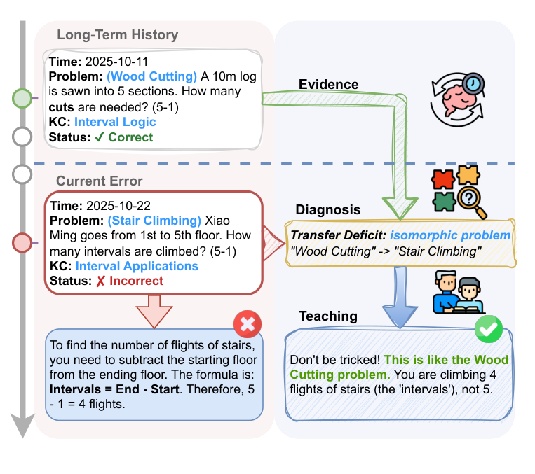
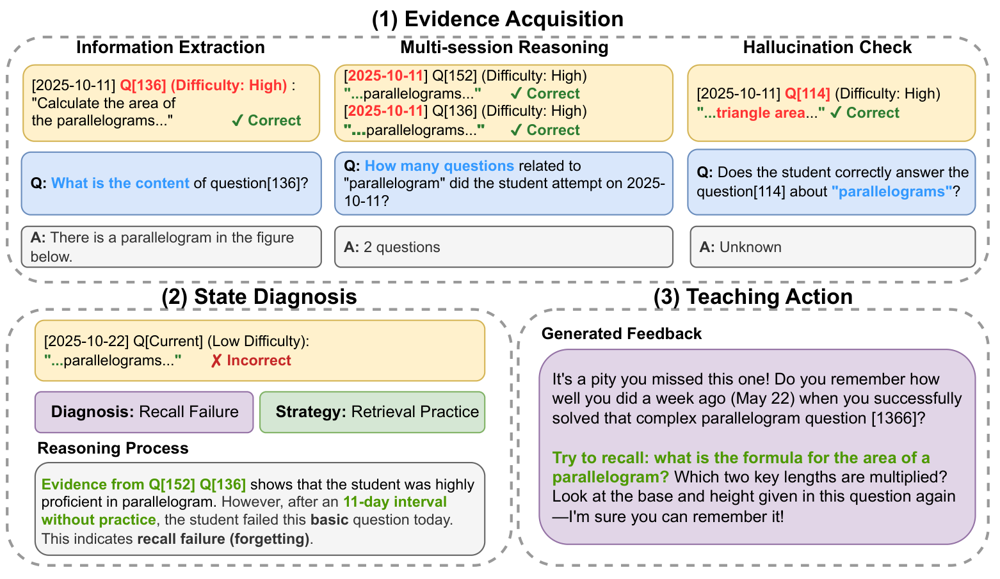
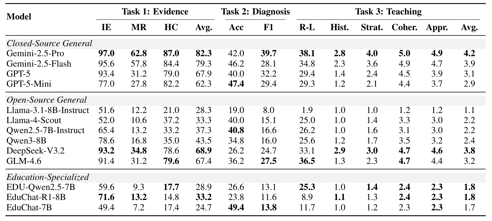
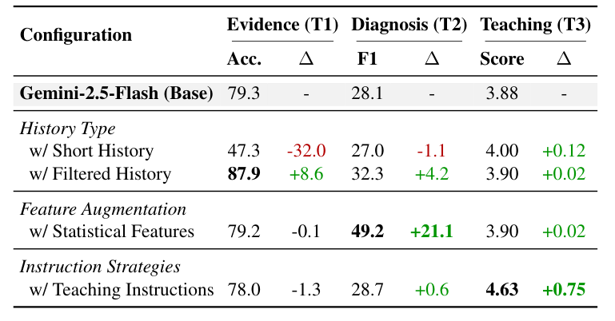
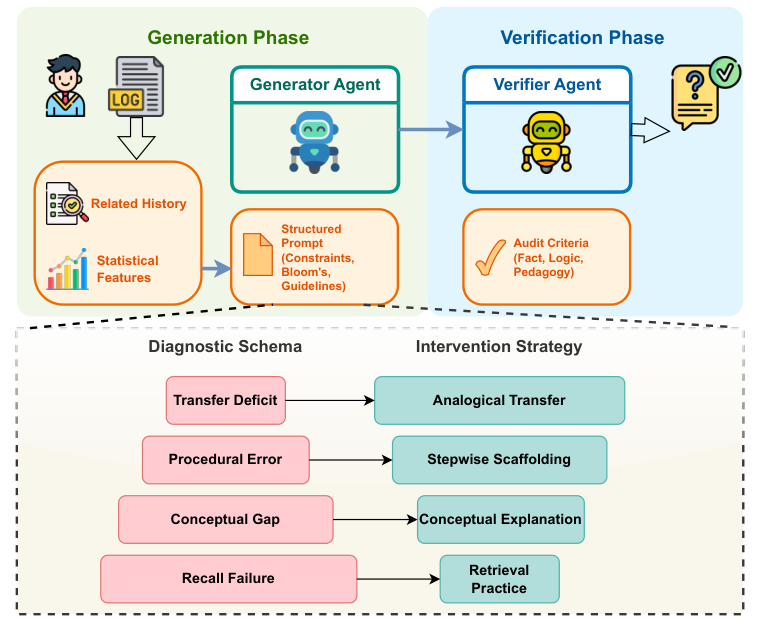

# LongTutor：从学习历史到知识诊断，再到个性化教学

> 论文：Ning Li 等，*LongTutor: Benchmarking Large Language Models for Long-term Personalized Tutoring*，ACL 2026 Long Papers，论文页码 29712–29737。以下「第几页」指所附 26 页 PDF。 
> 结构参考前次的 [ENPMR-Bench 精读模板](https://mr-iodin.github.io/my_wiki/2026/ENPMR-Bench%20%E6%96%87%E7%8C%AE%E9%98%85%E8%AF%BB/)。

**一句话概括。** LongTutor 用真实学生做题日志，加上专家标注的认知错误类型和教学建议，检验 AI 家教能否完成 **找历史证据 → 判断为什么错 → 据此选择教学行动** 的连续过程。

**先给判断。** 论文的价值在于把长期教育记忆从「能否回忆」推进到「能否诊断并教」。主要结果显示，模型查到单条历史较容易，跨多次练习推理、区分认知状态和用历史制定教学回应仍困难。最值得注意的实验启示是：预先筛出相关历史、显式计算学习统计特征，对诊断的帮助可能大于只加长上下文。不过，这些增强条件使用了额外结构化信息；静态教学评分和模拟学生成功率也不能直接等同于真实学习效果。

## 一、为什么需要长期个性化教学基准

同一道题答错，原因可能不同。学生刚学一个概念，可能是**概念不理解**；以前会做但今天忘了，可能是**提取失败**；掌握了相关知识却认不出新题的同构关系，可能是**迁移不足**。如果只看当前这一次作答，AI 家教很难决定该讲定义、带着做步骤、练习回忆，还是引用学生过去成功的相似题。（第 1–2 页）

图 1 用「切木头」和「爬楼梯」说明：学生 11 天前会用「五段只有四个间隔」解切木头题，今天却把楼层数当成爬过的楼梯段数。好的教学回应应找回以前的成功经验，指出两题共享「数间隔」结构，再引导学生自行迁移；单纯给当前题公式，缺少长期个性化。（第 1 页）

*图 1｜把曾经做对的切木头题用于爬楼梯题。原文 PDF 第 1 页。从历史成功推断学生已经掌握间隔概念，再用类比提示迁移。*

作者据形成性评价思想，把能力分成三层：

*图 2｜证据获取、状态诊断和教学行动。原文 PDF 第 4 页。上半部分展示三类证据题，下半部分展示如何从证据到诊断再到反馈。*

| 层次 | 测什么 | 关键区别 |
| --- | --- | --- |
| Evidence Acquisition | 从学生历史提取事实、跨记录计数、识别不存在的线索 | 事实有没有找准 |
| State Diagnosis | 从历史与当前错误推断认知状态 | 为什么会错 |
| Teaching Action | 依据诊断和历史生成恰当的教学回应 | 下一步怎么教 |

这个顺序有意义：历史找错会让诊断失准；诊断失准会让教学策略偏离。论文也用单独实验检验了后一段依赖关系。（第 2、4、7 页）

## 二、数据从哪里来，专家怎样标

LongTutor 的金标准来自 XES3G5M 的真实小学数学作答日志，历史记录包含题文、知识点、时间戳、对错标签。作者先筛选长度 **超过 200 条记录**、跨度 **超过 7 天**的学习序列，得到 3,437 条，再随机选 1,000 条做专家标注。两位教育领域专家独立标注每例的证据问答、诊断类别和教学行动；第三位资深专家裁决分歧。两位主标注者在**诊断类别**上的 Cohen’s $\kappa=0.90$。这个一致性数字针对诊断标签，不能扩展成证据与自然语言教学回复的全部一致性。（第 5 页；附录 E）

论文还构造银标准：对 XES3G5M 剩余 **2,437 条**序列用生成器—核验器标注，并将流程迁移至大学 MOOC 数据 MoocRadar，生成 **729 条**。合计 **4,166 条学习序列**，其中人工金标准 1,000 条、模型合成 3,166 条。主模型结果基于人工金标准；银标准用于扩展与一致性验证。（附录表 5，第 13 页）

**一个决定评测含义的细节：** 虽然入选学生序列超过 200 条，模型主实验的输入是**最近 100 条练习记录**，不是全部历史。每条输入带问题文本、知识点、时间和对错，再附当前答错的题；模型按统一 JSON 格式输出证据、诊断、理由、策略和教学回复。核心提示始终提供四类诊断的定义及对应策略。（附录 H、图 7，第 15、25 页）所以结果测的是「在一个较长、结构化的近期历史窗口中推理」，不等于无限长记忆系统的端到端能力。

### 四类诊断与对应策略

| 诊断标签 | 作者的定义 | 预设教学策略 |
| --- | --- | --- |
| Recall Failure：回忆失败 | 以前掌握，今天未能提取基本事实或术语 | 回忆练习 |
| Conceptual Gap：概念缺口 | 对概念关系有根本性误解 | 概念解释 |
| Procedural Error：步骤错误 | 理解概念，但在算法、技术或计算步骤上失误 | 分步支架 |
| Transfer Deficit：迁移不足 | 会在旧情境中使用知识，不会在新题中识别何时应用 | 类比迁移 |

作者把这四类映射到修订版布鲁姆分类的知识维度。它是一套**可操作的标注框架**，不是经独立心理测量证实的唯一认知分类；一名学生也可能同时存在多种原因，但任务要求选**一个**标签。（附录表 6，第 13 页）

金标准类别并不均匀：步骤错误 **50.6%**、回忆失败 **21.2%**、概念缺口 **18.0%**、迁移不足 **10.2%**。因此主要看 Macro-F1 比只看准确率更合理。正文图 3 的图注写「步骤错误和迁移不足占主导」，但图中的迁移不足恰恰最少；以下采用图表数值。（第 6 页）

## 三、怎么评分，实验是否把三层区分开

**证据任务**分为信息提取 IE、跨记录推理 MR、幻觉检查 HC。使用语义准确率：先允许非逐字的等价答案，再由模型判断与标准答案是否一致。**诊断任务**报告四类准确率与 Macro-F1。**教学任务**报告 ROUGE-L 作辅助，重点由 Gemini-3-Flash 依据具体样本与参考答案，在历史使用、策略匹配、连贯性、合适性四项上各打 1–5 分，取平均。（第 5–6、24 页）

论文比较闭源通用模型、开源通用模型和教育专用模型，在统一零样本提示下运行。这里「零样本」表示没有给该模型示例；提示中仍有完整的标签定义、策略映射和 JSON 输出要求。（附录 H、图 7）教学分反映**该 rubric 和模型裁判的判断**，不是学生最终学会多少。

## 四、实验分别证明什么

### 1. 主结果：取单条证据容易，跨历史推理与诊断难

*表 2｜LongTutor 金标准测试集主结果。原文 PDF 第 6 页。把信息提取 IE 与跨记录推理 MR 对照阅读，再看诊断 Macro-F1 和教学历史利用分。*

| 模型 | IE | MR | HC | 诊断 Macro-F1 | 教学平均（1–5） |
| --- | ---: | ---: | ---: | ---: | ---: |
| Gemini-2.5-Pro | **97.0%** | **62.8%** | 87.0% | **39.7%** | **4.2** |
| Gemini-2.5-Flash | 95.6% | 57.8% | 84.4% | 28.1% | 3.9 |
| GPT-5 | 93.4% | 31.2% | 79.0% | 32.2% | 3.1 |
| DeepSeek-V3.2 | 93.2% | 34.8% | 78.6% | 24.7% | 3.8 |
| Qwen3-8B | 78.6% | 16.8% | 35.0% | 16.0% | 2.4 |
| EduChat-7B | 49.4% | 7.2% | 17.4% | 13.8% | 1.7 |

表 2（第 6 页）最直观的差距是 IE 与 MR：Gemini-2.5-Pro 从 97.0% 降到 62.8%；Qwen3-8B 从 78.6% 降到 16.8%。说明找出局部历史细节与综合多次练习并非同一能力。诊断最好的 Macro-F1 也不足 40%，明显低于历史信息提取。

教学分还要看子项。Gemini-2.5-Pro 的连贯性／合适性为 5.0／4.9，但历史利用只有 2.8；GPT-5 的历史利用为 1.4。好听、通顺的反馈不一定真正用了学生的过去。（表 2）

一些教育专用模型落后同源通用底座。文中举例 EDU-Qwen2.5-7B 与 Qwen2.5-7B 的证据平均分为 **28.9 vs. 37.3**、教学平均分 **1.8 vs. 2.2**。这提示教育微调可能损失长历史使用能力，但它是具体模型间比较；训练数据、指令和模型版本也可能不同，不能泛化成「教育微调必然有害」。（第 7 页）

### 2. 历史怎么给，影响哪个环节

*表 3｜历史窗口、统计特征和教学指令的敏感性分析。原文 PDF 第 7 页。缩短历史、筛选知识点、增加统计特征和增加教学指令分别影响不同阶段。*

Gemini-2.5-Flash 的敏感性实验（表 3，第 7–8 页）：

| 输入设置 | 证据平均 | 诊断 Macro-F1 | 教学平均 |
| --- | ---: | ---: | ---: |
| 最近 100 条历史（基准） | 79.3% | 28.1% | 3.88 |
| 仅最近 20 条 | 47.3% | 27.0% | 4.00 |
| 按相同知识点筛选历史 | **87.9%** | 32.3% | 3.90 |
| 加显式学习统计特征 | 79.2% | **49.2%** | 3.90 |
| 加详细教学指令 | 78.0% | 28.7% | **4.63** |

**怎么读：** 截短历史明显伤害证据获取，但教学评分略升，说明长历史也可能给生成阶段带来噪声；知识点过滤同时提高证据和诊断；统计特征使诊断 Macro-F1 增加 **21.1 个百分点**；详细教学指令提高教学评分 **0.75**。这四个变体改变的东西不同，不要把它们当成互斥的单一最终系统。

尤其需要留意：按知识点过滤要知道当前题的知识点；统计特征由完整历史预先计算，包括相关概念正确率、最近表现等。它们给模型提供了额外整理过的信息，并不证明模型单凭原始日志已会自动推断这些特征。（附录 J，第 17–18 页）

论文还比较了语义 Top-20 RAG 与 100 条完整窗口：证据 **74.2% vs. 79.3%**，诊断 **21.4 vs. 28.1 Macro-F1**，教学 **3.3 vs. 3.9**。这说明简单语义相似检索会丢掉时间连续性或错误轨迹；但只比较了一个 Top-20 方案，不能推断所有检索记忆系统都不如完整历史。（附录表 11，第 17 页）

### 3. 诊断与教学是否真的有依赖

把标准诊断替换成模型预测诊断，教学分从 **4.6 降到 3.9**；各模型诊断 Macro-F1 与教学分的 Spearman 相关为 **0.88**。这支持「诊断准确性影响教学」的任务链设计，但相关性并非严格的因果证明，也可能含模型总体能力差异。（第 7 页；附录表 10）

作者用 100 条分层抽样的教学回复比较模型裁判与教育专家，教学总分 Spearman $\rho=0.87$、**92% 在 ±1 分内**。另用固定 GPT-5 模拟学生，在最多三轮里测答对当前题的比例；五个模型的静态教学分与模拟成功率排名相关为 $\rho=0.90$。这为静态评分提供辅助验证，但模拟学生事先被注入标准诊断，且只有五个模型；它不是对真实学生学习增益的测量。（附录表 8–9，第 16 页）

### 4. 自动扩展的数据可靠吗

*图 4｜学习诊断数据的生成与核验流程。原文 PDF 第 8 页。生成器用相关历史和统计特征草拟标签，核验器审核事实、逻辑和教学策略。*

生成器先看**相关知识点筛选的历史和统计特征**，提出诊断与教学回复；核验器再对照原历史检查事实、诊断逻辑和教学有效性。最佳组合 GPT-5 生成、Gemini-3-Flash 核验，在 100 条人工金标准样本上的诊断标签一致性为 **$\kappa=0.81$、准确率 87%**；GPT-5 单独生成是 $\kappa=0.61$、准确率 74%。（第 8 页；附录表 12）

扩展出的 2,437 条 XES 银标准上，作者比较五个模型与金标准的排名：证据和教学的 Spearman 相关均为 **1.00**，诊断为 **0.90**。这表明银标准能较好复现这五个模型的相对顺序；但样本模型仅五个，完美排名相关不能证明每个自动标签都正确，也不能保证对新模型或新学科仍一致。（第 9 页；附录表 13）

## 五、结论应保留的边界

1. **长历史的定义有两个层次。** 数据筛选要求序列超过 200 条，主模型实际只见最近 100 条。对更早证据的真实长期检索能力还需另测。（第 5、15 页）
2. **真实日志加上了专家解释。** 做题对错、时间戳和题目是真实数据；「为什么错」及推荐教学策略是专家基于有限记录推断的标签。相同错误可能有多种合理诊断，四选一分类简化了学生状态。
3. **类别不平衡与语言／格式影响分数。** 步骤错误占约一半，弱模型可能靠多数类提高准确率，故看 Macro-F1；统一 JSON 和长中文教学历史也可能使部分英语中心模型失分。（第 6、15–17 页）
4. **教学动作受预设映射约束。** 四类诊断各有固定目标策略，模型裁判也参考标准教学答案。因此评分很适合检查「是否按照这套教育框架回应」，却不覆盖教师可能采用的所有合理策略。（附录表 6、图 6）
5. **模拟成功率不是现实成效。** 固定 GPT-5 学生模拟器已知道标准认知状态；真实学生的理解、情绪、长期保持和迁移尚未验证。

## 六、R&Q：接下来可以研究什么

**RQ1｜能否让诊断直接利用学生的时间轨迹？** 将相关知识点正确率、遗忘间隔、难度变化显式建模，比较纯文本、统计特征和可解释状态追踪，而不只依赖长提示。

**RQ2｜什么检索能保留「学习过程」？** 比较按知识点、时间邻域、错误模式和先修关系组合检索，并固定 token 预算，检验是否优于完整 100 条窗口。

**RQ3｜多诊断并存时怎样教？** 允许模型提出带置信度的多个假设，再用澄清题或追问缩小范围，避免把复杂学生状态硬塞进四个互斥标签。

**RQ4｜教学分高是否让学生长期学会？** 在教师监督下做真实学生后测与延迟测，并记录误诊、学生负担、迁移题表现和个体差异。

**最终收获。** LongTutor 最重要的贡献是提出一个可核对的研究链：**历史证据 → 认知状态 → 教学行动**。它也提醒我们，教育记忆系统的目标不只是找到类似旧题，更要从一段学习轨迹中判断学生现在需要什么，并检验指导是否真正改善学习。
