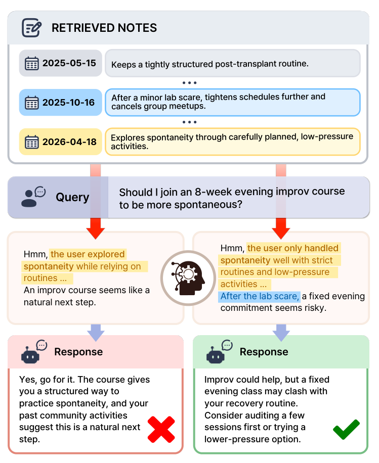
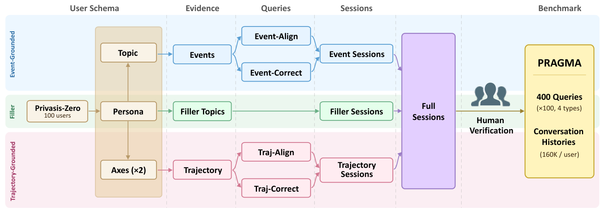
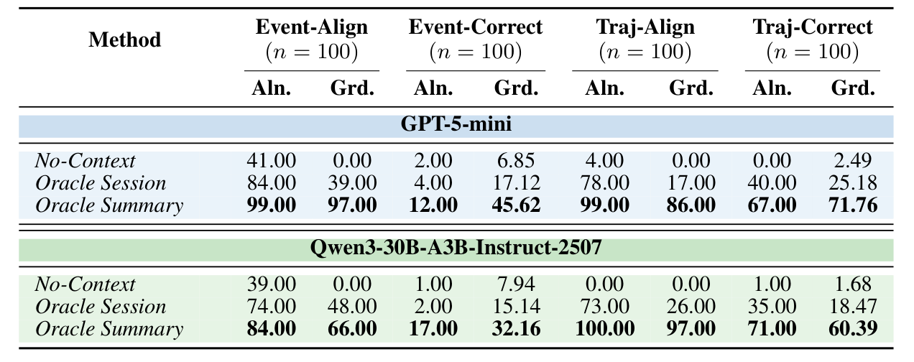
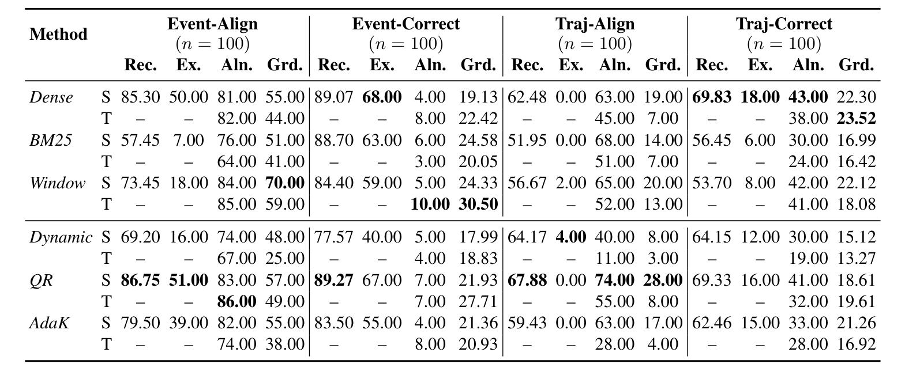
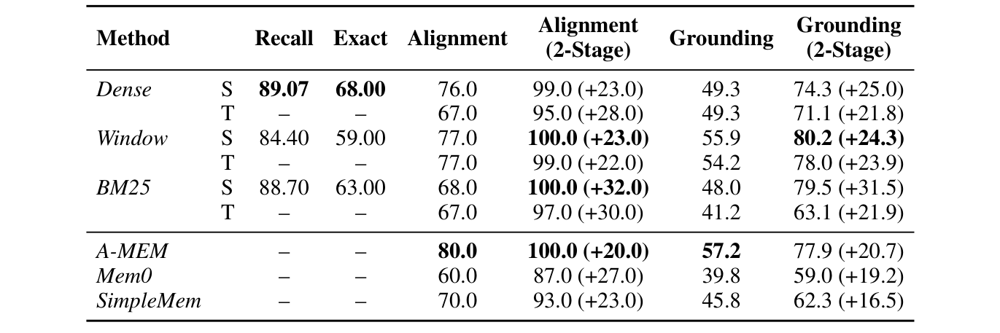

# PRAGMA：长期对话中，记忆能否支撑个性化建议

> 论文：Hyojeong Yu 等，*PRAGMA: Evaluating Personalized Guidance with Memory Alignment in Lifelong Conversations*，EMNLP 2026，论文页码 59750–59775。

`# EMNLP 2026`

**概括：** PRAGMA 不只问模型「想起了什么」，还问它能否把跨越数月的个人经历和变化趋势用于当下建议，尤其能否温和地纠正用户与历史不符的前提。

这是一个有针对性的**评测基准**，不是新的记忆模型。最有价值的发现是：检索到标注证据并不等于生成了有根据的建议；证据呈现方式和回复阶段的推理同样重要。读数时要注意四种题型的评分量尺不同、历史是合成的，而且部分「完整召回率为零」受固定检索深度限制。

## 一、为什么普通记忆问答不够

传统长期对话记忆评测多问事实：用户去过哪里、何时做过某事。个性化建议更进一步：用户问「下一步怎么做」时，助手要解释过往经历如何支持建议；若用户把几件旧事混在一起，助手还应识别误记，而不是顺着错误前提继续推荐。

论文图 1 的意思很直观：用户曾经偏好轻松、低压力的活动，后来又经历健康／生活事件。仅检索到「用户对即兴课程感兴趣」就鼓励报名固定晚间课程，可能忽视近期情境。好的建议要综合纵向变化，并说明为什么此时适合或不适合。

*图 1｜同一组历史证据，两种个性化建议。原文 PDF 第 1 页。右侧回复同时考虑过去偏好和后来对生活安排的调整。*

作者把问题分成两个维度：证据是**单组事件**还是**长期变化轨迹**；用户当下表述与历史是**一致**还是**冲突**。组合为四种题型。（表 2，第 3 页）

| 题型 | 任务要求 | 例子 |
| --- | --- | --- |
| Event-Align | 从多次相关事件推下一步 | 已尝试几种烹饪活动，下一次推荐什么 |
| Event-Correct | 先纠正混合／误记的事件，再给建议 | 把早上的薄饼与午餐用的芥末油误说成同一顿夜宵 |
| Traj-Align | 综合多个时间点、多个行为轴的变化 | 如何根据长期投资经历写个人简介 |
| Traj-Correct | 识别提议与长期轨迹冲突，再给建议 | 原本逐步转向低暴露的社区协调，却计划每周公开主持活动 |

这里的「Correct」是纠正与**合成历史**不符的前提，并不自动意味着真实用户当前的意愿不合理；现实助手仍需给用户保留解释和改变主意的空间。

## 二、基准怎样造出来

作者从 Privasis-Zero 的 **100 个合成用户画像**出发，用 GPT-5 为每个人生成一个人格摘要、一个事件主题和两条独立的行为变化轴。事件主题生成跨一年时间的 2–5 条事件；行为轴生成 4–8 个按时间排列的状态，并据此各产生两类查询。相关事件和状态由 GPT-5-mini 扩成对话会话；每人另有 30 个无关但符合画像的填充话题。填充会话被插入相关会话之间，并占据首尾位置，降低「只看最近一次」的捷径。（图 2，第 3–4 页；附录 A）

*图 2｜PRAGMA 的画像、轨迹、会话与核查流程。原文 PDF 第 4 页。事件与轨迹各产生一致和纠错查询，再与填充会话合成长历史。*

最终共有 **100 人、400 条查询（每类 100 条）、4,167 个会话**；每人的同一段历史供四种题型共享。每段历史平均约 **160K token**（范围 127K–194K），每条查询平均要用 **4.91 个证据项**，证据平均跨越 **282.8 天**。3,000 个填充会话占总会话数的 **72%**。（附录表 11–12，第 14–15 页）

六名标注者核查问题是否自然、证据会话是否完整、填充内容有无泄漏，以及误记／轨迹冲突是否成立；其中包括三位论文作者。样本按标注者分配，没有全面双人重复标注，因此论文**未报告人工标注一致性**。这应与后文的「模型裁判间一致性」区分开。（附录 A.3，第 13 页）

**构造方式如何影响难度：** 轨迹题刻意让两条行为轴同时变化；轨迹一致题还把轴名改写成抽象词；事件纠错题刻意混合几次旧事；轨迹纠错题要求提议单看合理、合起来才与历史相冲突。这个设计能测试隐含推理，但也意味着冲突和「理想建议」是由生成规则与人工核查共同界定的。（第 3–4、12–13 页）

## 三、模型到底要完成什么，怎么评分

PRAGMA 同时评估两个环节：

1. **证据检索。** 标注每题需要哪些历史会话。会话级检索报告 Recall（所需会话找回的比例）与 Exact Recall（所需会话是否全部找回）；由于金标准只在会话级，逐轮检索不报告这两个召回指标。（第 4、6 页）
2. **建议生成。** GPT-5 依据题型专用规则评估 Alignment（是否与用户历史／变化相符）与 Grounding（是否明确使用标注证据）。两项是模型裁判分数，**不是用户对建议的满意度或行为改善**。（第 5–6、15–16 页）

一个关键口径：Event-Align 与 Traj-Align 的 Grounding 基本是二值判定；Event-Correct 与 Traj-Correct 的 Grounding 是「回复提及了多少标注证据项」的覆盖比例。四类题虽都写成百分比，**分数含义并不完全相同**，不宜机械横比。Traj-Align 的 Alignment 判据中还要求依据两条行为轴及具体经历，因此它和 Grounding 在定义上有重叠。（附录 C.1，第 15–16 页）

主实验使用 GPT-5-mini 与 Qwen3-30B-A3B-Instruct 生成回复；比较完整历史、会话／轮次级的 Dense、BM25、Window 检索，以及 A-MEM、Mem0、SimpleMem。另设无历史、直接给标注证据会话（Oracle Session）、给浓缩后的标注证据（Oracle Summary）三种参考条件。会话级固定取 5 个，轮次级取 10 个；两者输入长度不同，不能把「5 vs. 10」当成相同的 token 预算。（第 5–6 页；附录 D）

## 四、实验分别说明了什么

### 1. 主实验：一致题较容易，纠错题困难

以 GPT-5-mini 为回复模型（表 3，第 5 页）：

| 方法与题型 | Alignment | Grounding |
| --- | ---: | ---: |
| Dense 会话，Event-Align | 90% | 57% |
| Dense 会话，Event-Correct | 3% | 15.56% |
| Dense 会话，Traj-Align | 73% | 13% |
| Dense 会话，Traj-Correct | 32% | 17.68% |
| A-MEM，Event-Correct | 8% | 22.52% |
| A-MEM，Traj-Align | 81% | 16% |
| 完整历史，Traj-Align | 70% | 8% |

同一方法在一致题与纠错题间差距很大。Traj-Align 中也常出现「建议看起来贴合历史，但没有明确用足证据」的情况。完整历史并非自动可靠：GPT-5-mini 的 Traj-Align Grounding 只有 8%。不过，附录用更强的 Claude-Opus-4.6 时，完整历史的总体 Alignment / Grounding 为 71.75% / 71.72%，表明「完整历史很差」并非所有生成模型下都同样严重。（附录表 16，第 21 页）

### 2. 两种 Oracle 为什么差距很大

*表 4｜无历史、金标准会话和金标准摘要。原文 PDF 第 6 页。按同一生成模型对比 Oracle Session 和 Oracle Summary 两行。*

GPT-5-mini 在 Traj-Align 上，即使直接给所有标注证据**会话**，Alignment / Grounding 也只有 **78% / 17%**；换成浓缩的标注证据**摘要**后变成 **99% / 86%**。Event-Correct 的 Alignment 则分别只有 **4% / 12%**，连摘要条件仍难。（表 4，第 6 页）

这个实验最清楚地表明：检索成功只是起点，模型还要从长会话中整理趋势与矛盾。不过，Oracle Summary 不仅缩短输入，也把标注证据的关键信息明确归纳出来，因此差距不能全部解释为「相同信息仅仅换了排版」。它同时测到了信息蒸馏、组织方式与生成推理的联合效果。

### 3. 检索成功为何仍不能保证回复成功

*表 5｜召回指标与建议质量的差异。原文 PDF 第 7 页。Rec. 看找回比例，Ex. 看是否全部找回。每组的 Aln. 与 Grd. 分别看建议的一致性和证据支撑。*

Qwen3-30B 的 Event-Correct 题中，会话级 Dense 的 Recall 为 **89.07%**、Exact Recall 为 **68%**，但回复的 Alignment 仅 **4%**；BM25 的 Recall / Exact Recall 为 **88.70% / 63%**，Alignment 仅 **6%**。（表 5，第 7 页）附录案例也展示了「5/5 所需证据已找回，但仍推荐用户去已经去过的地方」等失败。（附录表 21，第 25 页）

Traj-Align 的会话级 Dense Recall 为 **62.48%**、Exact Recall 为 **0%**。这里需要特别小心：该题型平均需要 **6.73 个证据项**，而会话级检索固定只取 **5 个会话**。当一题所需会话超过 5 个时，任何排序器都不可能达到完整召回。因此 0% Exact Recall **部分受预算上限约束**，不能单独当作检索排序极差的证据。（表 5；附录表 12）

检索粒度也影响任务：轨迹题通常更需要完整会话的上下文，Qwen 的 Traj-Align Dense Alignment 从逐轮的 45% 到会话级的 63%；细节纠错可能受益于更短的证据，Window 在 Event-Correct 的 Grounding 从会话级 24.33% 到逐轮 30.50%。这是该设置下的观察，因两种粒度的实际输入长度不同，仍需控制 token 后验证。（第 7 页）

### 4. 给模型明确的纠错过程会怎样

*表 6｜明确提醒后的一阶段与两阶段纠错。原文 PDF 第 8 页。两列一阶段得分都来自已提醒用户假设可能有误的条件。*

作者又做了一个**不同提示条件**：先明确告知「用户的假设可能有误」，再比较直接生成与「先找出不一致、后生成回复」两阶段流程。在两类纠错题汇总后，Dense 会话的 Alignment 从 **76% 到 99%**，Grounding 从 **49.3% 到 74.3%**；A-MEM 的 Alignment 从 **80% 到 100%**。（表 6，第 8 页）

这些一阶段数字已经是在额外提醒后的结果，**不能直接拿来与主表中没有该提醒的 3%–8% 纠错分数相比**。它显示任务表述和推理流程对纠错表现影响很大；也显示即使两阶段 Alignment 接近满分，Grounding 仍没有同等满分。两阶段增加了中间推理及调用成本，论文未用相同成本做比较。

### 5. 记忆在「存、取、用」哪一步丢失

作者用 GPT-5-nano 的蕴含判断，把记忆管线拆成证据保留 St、已保留证据被取回 Rt、已取回证据进入回复 Rs。Traj-Correct 中，A-MEM 的 St 为 **99.1%**，Rt 为 **48.9%**，Rs 为 **63.3%**；Mem0 的 St 较低，为 **77.5%**，Rs 却为 **81.2%**。（表 7，第 8 页）

这支持「保留越多并不必然越能用好」：压缩可能丢失事实，却也可能让剩余事实更容易进入回复。但三项分数的分母不同，Rs 是**取回证据中的使用比例**，不能直接当成总金标准证据的覆盖率。

裁判稳健性方面，论文在 800 个平衡抽样的判例上用 Gemini 和 Claude 复核 GPT-5 判分，三方完全一致率 **72.3%**、Krippendorff’s $\alpha=0.697$；Grounding 一致性低于 Alignment。评分有一定可重复性，但不能当作无争议的人类真值。（附录表 13，第 17 页）

## 五、结论的边界

1. **这是一套合成且高控制度的个人历史。** 优点是证据可标、四类推理可控；限制是与自然用户的含混表述、反复改变主意、跨文化表达仍有差距。作者也明确承认单轮评测无法检验追问与纠错后的恢复。（第 9 页）

   **有效独立单位更接近 100 段用户历史。** 400 条查询中每人贡献四题并共享约 160K token 历史。主结果没有随机重复的误差条或置信区间；对接近的分数，不宜只凭点估计排序。（附录 D，第 17 页）

2. **评分协议自带「理想建议」的规范。** 纠错题需指出预设的不一致；轨迹题需沿两条预设行为轴进行推理。一个谨慎而合理的回复可能用不同方式处理用户新意愿，却不完全符合 rubric。模型裁判的一致性检查有帮助，但仍应结合人工质检。

3. **Oracle Summary 是一个强条件。** 它使用从标注元数据整理的证据摘要，不能被当成现实检索系统轻易获得的输入。它更适合作为「证据组织得好时能达到什么」的上界参考。

5. **检索深度影响完整召回。** 尤其 Traj-Align 题平均所需 6.73 项、会话级最多给 5 项，Exact Recall 难以反映纯排序能力。更合理的补充实验应画出不同 k 或固定 token 预算下的完整证据覆盖曲线。

## 六、R&Q：下一步值得研究的问题

**RQ1｜怎样让系统在给建议前识别「用户前提与历史冲突」？** 可以把矛盾检测做成显式阶段，但还要评估误纠正率，防止把用户的真实改变当成记忆错误。

**RQ2｜证据摘要应怎样产生，才能保留相反经历与时间变化？** 对比单条事实摘要、带时间轴的状态摘要和冲突保留式摘要，并固定证据来源与长度。

**RQ3｜如何区分「找回了」「理解了」「说出来了」？** 分别报告会话召回、证据解释、答案中的证据使用，以及用户是否认为建议合适；把 Rs 的条件分母与总体证据覆盖同时列出。

**RQ4｜模型能否在多轮对话中主动求证？** 当历史给出两个可能解释时，先问澄清问题可能比直接纠正更可靠。PRAGMA 的单轮评测尚未覆盖这一能力。

**最终收获。** PRAGMA 把长期记忆评测从「事实是否召回」推进到**「证据是否足以支持当下建议，以及模型能否据此调整或纠正建议」**。它最有用的启示是分开优化检索和证据使用，并在评测时对检索预算、证据呈现和评分规则保持清醒。
