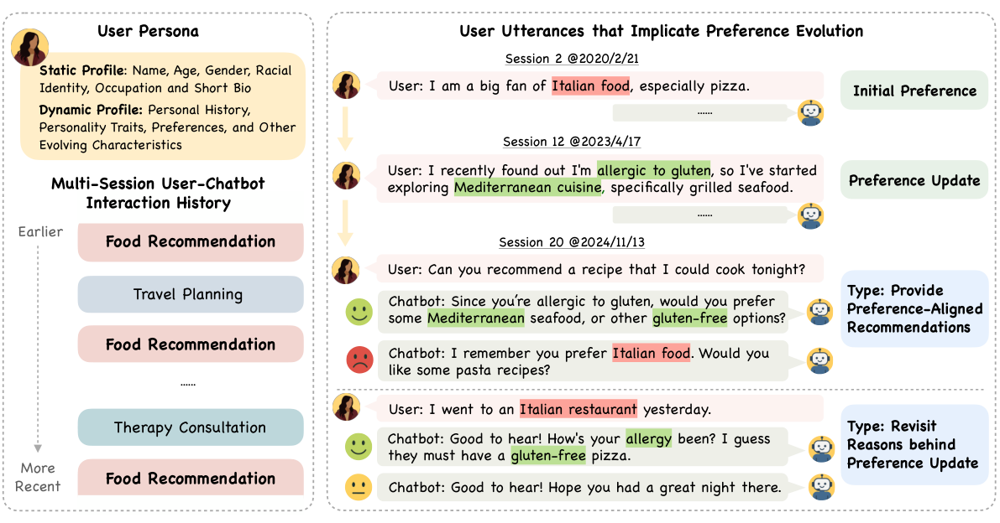
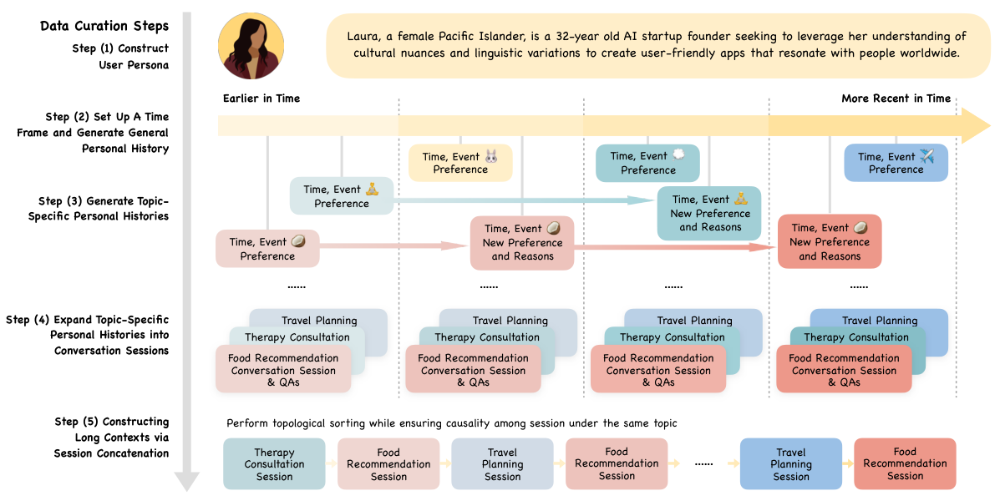
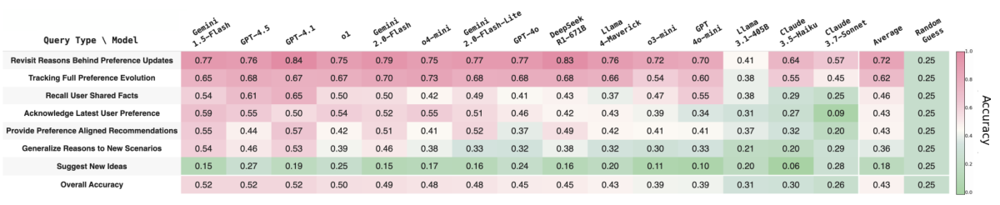
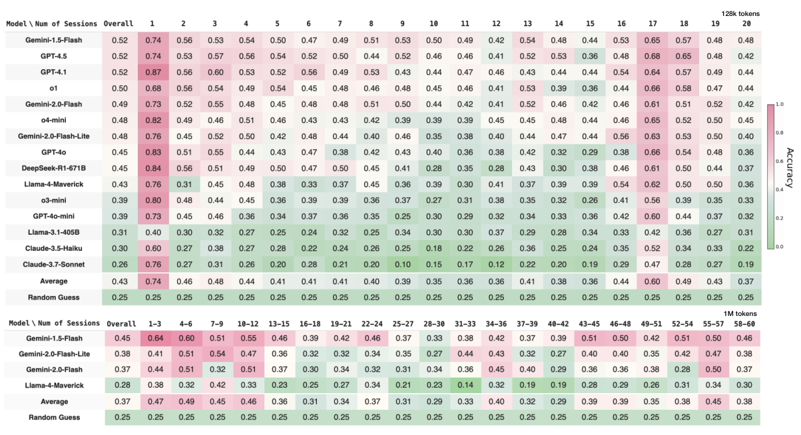
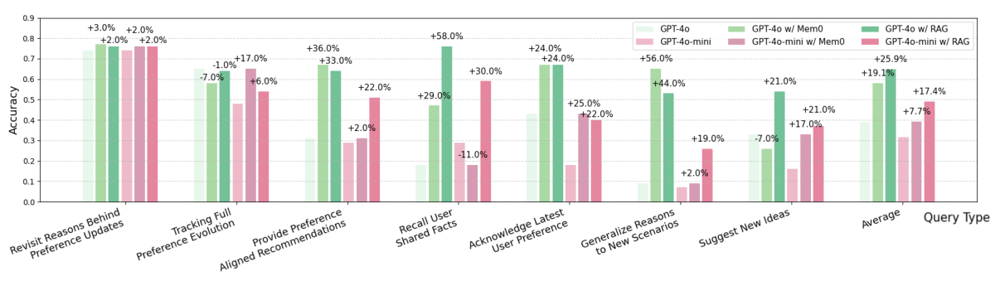

# PersonaMem｜从长期对话跟踪偏好变化，并把偏好用到新场景

> Bowen Jiang、Zhuoqun Hao、Young-Min Cho 等，*Know Me, Respond to Me: Benchmarking LLMs for Dynamic User Profiling and Personalized Responses at Scale*，COLM 2025，arXiv:2504.14225v2。页码按所附 28 页 PDF 计。

PersonaMem 把用户画像写成会随经历变化的时间线，再把这些经历分散到不同主题的多轮会话中。给定某时点以前的历史，模型要从四个候选回复中选出最适合用户当下处境的一个。128k 上下文条件下，表现最好的模型总体准确率约 52%。回忆事实通常更容易，把已经知道的偏好应用到一项新任务则更困难。

## 一、为什么要单独测动态画像

把用户表示成一条固定标签容易造成过时推荐。用户早期说喜欢意大利菜，后来提到对麸质过敏并开始探索其他菜系。若当前任务是推荐餐厅，模型需要知道哪些偏好仍有效。如果用户问的是「我为什么开始换着吃」，早期偏好和中途发生的事件都能成为证据。同一段历史的价值随当前任务变化。（§1–2）

*原文图 1，PDF 第 2 页。右侧让同一条饮食偏好演变同时服务于当下推荐和回溯变化原因。*

## 二、基准怎样构造

数据包含 20 个用户画像、180 多条模拟交互历史、15 个对话主题和约 6,000 道题。历史规模按 10、20、60 个会话组织，对应约 32k、128k、1M tokens。论文用 GPT-4o 生成数据，过程分四步。（§2–3）

1. **构建用户及其时间线。** 从 PersonaHub 抽取简短人物描述，补全人口统计信息、普通经历和带时间戳的生活事件。
2. **构建主题历史。** 给每个主题设置初始偏好，再写出导致偏好变化的事件、变化结果与原因。作者尽量避免不同主题的历史彼此重复。
3. **把经历改写成会话。** 按时段把历史扩写成多轮用户—助手互动。生成时先定位相关事件，再检查会话是否遗漏事件或更新。
4. **拼接多条主题会话。** 跨主题交错排列，同时保持各主题内部的因果顺序。部分会话间插入与用户偏好无关的短互动。

*原文图 2，PDF 第 5 页。先生成主题内的偏好变化，再交错拼接会话。不同长度可复用同一批会话片段。*

题目使用第一人称，标准回复依据提问时点的画像和历史判定。干扰项可用过时事实或不适用的偏好，作者还剔除了无需上下文即可答对的题目。三名标注者检查了随机抽取的 90 组问答，适切性、相关性、正确性和是否为最佳回复四项结果分别为 97.8%、95.6%、97.8% 和 90.0%。最后一项直接关系到四选一的区分度，说明即使基于同一份历史，部分题目的最佳选项仍有判断空间。（§3、附录 B）

## 三、七类问题分别在测什么

| 题型 | 模型要从历史里获取或推断什么 |
| --- | --- |
| 回忆用户分享过的事实 | 找回曾提到过的人、活动或行为 |
| 提出新点子 | 避免重复用户已经试过的方案 |
| 识别当前偏好 | 区分当前仍有效的偏好与已经更新的说法 |
| 追踪完整变化 | 按时间串起同一偏好的多个阶段 |
| 回溯变化原因 | 将偏好更新和触发事件联系起来 |
| 给出符合偏好的推荐 | 把已有偏好用于当前推荐任务 |
| 泛化到新场景 | 抽取偏好背后的倾向，判断它是否适用于另一类任务 |

最后两类容易混在一起。推荐可以直接复用用户明确说过的偏好，泛化则可能要求从「喜欢固定时间的瑜伽课」推到「或许也会喜欢固定周期的送餐」。后者多了一步对偏好背后原因的判断。（原文表 1，PDF 第 4 页）

## 四、模型怎么评，结果怎么看

### 1. 完整上下文也难以支撑偏好应用

主实验把历史、用户基本人口信息和随机排列的四个选项一起输入模型，让模型选择并简述理由，最终按选项是否正确计分。128k 条件测了 15 个模型，1M 条件测了其中 4 个。GPT-4.5、GPT-4.1、Gemini-1.5-Flash 等在 128k 条件下位居前列，最佳总体准确率约 52%，四选一的随机期望为 25%。（§4.1–4.2）

*原文图 3，PDF 第 7 页。先横看同一题型在不同模型上的表现，再看最后一行的总体准确率。*

回忆事实、说明已经发生的偏好变化通常较容易，提出新点子、给出符合偏好的建议、迁移到新场景通常较难。若干模型在追踪完整变化上高于识别最新偏好。两类题的提问和选项构造均有差异，这组比较适合描述题型难度，若要检验逐步推理是否有帮助，需对同一批题随机改变提示方式。

### 2. 模型表现随证据在历史中的位置变化

*原文图 4，PDF 第 7 页。上半是 128k 条件，下半是 1M 条件。横向比较的是距离，而非单独操纵的同一条记忆。*

作者观察到，相关信息出现在靠前或靠后的会话时，模型总体表现往往更好。原图也有波动。证据距离可能与题型、偏好更新次数和信息密度同时变化，若要测纯粹的位置效应，可以固定题目和相关证据，只移动它在历史中的位置。（§4.3）

### 3. 取历史原话和取抽取后的事实，效果不同

在 32k 条件下，作者针对 GPT-4o 和 GPT-4o-mini 比较完整历史、用 BGE-M3 检索前 5 条原始消息，以及用 Mem0 检索前 5 条抽取事实。外部记忆总体提高了准确率，尤其有助于回忆用户事实和向新场景迁移。直接取原消息的 RAG 在多数题型上优于 Mem0；两套流程同时改变了记忆表示、切分和检索方式，单凭这组数据难以把差异归因于某一步。（§4.4）

*原文图 5，PDF 第 8 页。比较同一模型、同一题型的三种设置，再对照右侧的总体结果。*

### 4. 逐个打分仍然使用预写候选

论文另设了所谓的「生成式」评测。三种开放权重模型在 32k 数据上，分别计算四个候选回复的按 token 长度归一化条件对数概率，再选分数最高的一项。这个设置衡量模型如何给已有回复排序。要检验模型能否自行提出合适建议，需要让模型自由回答，并独立评价其历史依据和建议质量。（§4.5）

## 五、哪些结论可用于后续研究

- **把回忆、更新和应用分开测。** 全部混成一个总分时，事实题可能掩盖推荐或迁移失败。做消融时可以固定候选答案，分别给原始对话、正确的最新事实、完整变化轨迹，观察收益来自证据定位还是解释和应用。
- **检查压缩是否保留更新所需的信息。** 抽取事实可能更节省上下文，但「什么时候变了」「为什么变」「适用到哪里」都可能影响答案。适合比较带时间和原因的结构化记忆、简短事实与原消息。
- **对照真实用户数据。** 合成时间线有可核验的状态和因果关系，便于规模化出题。仅 20 个基础画像、日常会话的反复拼接、预设的正确回复，都限制了对真实用户多样性和偏好含糊性的外推。

与 [PRAGMA](PRAGMA_论文精读.md) 配合阅读，可以比较四选一偏好应用与开放式建议的证据要求。与 [Memory Retrieval for Changing Preferences](../../01_筛选历史证据/02_证据准入与过滤/Memory_Retrieval_for_Changing_Preferences_论文精读.md) 配合阅读，可以进一步追问，在同一类偏好题中，哪些历史真正改变了回答器的选择。
