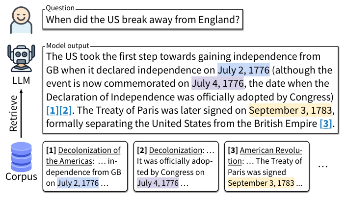
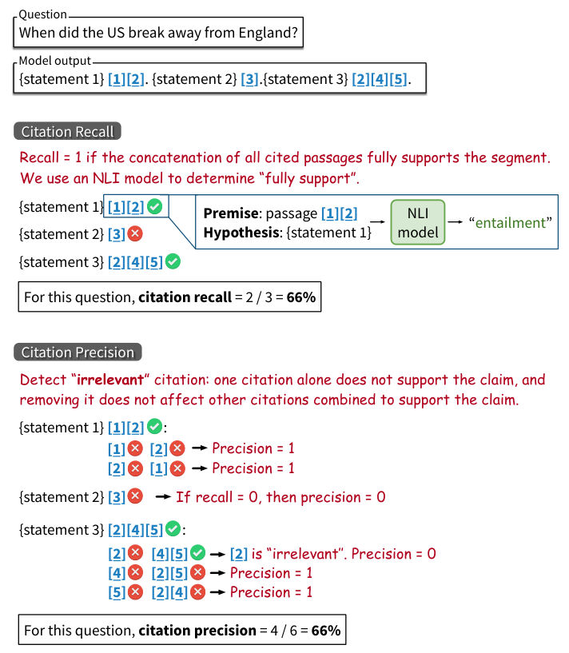
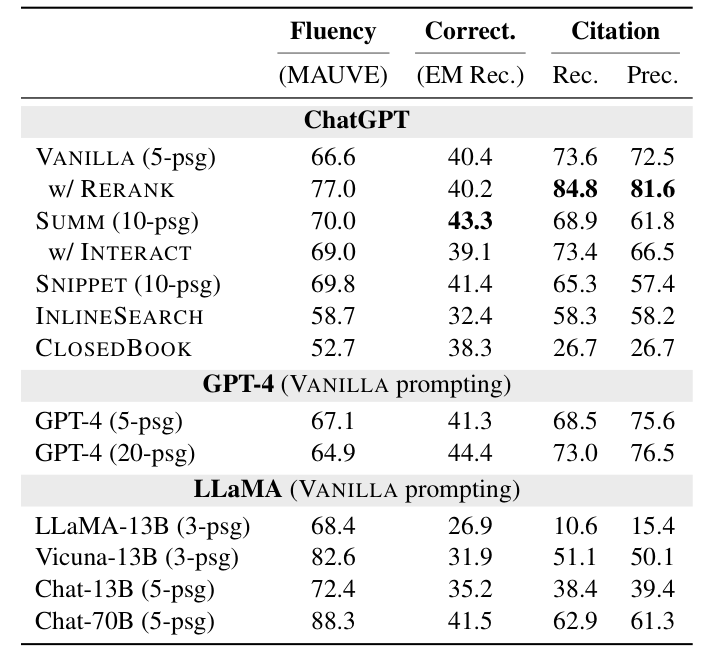
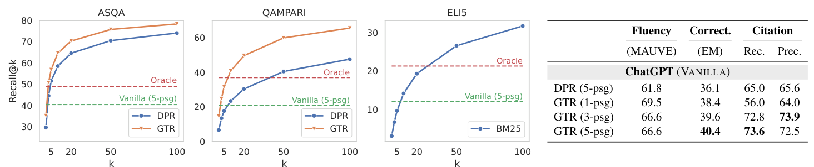

# ALCE｜长答案中的引用是否真的支持陈述

> Tianyu Gao、Howard Yen、Jiatong Yu、Danqi Chen，*Enabling Large Language Models to Generate Text with Citations*，EMNLP 2023，pp. 6465–6488。 [ACL Anthology](https://aclanthology.org/2023.emnlp-main.398/)

ALCE 要求系统从公开语料检索证据、写出回答，并把每条陈述连到支持它的具体段落。论文分别测答案覆盖了多少参考事实、引用能支持多少陈述、每条引用是否有用。在 ASQA 上，用引用分数重排四条候选回答能提高引用质量，答案正确性几乎持平。

## 一、为何要单独评估引用

事实正确的句子也可能挂错引用。引用充分的回答也可能只讲问题的一小部分。把几项性质分开测，才能知道系统缺的是答案、证据，还是两者间的对应。

*原文图 1，p. 6465。回答用编号引用语料中的短段落。*

以美国脱离英国的时间为例，「宣布独立」和「正式结束从属关系」对应不同日期与来源。系统需要覆盖多种解读，并让读者知道哪条来源支持哪一个日期。

## 二、基准中的数据和任务

三类数据各从原开发集抽 **1,000 道问题**。语料按约 100 词切成可引用段落，正文以句子为单位，QAMPARI 以每个列表实体为单位。每条陈述评估时最多使用 3 条引用。论文提供评测基准，原始数据没有逐句引用监督。（§2）

| 数据集 | 问题类型 | 检索语料 | 正确性指标 |
| --- | --- | --- | --- |
| ASQA | 有多种合理解读的事实题 | 维基百科，约 2,100 万段 | 标准短答案的精确匹配召回 |
| QAMPARI | 从不同来源列举满足条件的实体 | 同上 | 列表 Precision、Recall-5 |
| ELI5 | 开放式解释题 | Sphere，约 8.99 亿段 | 参考子主张的蕴含召回 |

Recall-5 将命中至少 5 个正确实体视为满召回，原答案少于 5 个时按可用答案数计。ELI5 的三个参考子主张由 text-davinci-003 从参考答案生成，再由 TRUE 自然语言推断模型判断生成文本是否蕴含这些子主张。两者对应的「覆盖」单位不同。

## 三、三类评分怎样读

| 评价维度 | 核心问题 | 方法 |
| --- | --- | --- |
| 流畅性 | 回复整体分布和风格是否接近参考 | ASQA、ELI5 用 MAUVE 作辅助检查 |
| 正确性 | 回答覆盖了多少参考内容 | 按上表使用短答案、实体或子主张 |
| 引用质量 | 现有陈述能否由所引段落验证 | 按句评引用召回，按引用评精确度 |

*原文图 3，p. 6468。示例中 3 条陈述有 2 条获得完整支持，6 处引用有 4 处计为有效。*

**引用召回。** 有引用且全部引用拼接后能蕴含该陈述时，这句记 1 分。无引用或证据不足记 0 分。对回答中所有陈述取平均。分母是模型生成的陈述，故高度可核验的短答也可能遗漏问题要点。

**引用精确度。** 先要求该陈述获得充分支持。单条来源自己可支持陈述，算有效。若单条来源不足以独立支持，但删掉后其余来源也无法充分支持，仍算作必要的联合证据。如果它单独不足、删去后其余引用仍能支持，则自动规则将它视为无关。多条来源各自都能完整支持同一句时，ALCE 允许这些来源并存。（§3.3）

这套方法核对引用是否能支持陈述。要检查模型是否实际依赖这些来源，需另做删除、替换或反事实测试，类似 ERASER 对输入证据的干预。

## 四、各组实验分别说明什么

### 1. 基线、答案重排与生成后补引

*原文表 4，p. 6470。CLOSEDBOOK 行的引用由 POSTCITE 补上。*

| ASQA，ChatGPT | 正确性 EM Recall | 引用 Recall | 引用 Precision |
| --- | ---: | ---: | ---: |
| VANILLA，直接给 5 段 | 40.4 | 73.6 | 72.5 |
| VANILLA 加 RERANK | 40.2 | 84.8 | 81.6 |
| SUMM，给 10 段摘要 | 43.3 | 68.9 | 61.8 |
| CLOSEDBOOK 加 POSTCITE | 38.3 | 26.7 | 26.7 |

RERANK 从每题随机生成的 4 条回答中，按自动引用召回挑一条。它提升引用召回 **11.2 个百分点**，EM Recall 下降 0.2 个百分点，多次生成也增加了推理成本。这里的重排对象是**已经生成的回答**，与 SETR 比较的候选段落重排处在不同阶段。

ASQA 上，多给若干摘要能覆盖更多参考答案，却让引用精确度降低。这个趋势不能推广到全部任务，QAMPARI 的摘要方案也提高了引用精确度（20.9→25.7）。闭卷后补引在 ELI5 的参考主张召回为 **18.6**，高于 5 段 VANILLA 的 **12.0**，引用召回却只有 **15.5**，后者为 **51.1**。（表 5–6）

### 2. 找到更多证据后，模型用了多少

*原文图 4，p. 6472。三图使用各自的正确性口径，右侧表格是 ASQA 的检索器和段落数对照。*

ASQA 中 GTR 的前 5 段覆盖 **56.8%** 的答案，实际 ChatGPT VANILLA 的正确性为 **40.4**。Oracle 从更大的候选池挑 5 个有答案信息的段落，结果仍落后于对应的检索证据覆盖。段落里有答案是生成器利用它的前提之一，实际成绩还取决于能否定位并综合证据。图中把检索召回当成有用的参照，闭卷也可能从模型参数中给出超出检索覆盖的答案。

在 ASQA 上，GPT-4 接收 5→20 段时 EM Recall 从 **41.3→44.4**，ChatGPT-16K 在同样段数变化下都是 **36.1**。模型版本和阅读能力都会影响长上下文收益。INLINESEARCH 在论文的实现里只重搜首轮前 100 段，不能由此判断所有迭代检索策略的效果。（表 7、§4.2）

### 3. 自动引用评分与人工判断是否一致

在抽样人工评测的 ASQA 与 ELI5 中，三个系统的相对排序一致。Cohen κ 在引用召回上为 **0.698**，在引用精确度上为 **0.525**。以 ELI5 的 RERANK 为例，引用召回人工给 **59.7**，自动给 **63.0**。使用同一个自动分数做候选选择和结果评估可能放大改进，人工对照能检验方向是否一致。（表 8–9、§6）

## 五、结论的适用边界

- **引用支持依赖 NLI 与来源质量。** 来源文本可以蕴含陈述，却仍可能过时或包含错误。二值蕴含规则也难分辨部分支持。
- **参考答案覆盖有限。** ELI5 的三个子主张来自参考回答，Recall 之外的额外说法仍需独立核验。ASQA 的字符串匹配也会漏掉一些等价表述。
- **生成方式和预算同时改变。** 摘要把更多候选放入上下文，重排生成了多份答案。比较部署方案时，最好固定检索和推理预算，再测正确性与引用指标。

## 六、R&Q

1. **能否在事实级标注部分支持？** 先把复合句拆成原子事实，再让每一处引用指向其支持的事实。
2. **能否用更少证据覆盖更多要点？** 固定生成器和 token 预算，对比 Top-k 段落与 SETR 式集合选择，再看答案覆盖与引用召回是否一起提高。
3. **能否验证模型真的使用了引用？** 分别删除、替换和交换声明对应的来源，比较生成内容与引用位置怎么变。
