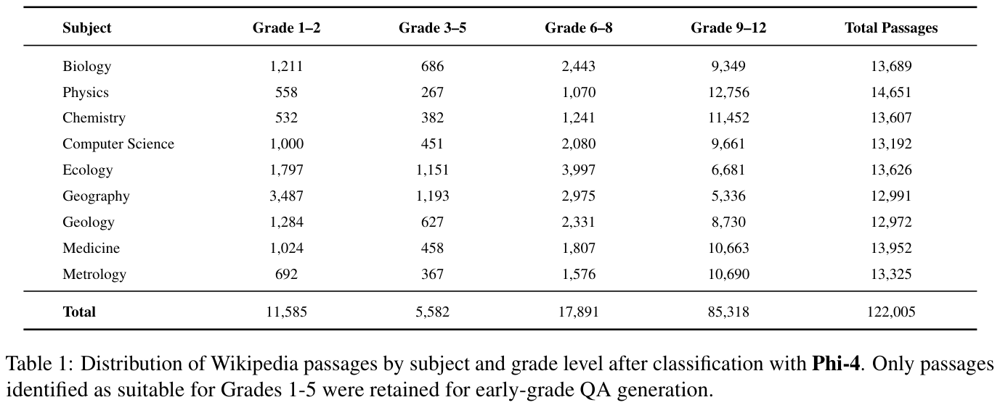
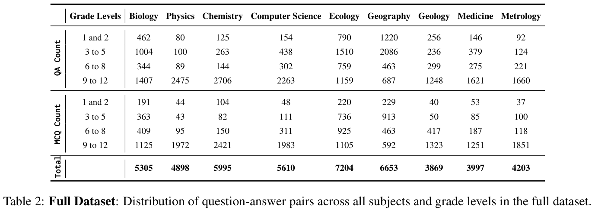
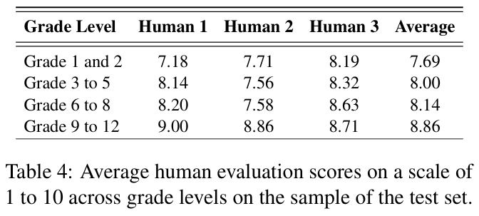
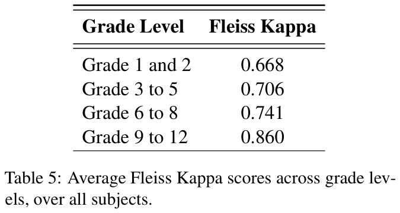
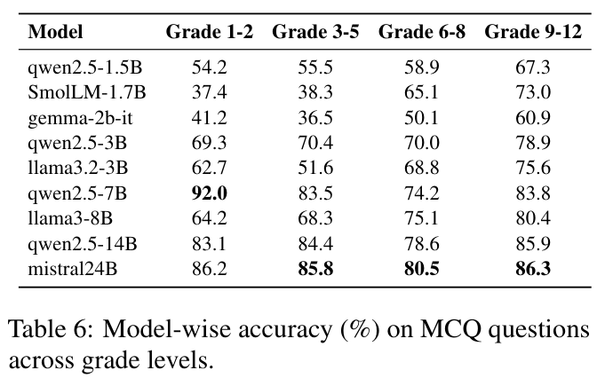
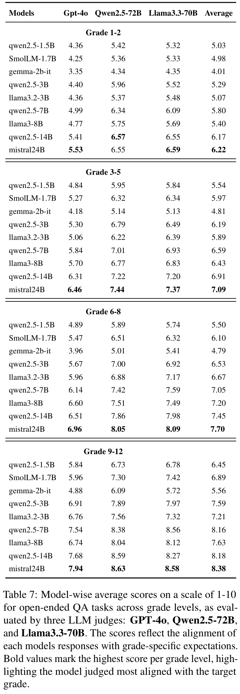
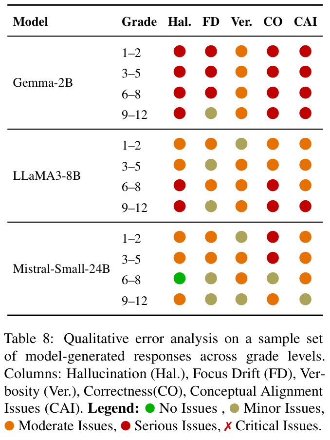
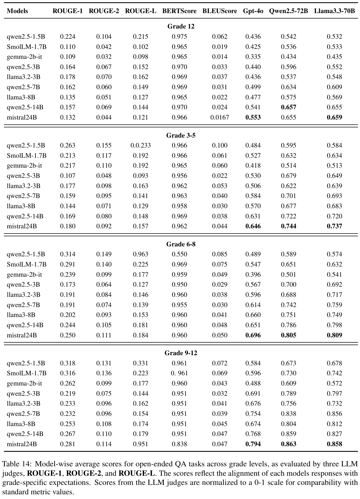

# EDUADAPT：评估大模型能否按年级回答问题

**论文**：Numaan Naeem, Abdellah El Mekki, Muhammad Abdul-Mageed. *EDUADAPT: A Question Answer Benchmark Dataset for Evaluating Grade-Level Adaptability in LLMs*. EMNLP 2025 Main, pp. 34236–34263。 
**原文**：[ACL Anthology](https://aclanthology.org/2025.emnlp-main.1736/) · [论文 PDF](https://aclanthology.org/2025.emnlp-main.1736.pdf) · [代码与数据](https://github.com/NaumanNaeem/EduAdapt) 

`# EMNLP 2025 Main`

> ​    EDUADAPT 贡献的是一个覆盖 K–12四个年级段（指从幼儿园到高中 12 年级的教育阶段）、九个学科的英语科学问答基准。它发现被测模型在低年级开放问答上得分较低；但“年级适配”与“知识正确”在现有评分里混在一起，跨年级成绩也受到题目与学科分布影响。

## 一、为什么需要这个基准

​        传统教育问答基准通常问模型**会不会做题**。这篇论文追问：同一个教育助手面对不同年龄的学生，能否用相应的词汇、概念深度和解释方式回答？例如，给一年级学生解释现象，不能只保证科学上正确，也要让孩子能理解；给高中生回答则不能停留在过于笼统的口号。

​        作者认为既有基准缺乏覆盖完整 K–12、明确标注目标年级的科学问答，因此提出 EDUADAPT。它提供训练、开发、测试划分，并比较多种开放权重指令模型。这里的“适配”是根据题目指定的年级生成回答；实验没有让同一个问题在多个年级分别作答，因此并未直接测量同一知识点的跨年级改写能力。

原论文 Figure 1：Phase I 是数据生成及人工核验；Phase II 才是模型评测

* 第一阶段（PHASE-1） ：

  ​    **(a)  自动生成**：从维基百科文章提取内容，由 QA Generator 生成问题和参考答案，筛选后分成训练集（Train）、开发集（Dev）和测试集（Test）。

  ​    **(b)  人工核验**：从测试集抽取一部分“问题＋参考答案”，交给人工评审检查质量。图中的 *Gold Answers* 是题库提供的**参考答案**；“Human Verification”不表示整个测试集都经过逐题人工检查。

* 第二阶段（PHASE-2）：用测试集评测大模型。把测试题交给被测模型作答，再按题型分别计分：

  * **开放问答（Open-Ended QA）**：由其他大模型担任评审（LLM as a Judge），比较模型回答与参考答案。
  * **选择题（MCQ）**：直接计算选对的比例，即准确率（Accuracy）。

## 二、基准数据是如何构造的

​        流程可以概括为：**维基百科文章清洗 → Phi-4 判断文本适用年级 → 按 NGSS 设计提示词生成选择题和开放问答 → 同一模型自评过滤 → 抽样人工复核**。九个领域涵盖生物、物理、化学、计算机科学、生态、地理、地质、医学及表中==写作 Metrology==的领域。正文 §2.1.1 却写 *Meteorology*（气象学），名称并不一致，使用数据时应核对实际学科标签。

​        *原论文 Table 1，PDF 第 4 页。低年级来源文本少，是后续样本不均衡的一个起点。表中汇总值另有算术问题，见第六节。*

​        作者用按年级定制的提示词，从文本中生成约 **16.6 万**道问答；Phi-4 再从语言适宜性、年级匹配、相关性、清晰度、学科适配五方面各给 1–10 分。每项至少 8 分才保留，最终得到 **47,734** 条，约为初始生成量的 **28.8%**。这种过滤能筛除明显差的题，但生成和首轮审查依赖同一模型，不等于独立人工逐条认证。

原论文 Table 2，PDF 第 5 页。QA Count 指开放问答，MCQ Count 指选择题。按表内数字重算，四个年级段分别为 4,291、8,623、5,971、28,849 条；9–12 年级占约 60.4%。

​        正文报告的划分是训练 **28,640**、开发 **9,547**、测试 **9,547**。人工质量核验只抽取约 **1,000** 条测试题，由三名教育内容背景的评审打分。人工平均分从 1–2 年级的 **7.69/10** 增至 9–12 年级的 **8.86/10**；年级段上的 Fleiss κ 分别为 **0.668、0.706、0.741、0.860**。这支持“抽样中较高年级题目质量更稳定”的判断，也提示低年级数据在模型测试前就更难通过人工审视。

原论文 Table 4、Table 5，分别在 PDF 第 5、6 页。κ 衡量评审一致程度，不衡量题目本身的科学正确率。

## 三、任务到底要求模型做什么

测试时，模型收到问题和目标年级；附录 Listing 11 的指令要求它以该年级的教师口吻给出清楚、发展阶段合适的回答。论文比较两种题型：

| 题型 | 输入与模型输出 | 论文指标 | 能说明什么 |
| --- | --- | --- | --- |
| MCQ 选择题 | 题干和选项；选正确项 | Accuracy，百分比 | 在既定选项中答对多少题；几乎不能直接说明解释语言是否适龄。 |
| 开放问答 | 问题；自由生成回答 | 三个 LLM 评审的 1–10 分，再取平均 | 同时涉及词汇、概念深度、术语、正确性、清晰度、完整性；更贴近“怎样回答”，但依赖参考答案和评审模型。 |

三个评审模型是 GPT-4o、Qwen2.5-72B、LLaMA3.3-70B。**Table 7 的 6.22 是十分制评分，不是 62.2% 的答对率。**此外，正文 §3 写开放回答按“五项”评价，实际附录 Listing 10 列出**六项**：Vocabulary Alignment、Conceptual Alignment、Scientific Language Alignment、Correctness、Clarity、Completeness。这里应以附录列出的具体评审提示为准，并在复现时确认代码如何求平均。

> **关键区分**：有了年级标签，并不意味着分数只测“语言随年龄变化”。一道题若事实答错，会拉低 Correctness；若参考答案本身不适龄，也会影响其他维度。要单独归因年级适配，需要把知识正确与表达适龄分开报告。

## 四、各组实验分别证明什么

### 1. 选择题：模型能不能选对

原论文 Table 6，PDF 第 6 页；单位为百分比。

总体上，较大的模型在多数年级段表现较好：Mistral-Small-24B 在 3–5、6–8、9–12 年级分别为 **85.8%、80.5%、86.3%**。但“越大越好”并不处处成立：**Qwen2.5-7B 在 1–2 年级为 92.0%**，高于 Qwen2.5-14B 的 **83.1%** 和 Mistral-24B 的 **86.2%**。这张表说明模型能力有差别，不能单凭它断定模型会或不会用适龄语言解释。

### 2. 开放问答：生成回答是否符合目标年级

*原论文 Table 7，PDF 第 7 页；每项为 1–10 分，Average 是三个评审的平均。*

这组结果显示明显的低年级落差。以 Mistral-Small-24B 为例，四档 Average 依次为 **6.22、7.09、7.70、8.38**；Qwen2.5-14B 为 **6.17、6.91、7.45、8.18**。因此在这套题、参考答案和评审规则下，模型的低年级回答更容易失分。三个评审的绝对分数并不相同，例如 Mistral 在 1–2 年级获 GPT-4o **5.53**、Qwen2.5-72B **6.55**、LLaMA3.3-70B **6.59**；比较模型时应同时看评审之间的差异。

🌟 **结论**：开放问答比选择题更接近作者要测的“回答方式”，但跨年级分数上升不能全部解释为“高年级更容易适配”。不同年级段的题目与学科构成也变了；论文没有对同一道题做控制实验。

### 3. 错误分析：模型错在什么地方

作者对 Gemma-2B、LLaMA3-8B、Mistral-Small-24B 各抽 **20** 条回答，总共 **60** 条，检查幻觉、偏题、冗长、正确性和概念对齐。表中颜色是各类错误的严重程度，不是准确率或出现频率。

*原论文 Table 8，PDF 第 8 页。Hal. = 幻觉，FD = 偏题，Ver. = 冗长，CO = 正确性问题，CAI = 概念对齐问题；绿色到红色代表问题逐渐加重。*

表 8 与附录案例提示一个常见失败模式：回答可以流畅、像是在给儿童说话，却补入无根据的细节或漏掉关键事实。例如低年级答案的可读性和事实可靠性不能互相替代。由于仅分析 60 条，不能把颜色直接推广为所有测试题的错误比例。

### 4. 传统文本相似度指标是否足够

附录 Table 14 把 BLEU、ROUGE、BERTScore 与三名 LLM 评审并列。BERTScore 常在 **0.95–0.97** 左右，但评审分数差异仍很大，作者认为词面或嵌入相似度难以反映事实正确和年级适配。此处的证据主要是表格对照，论文没有给出与人工年级适配评分的相关系数或置信区间，因而“哪种自动指标最好”仍需要更严格验证。

*原论文 Table 14，PDF 第 18 页。该表个别单元格可见排版/录入异常，复现时不宜直接机器抄录。*

## 五、这篇论文的价值与适用边界

**价值**：它把教育问答的“目标年级”明确放进数据和评测，提供了大规模的训练与测试划分；同时把选择题答对和开放回答质量分开，让研究者看到知识选择与回答表达不完全是一回事。

**边界一：年级、难度、学科构成相互纠缠。** Table 2 显示 9–12 年级占约六成，低年级主要来自生态、地理等领域，高年级在物理、化学、计算机科学等领域更多。跨年级分数不能直接当成只改变“目标年级”的因果实验。

**边界二：数据质量与评测质量互相影响。** 低年级的人工数据质量评分本身较低；开放问答又把模型回答与一条参考答案对照。参考答案不完整、过窄或不够适龄，都会影响模型分数。三名评审虽减少单一评审的偶然性，但论文没有报告这些自动评审与真人教师对**模型回答**评分的一致性。

**边界三：样本覆盖与普适性有限。** 数据来自英语维基百科，按 K–12/NGSS 设计，且以纯文本科学问答为主；不能直接外推到中文课堂、其他课程体系、多模态教学或真实儿童长期学习效果。

## 六、R&Q：把论文结论串起来

*以下是阅读时归纳的问题；论文没有像示例文章那样正式列出 RQ1–RQ4。*

| 阅读问题 | 这篇论文给出的证据 | 仍未解决的事 |
| --- | --- | --- |
| RQ1：能否构造覆盖多个年级的科学问答？ | 47,734 条、四个年级段、九个学科；人工抽样 1,000 条。 | 低年级题目与年级/学科分布不均；人工并未逐条核验。 |
| RQ2：模型能否答对这些题？ | Table 6：选择题准确率差异较大，Qwen2.5-7B 的 1–2 年级达 92.0%。 | 答对选项不代表解释适龄。 |
| RQ3：模型能否按年级生成好答案？ | Table 7：开放问答低年级普遍低分；Mistral-24B 从 6.22 升到 8.38。 | 评分混合了适龄表达、事实正确和与参考答案的一致性。 |
| RQ4：主要失败模式是什么？ | Table 8：抽样回答出现幻觉、偏题和概念不匹配。 | 60 条定性样本不足以估计全体错误率。 |

### 复核记录：读论文时要留意的原文不一致

1. **Table 1 的年级列合计有误。** “Grade 6–8”一列九个学科相加为 **19,520**，表底却印作 **17,891**；用 19,520 加其余三个年级的列合计，才得到右下角的 **122,005**。不要用印刷的 17,891 计算占比。
2. **正文与附录的评审标准数量不一致。** §3 称开放回答有五个定性标准，附录 Listing 10 实际列出六个。上述分析按六项理解，并提醒复现者检查实现。
3. **正文数据划分与附录明细表不一致。** 正文给出的训练/开发/测试数为 **28,640/9,547/9,547**；逐项加总附录 Tables 9–11 的各学科 Total 行得到 **28,996/9,664/9,686**。因此这里保留论文正文数，同时不把附录汇总用于进一步比例计算。
4. **学科英文名不一致。** 正文写 *Meteorology*，Tables 1–2 及附录表写 *Metrology*；两者不是同一学科。

**最终判断**：EDUADAPT 适合作为“英语科学问答随目标年级变化”的研究起点。它最有说服力的发现是：模型在这套开放问答上，低年级得分显著较低。若要证明模型真正缺少“同一内容的年级迁移能力”，下一步需要同题多年龄版本、人工验证的参考答案，以及把事实正确性和表达适龄性分开评分的实验。
