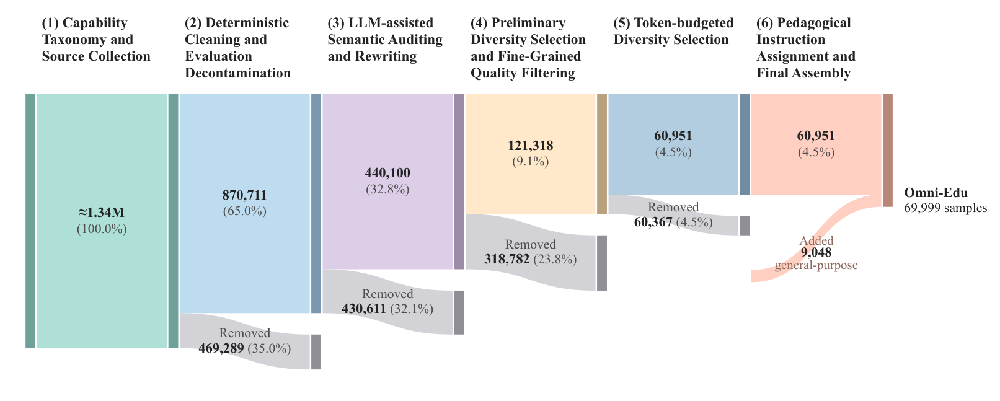
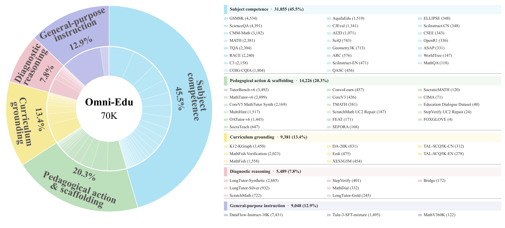
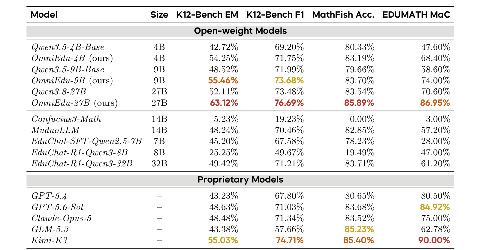
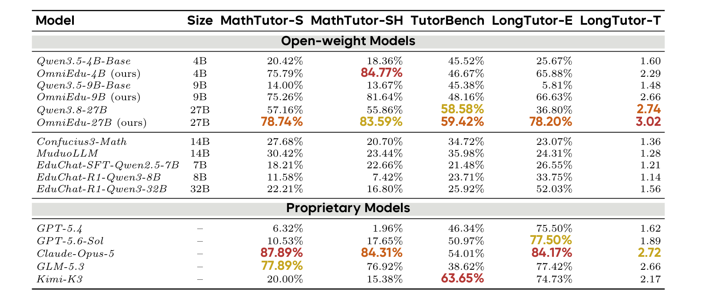

# OmniEdu：用能力导向的数据配比训练开放式教育基础模型

> 论文：Hao Liang 等，*OmniEdu: Open Foundation Models for Learning and Teaching*，OpenDCAI Technical Report，2026-09-22，arXiv:2609.23088v1；

**一句话概括。** OmniEdu 将教育数据按「解题、课程定位、错误诊断、教学行动」四类能力组织，用多阶段清洗、质量审核、按 token 预算选样和任务专用系统指令，微调出 4B、9B、27B 三个开放模型。

**先给判断。** 论文最强的证据是同一底座模型在训练前后的配对比较：多个教育基准明显提升，尤其课程定位、脚手架式辅导和长期学习证据利用。但实验主要评估**整套训练配方**，没有逐个剥离数据配比、审核、去重、多样性选样或 20 种系统指令；不能把增益单独归因于其中某一步。细分指标也并非全面提高。

## 一、作者认为教育模型缺什么

一个合格的教学助手不应只给正确答案，还需知道题目位于课程的哪个知识点、学生为什么答错，以及下一步该用提示、追问、复习先修知识还是直接讲解。现有教育模型可能擅长考试题，却不擅长诊断与引导；有的会进行苏格拉底式对话，却未必理解课程结构。

作者的假设是：这不仅是模型规模问题，也与训练数据如何混合有关。短答案、先修关系、错误诊断和教学对话要求模型学到**不同甚至相反的回复行为**：某题应给出答案，某教学场景反而应暂时保留答案。按数据来源或学科粗略混合，可能掩盖这种差别。

论文提出四类能力目标：（第 3、6 页）

| 能力 | 学什么 | 典型回复行为 |
| --- | --- | --- |
| Subject competence：学科能力 | 解 K–12 数学、科学、阅读、写作问题 | 给出正确答案与说明 |
| Curriculum grounding：课程定位 | 年级、知识点、难度、先修关系 | 定位题目在知识结构中的位置 |
| Diagnostic reasoning：诊断推理 | 从学生作答识别错误和误解 | 判断缺的是概念、步骤还是先修知识 |
| Pedagogical action & scaffolding：教学行动与支架 | 选择并执行下一步教学动作 | 提示、追问、回顾、分步引导或解释 |

每个样本只指定一个**主要**能力标签，其他性质保留为次要元数据。所谓「能力平衡」是按能力与细任务桶设计数据预算，**不是四类样本等量**。

## 二、训练数据到底怎么做出来

作者收集超过 100 个数据集和教育资源，教育候选池约 **134 万条**。流程并非直接全量训练，而是连续六步压缩与整理。（图 1，第 5–8 页）

*图 1｜OmniEdu 训练数据的六步筛选。原文 PDF 第 5 页。灰色分支是各阶段移除的样本，通用指令数据在最后加入。*

| 阶段 | 处理 | 留下的教育专用样本 |
| --- | --- | ---: |
| 1. 来源与能力分类 | 赋予主要能力和细任务桶 | 约 1.34M |
| 2. 确定性清洗与评测去污 | 去精确重复、坏字段、可验证的错误答案、无关内容、失效图片；移除与评测集重叠样本 | 870,711 |
| 3. LLM 语义审核与改写 | Qwen3.5-122B-A10B-FP8 给 0–100 分；高分保留，中分只修复输出后复审，低分剔除 | 440,100 |
| 4. 初步多样性与细质量过滤 | 对过量来源做 BGE-M3 + k-center 抽样；GPT-5.6-Terra 按任务细项打分、设置关键项门槛 | 121,318 |
| 5. 按 token 预算的多样性选样 | 每个任务桶独立进行 k-center greedy；以监督回复 token 而非样本数控配额 | **60,951** |
| 6. 指令分配与最终装配 | 为每条样本分配一个任务专用系统指令，加上通用指令数据 | **69,999** 总样本 |

第 3 步的阈值为 **85–100 保留、50–84 改写复审、低于 50 删除**；第 4 步要求适用维度均至少 3/5，正确性、有效性和证据充分性等关键维度至少 4/5。改写时固定原始输入，只修复监督输出。（第 6–7 页）

最终 60,951 条教育数据约 **12.0M 监督回复 token**，另加 9,048 条通用数据，合计 **69,999 条、15.96M 监督回复 token**。教育数据内部为学科能力 31,855、课程定位 9,381、诊断推理 5,489、教学行动 14,226。论文另外为每条样本分配 20 种系统指令模板之一，明确它该直接解答、诊断还是引导。（图 2，第 7–8 页）

*图 2｜69,999 条训练样本的能力类别和来源。原文 PDF 第 7 页。外圈按能力类别汇总，内圈和右侧列表对应数据来源。扇区反映条目占比。*

**这个设计的关键点：** 按回复 token 控预算有理由，因为一条长教学对话的训练信号量远多于一个短答案；按任务桶做多样性选样可以避免大来源淹没稀有任务。但论文没有给出「随机选样 vs. k-center」「按样本数 vs. 按 token」「有无任务指令」的独立消融，所以这些具体机制的增量收益仍未单独验证。

## 三、模型和评测怎么设置

作者对 Qwen3.5-4B-Base、Qwen3.5-9B-Base、Qwen3.8-27B 做**全参数监督微调**，训练 3 个 epoch，学习率 $5\times10^{-6}$，最长序列 32,768；训练配置见附录表 16（第 21 页）。与对应底座直接比较，是检验「整套 OmniEdu 训练」效果的核心对照。

评测分三组，再加一般能力检查：（第 8–9 页）

| 能力组 | 基准 | 主要测什么 |
| --- | --- | --- |
| 课程定位 | K12-Bench、MathFish、EDUMATH | 知识点与先修关系、题目对课程标准的匹配、按标准生成题目 |
| K–12 解题 | GAOKAO-Bench、EXAMS-V、MDK12-Bench | 学校考试题、图文题、开放／客观题 |
| 教学能力 | MathTutorBench、TutorBench、LongTutor | 提示与教学策略、反馈、长期学生历史的证据使用 |
| 一般能力 | IFEval、GPQA、MMMU-Pro | 指令遵循、科学推理、多模态理解 |

跨其他教育模型和闭源模型的比较可帮助定位成绩，但训练来源、提示习惯、模型规模和模态支持不同。论文明确说，部分开放教育模型和 GLM-5.3 不支持图片输入，因此图文题只拿到文字；这会影响多模态排行榜的可比性。（第 8 页）

## 四、实验分别说明了什么

### 1. 课程定位：同底座提升明显

*表 1｜课程定位主实验。原文 PDF 第 9 页。从同一尺度的底座与 OmniEdu 成对读取，分别比较 K12-Bench、MathFish 和 EDUMATH。*

| 27B 指标 | 底座 | OmniEdu-27B | 变化 |
| --- | ---: | ---: | ---: |
| K12-Bench EM | 52.11% | **63.12%** | +11.01 个百分点 |
| K12-Bench F1 | 73.48% | **76.69%** | +3.21 个百分点 |
| MathFish 准确率 | 83.54% | **85.89%** | +2.35 个百分点 |
| EDUMATH MaC | 70.60% | **86.95%** | +16.35 个百分点 |

4B、9B 也都在三个基准的总体指标上高于各自底座。（表 1，第 9 页）K12-Bench 的大增益说明训练让模型更会处理课程知识结构，而不只是答题；EDUMATH 则是按课程标准生成题目的评测。

**细分结果要补充看：** MathFish 的 27B 正向「应该匹配」样本从 45.95% 提升到 67.60%，但若干负向类别下降，例如同领域同年级负例从 88.31% 降至 79.07%。总体准确率上升，仍可能伴随「更愿意判匹配」的阈值或类别偏向。（附录表 5，第 16 页）EDUMATH 的格式通过率从 100% 降到 98.80%，尽管 MaC 大幅提升。（附录表 6，第 17 页）

### 2. 解题：所有尺度总体上升，增幅不均

27B 在 GAOKAO-Bench 的 Full Rate 为 **91.55%→94.87%**，EXAMS-V 总准确率为 **68.65%→69.52%**，MDK12-Bench 的 Full Overall 为 **46.04%→57.76%**。4B 在 EXAMS-V 的进步更大，为 **44.69%→57.62%**。（表 2，第 10 页）

这说明同一训练配方没有只训练「会教」，也提高了多种题目的解决能力。不过，27B 在 EXAMS-V 的增益只有 **0.87 个百分点**；某些细分类还会退步，如 MDK12 单选从 56.34% 降到 53.97%。因此「整体提高」不等于每个学科、题型都提高。（附录表 8–9，第 18 页）

### 3. 教学：支架式引导最显著，诊断仍是短板

*表 3｜教学支架、反馈与长期学习证据。原文 PDF 第 11 页。LongTutor 的证据分用百分比报告，Teaching 保留原基准评分量尺。*

| 27B 指标 | 底座 | OmniEdu-27B | 变化 |
| --- | ---: | ---: | ---: |
| MathTutorBench Scaffold 胜率 | 57.16% | **78.74%** | +21.58 个百分点 |
| Scaffold-hard 胜率 | 55.86% | **83.59%** | +27.73 个百分点 |
| TutorBench 总分 | 58.58% | **59.42%** | +0.84 个百分点 |
| LongTutor Evidence 平均 | 36.80% | **78.20%** | +41.40 个百分点 |
| LongTutor Teaching 平均 | 2.74 | **3.02** | +0.28 |

4B、9B 的 Scaffold 胜率也分别提高约 **55.37** 和 **61.26** 个百分点；这与作者强调的「通过明确系统指令学会何时不要直接给答案」相符，但没有单独的指令消融证明它就是主要原因。（表 3，第 11 页）

LongTutor 的长期证据使用改善值得关注，但**诊断标签的 Macro-F1 并未同步改善**：27B 从 **38.41% 降到 30.58%**，尽管诊断 Accuracy 从 51.78% 小幅升到 54.04%；LongTutor Evidence 子项中的 HC 也从 72.17% 降到 68.24%。所以这组结果更准确的读法是：更会引用历史、教学回复得分更高，**不代表更会区分每一种学生认知错误**。（附录表 12，第 20 页）

### 4. 一般能力是否保持

作者用 IFEval、GPQA、MMMU-Pro 检查教育专门化是否损害通用能力。27B 的 GPQA Main 为 **70.76%→72.32%**，MMMU-Pro 总体为 **64.97%→67.98%**；IFEval Prompt Strict 为 **80.59%→82.07%**。（附录表 13–15，第 20 页）这些结果支持「没有明显的总体遗忘」。但 4B 的 IFEval Inst. Loose 从 76.50% 微降到 76.38%，MMMU-Pro 的一些学科细分也下降，因此不能说所有一般能力指标均提高。

## 五、结论应保留的边界

1. **没有拆解训练配方的因果贡献。** 同时更换了样本集合、质量门槛、多样性选择、能力配比、系统指令；主实验只比较全套 SFT 与底座。要证明「能力导向配比」比同量普通 SFT 更好，需要匹配数据量与 token 的对照实验。
2. **评测数据去污的可核验度有限。** 论文称移除与最终评测集重叠的样本，但训练来源中包含与评测同名或近邻的资源，如 MathFish、TutorBench-v6、LongTutor 系列和 K12-KGraph。仅凭论文不能确认语义近重复、任务模板重用和元数据泄漏是否已完全排除；高分应结合公开数据与去污脚本复核。（第 6–7 页）
3. **教学指标不是现实学习增益。** MathTutorBench 胜率、LongTutor 教学分和 TutorBench 分数描述的是基准协议下的回复质量；论文未在真实学生身上测知识保持、迁移或长期进步。
4. **跨模型横排有模态和协议差异。** 不支持图片的基线在图文题只看文字；不同模型也可能受输出格式、采样与考试评分协议影响。EXAMS-V 附录中几个不同开放教育模型出现完全相同的 21.95% 总分，提示应检查适配或默认输出行为后再解释名次。（第 8 页；附录表 8）
5. **总体均值会掩盖能力冲突。** MathFish 的正例进步伴随部分负例退步；LongTutor 的 Evidence 和 Teaching 上升伴随诊断 Macro-F1 下降。部署时应按任务优先级选择模型，不宜只看平均排名。

## 六、R&Q：可以如何继续验证

**RQ1｜配方里哪一步最值？** 固定底座、总样本数和监督 token，逐项消融质量审核、k-center、能力配比、20 种指令，并报告成本与收益。

**RQ2｜教育模型是否真的理解学生错误？** 单独评估四类认知错误的 Macro-F1、混淆矩阵与诊断依据，避免把「更会写教学回复」误当成「更会诊断」。

**RQ3｜课程定位是否有正例偏向？** 在 MathFish 上画出正负例的精确率、召回率、校准曲线，检查总准确率提高是否以更多误判匹配为代价。

**RQ4｜怎样测真实教学效果？** 在有教师监督的纵向实验里记录学生后测、延迟测、迁移题表现与学习负担；同时测试模型何时给答案、何时只给提示。

**最终收获。** OmniEdu 展示了一个清晰的工程路线：**先定义教育能力，再让数据筛选、token 预算和回复指令围绕能力目标组织。** 它证明整套训练能带来广泛的基准增益；下一步最重要的是拆清每个设计的贡献、严格验证去污，并把「回复得分」与真实学习成效连接起来。
