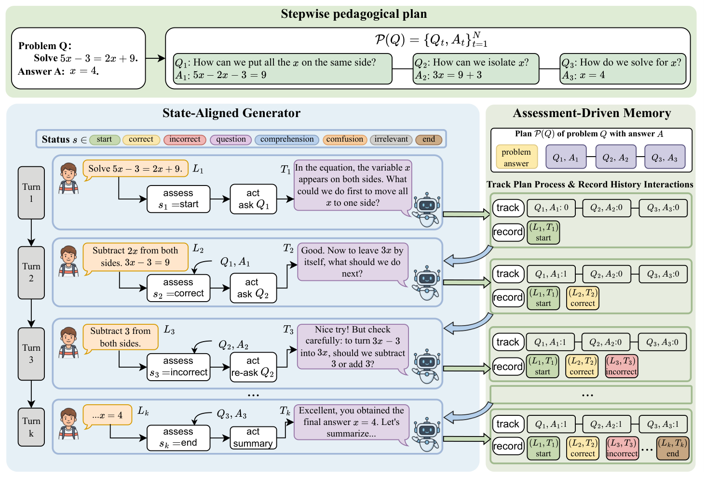
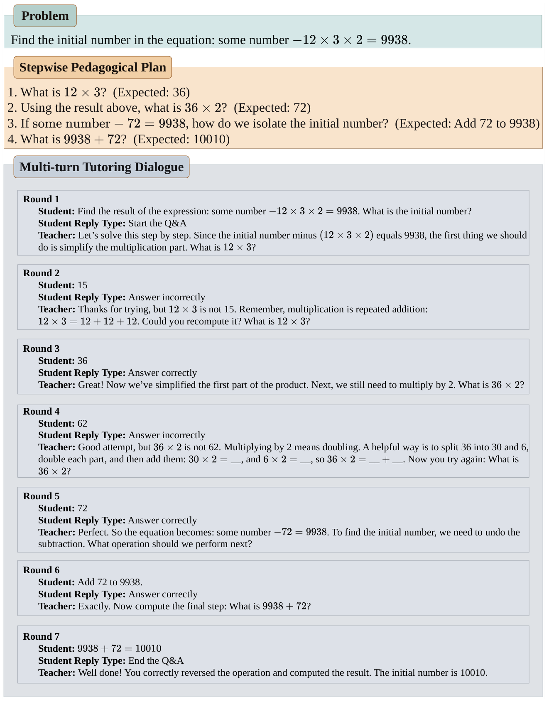
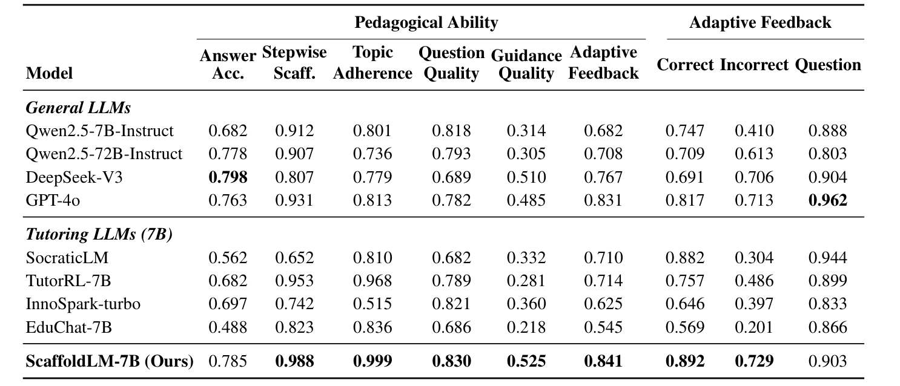
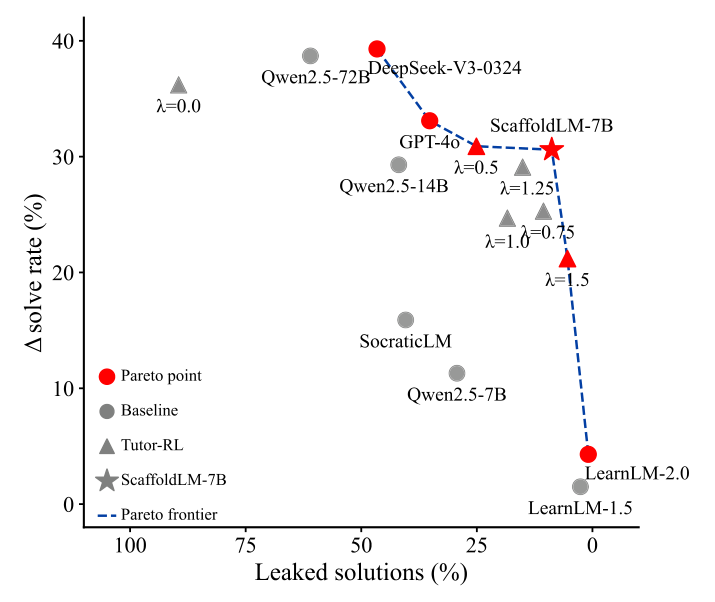

# ScaffoldLM｜用教学计划和逐轮评估决定下一步怎么教

> Zechen Li、Qiannan Zhu、Mei Wang、Jia Li、Hua Huang，*Planning-Guided Tutoring with Assessment-Driven Memory for Pedagogical LLM Tutors*，ACL 2026，pp. 7165–7188。 [ACL Anthology](https://aclanthology.org/2026.acl-long.325/)

ScaffoldLM 先把数学题拆成可检查的子目标，再根据学习者每一轮的回复决定继续当前步骤还是推进。论文展示了在模拟辅导中提高解出题目的比例，同时控制直接泄露解答的比例。教学记忆保存的是**当前一道题的计划、进度和对话状态**。

## 一、为什么需要显式教学计划

会解题的模型很容易在学生答错时直接展示余下步骤。纯对话策略也可能在连续几次答错后失去目标，重复提醒却没有实质进展。作者将形成性评价落实为两个问题。当前要学生独立完成哪一步？这一步完成了吗，下一句该给多大帮助？

*原文图 1，p. 7167。上半部分是一道方程题的三个子目标，下半部分画出对话如何更新记忆。*

图中的学生正确移项以后，模型才推进到下一个问题。学生在下一步把加法说成减法，模型继续围绕该步给提示。右侧的进度记录让下一轮能接着这里教。

## 二、训练数据如何构造

作者从 BigMath 筛选有唯一数值答案的问题，按解题难度抽 **10,000 道训练题、300 道留出题**。DeepSeek-V3 给出解法及其 2–7 个子问题与子答案。先验证步数、格式及最终答案，得到 **7,353** 份可用计划。Doubao 再检查子问题与解题路径的一致性，保留 **5,635** 份用于计划训练。辅导模拟从较大的 7,353 份计划池起步，因此最终有 **5,844** 段辅导会话，数量可多于高质量计划样本数。（§5–6、附录 C）

模拟时先抽学习者状态，再由学习者模型生成相应发言，教师模型核对发言和状态是否一致。不一致就重写，避免把实际答错的文本配上“答对”标签。之后筛掉提前泄露最终答案或对话异常的样本。保留下来的会话拆成 **49,815 条单轮监督**，平均每段 **8.5 轮**。计划任务和辅导任务共享一个 Qwen2.5-7B-Instruct 底座，用不同指令做联合全参数 SFT。（附录 B–C）

## 三、模型怎样评估、回应和推进

计划由顺序排列的子问题与预期答案 $(q_t,a_t)$ 组成。记忆保存计划 $P$、逐步完成向量 $p$，以及带学习者状态的对话历史 $H$。学生每次发言后，模型执行 Assess（判断状态）、Act（选择教学动作）、Track（更新步进度）和 Record（记录对话）。训练时子答案是判断依据，给学生的反馈应遵守披露时机。

| 评估到的状态 | 当前轮动作 | 进度 |
| --- | --- | --- |
| 答对或表达理解 | 肯定并过渡到下一个子问题 | 当前步完成 |
| 答错或困惑 | 给定向提示、简化问题或引导自纠 | 留在当前步 |
| 追问或离题 | 澄清疑问或拉回主题 | 留在当前步 |
| 到达最后一步 | 核验最终解并总结 | 结束 |

*原文附录图 5，p. 7181。先计算乘积，再撤销减法，最后让学生完成计算。*

这段对话中，学生两次算错乘积，教师分别提示用重复加法和拆成十位与个位来计算。等学生自己得到 72，才问逆运算。这个案例也说明，允许透露多少**中间步骤**与是否提前说出**最终解答**，是两项不同的教学要求。

## 四、实验分别说明什么

### 1. 主表的教学质量

*原文表 2，p. 7171。各项是 0–1 分，越高越好。*

ScaffoldLM-7B 在六项主指标中五项最高。相对 Qwen2.5-7B，分步支架 **0.912→0.988**，指导质量 **0.314→0.525**，适应性反馈 **0.682→0.841**。最终答案准确率 **0.785**，仍低于 DeepSeek-V3 的 **0.798**。答错情形下的反馈为 **0.729**、高于 GPT-4o 的 **0.713**，但回应追问的得分 **0.903** 低于后者的 **0.962**。

前五项来自 300 道留出题上的合作和混合两轮评测，每轮 300 段模拟对话。学习者按规则从固定模板回应，单段最多 20 轮。适应性反馈是另一个静态集，由标注员扮演学生收集并人工核验 210 段，每类 70 个。附录 D.1 写明静态评测输入带类别标签，因此这一分数主要说明**给定学习者类别时的反馈质量**。GPT-4o-mini 对教师共识标签的平均完全一致率为 **79.6%**。（附录 D）

### 2. 计划和评估循环各提供了什么

完整模型的指导质量 **0.525**，移除计划后 **0.468**，移除评估后 **0.425**，两者都去掉后 **0.392**。移除评估同时取消状态监督和动态记忆更新，差异不能细分到单独一个步骤。附录表 6 里，计划末答案不符的组最终准确率只有 **0.351**，经过验证的计划组是 **0.960**，但两组分步支架分数仍为 **0.981** 和 **0.991**。流程走得平稳时也应检查计划数学上是否正确。（表 3、附录表 6）

### 3. 解题帮助与答案泄露的权衡

*原文图 2，p. 7172。横轴是泄露率且方向反转，越往右越低，纵轴是辅导后解题率增量。*

用 TutorRL 的测试协议，ScaffoldLM 的解题率增量是 **30.6 个百分点**，泄露率为 **8.8%**。TutorRL 的一个相近增量配置为 **30.9 个百分点 / 25.1%**。两者解题增量相近，泄露率差 **16.3 个百分点**。也有泄露率更低、但解题增量较小的点。独立数学测试中，MATH500、OlympiadBench 和 TheoremQA 相对底座分别变动 **−1.2、+0.5、−0.3** 个百分点。（表 4、附录表 7）

## 五、结论的适用边界

- **学习者被压缩成离散状态。** 真实学生可能给部分正确答案、换一种解法，或说理解却没有掌握。系统会把表达理解视为一种可推进信号。
- **预先计划会约束路径。** 计划自身出错时，逐轮检查可能沿错误路径稳定推进。论文的验证主要针对合成计划与所测数学题。
- **结果覆盖当前题的辅助解题。** 模拟解题增量和教师评分分别反映即时表现与反馈质量。延迟记忆、知识迁移和真实课堂效果仍待验证。

## 六、R&Q

1. **学生用另一种正确解法时怎么办？** 对比固定计划与允许从当前进度重规划的策略。
2. **如何测自主理解？** 将“表达理解”、独立完成当前子问题和迁移到新题分开测量。
3. **如何和 LongTutor 衔接？** 在开题前用长期练习记录诊断先修知识，再用本题内的逐步记忆更新教学动作。
